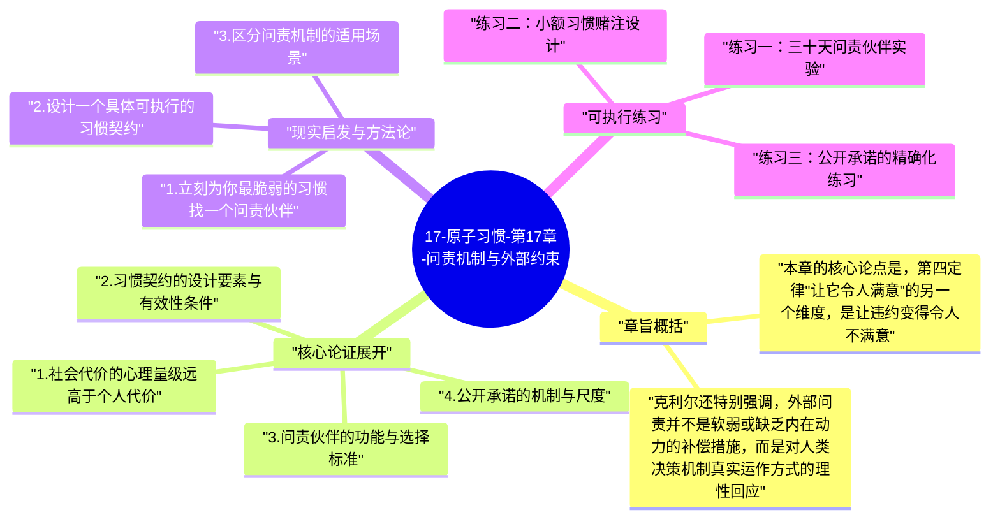

# 17-原子习惯-第17章-问责机制与外部约束

人是社会动物，社会认可与社会排斥的力量在进化上根深蒂固。在整个人类进化史中，被群体接纳意味着生存，被群体排斥意味着危险，因此大脑对社会评价有着极度的敏感性——比对个人私下行为后果的敏感性高出许多倍。詹姆斯·克利尔在第十七章把这个社会心理学现实转化为一种实用的习惯建立工具：通过创造外部问责机制，让习惯的执行或放弃产生社会后果，从而利用大脑对社会压力的高度敏感性来强化行为的一致性。这不是玩弄人性的操控技巧，而是对人类真实决策机制的清醒认识和有效应用。

习惯契约（habit contract）是本章提出的核心工具，也是问责机制最正式的表现形式。习惯契约是一份书面文件，明确规定你承诺执行的具体习惯（什么时候、什么地点、做什么）、如果违约的具体后果（可以是金钱惩罚、公开的社会尴尬，或者其他有真实成本的后果），以及这份契约的见证人（问责伙伴）。克利尔提出，习惯契约的力量不主要来自惩罚本身（惩罚的数额往往不大），而来自于社会见证所产生的心理压力——当有人知道你的承诺，当违约会被别人看见，违约的心理成本就从"只让自己失望"提升到了"在他人面前失信"，而后者的心理成本对大多数人来说要高出一个数量级。

外部问责机制的另一个核心工具是问责伙伴（accountability partner）。问责伙伴与习惯契约的见证人有所不同——见证人主要是知道你的承诺并在违约时施加社会压力；而问责伙伴是主动参与你习惯执行过程的人，他们定期询问你的进展，在你状态低落时提供鼓励，在你偏离轨道时给出提醒和反馈。好的问责伙伴不是在执行一段时间后就自然消失的，而是与你建立持续的沟通关系，把你的习惯执行状态纳入他们的关注范围，从而让你的习惯执行不再只是一件私人的、随时可以悄悄放弃的事情，而是一件有人在关注、有人会问起的社会事务。

## 章旨概括

本章的核心论点是，第四定律"让它令人满意"的另一个维度，是让违约变得令人不满意。让好习惯令人满意，是通过即时奖励和追踪连续性实现的；让违约令人不满意，则是通过问责机制和社会成本实现的。这两个方向共同构成了习惯激励系统的完整设计：一方面让执行有奖励，另一方面让放弃有代价。在没有任何设计的默认情况下，执行好习惯往往没有即时奖励，放弃也没有即时代价——这是大多数习惯无法持久的结构性原因。外部问责机制通过给违约增加即时的社会成本，平衡了这种不对称性。

克利尔还特别强调，外部问责并不是软弱或缺乏内在动力的补偿措施，而是对人类决策机制真实运作方式的理性回应。最高度自律的人也会使用外部问责——奥运级别的运动员有教练、有公开的竞赛成绩、有训练伙伴；最成功的企业家有董事会、有公开承诺的季度目标、有问责他们的合伙人。外部问责不是替代内在动力，而是在内在动力波动时提供结构性保障，确保行为的一致性不会因为一个动机低落的下午而崩溃。理解这一点，能帮助人们消除对寻求外部帮助的心理障碍，主动把问责机制纳入习惯系统的设计中。

## 核心论证展开

### 1. 社会代价的心理量级远高于个人代价

行为科学研究反复证实，同样量级的奖惩，社会性的比个人性的有更强的行为影响力。输掉一场公开竞赛的羞耻感，比私下对自己承认失败的挫败感强烈得多；在朋友面前违背承诺的愧疚感，比单独一人放弃计划的失望感大得多。这种量级差异有进化根源：在原始社会，社会评价与群体地位直接相关，而群体地位影响资源获取和生存概率，因此大脑对社会性后果进化出了比对个人后果更高的敏感阈值。现代社会虽然不再有群体放逐的生死威胁，但这个神经机制依然完整保留。

这个量级差异有直接的习惯设计含义：把习惯违约的代价从私人领域转移到社会领域，能以相对小的设计成本产生大幅提升的行为约束力。一个人私下对自己承诺"今天必须锻炼"，和公开对五个朋友承诺"今天我会锻炼，谁跟我一起"，这两种承诺在形式上只有少许差异，但在心理约束力上有显著不同。前者的违约成本只是"今天感觉不好"；后者的违约成本还包括"要解释为什么没去"和"在意这件事的朋友对我的看法可能改变"。后者的综合成本足以让大多数人在疲惫的下午重新找回动力。

### 2. 习惯契约的设计要素与有效性条件

一份有效的习惯契约需要满足几个关键设计要素：具体性（承诺的行为必须可量化、可验证，不能是模糊的"我要更健康"）、可执行性（惩罚条款必须是见证人真正会执行的，不能是双方都知道不会兑现的空话）、对称性（奖励和惩罚都应该事先明确，不只是惩罚）、以及社会见证（必须有至少一个真实的人在场或知情，而不是只写在自己的日记里）。这四个要素缺一不可：没有具体性，行为是否符合承诺就会陷入争议；没有可执行性，契约就失去约束力；没有对称性，习惯执行缺乏积极的正向激励；没有社会见证，就退化为私人承诺，失去了社会成本的放大效应。

克利尔举了一个真实案例：一位叫Brian的人和他的营养师、妻子签了一份正式的习惯契约，规定他每天的饮食和运动计划，如果未达到则需要向特定账户转入一笔钱，由营养师核查执行。这份契约的有效性来自于它满足了所有四个要素——行为高度具体（每天的饮食和运动清单）、惩罚可执行（第三方核查的金钱转账）、有见证人（妻子和营养师都签署了契约）。Brian后来描述，当他在某个下午想放弃执行计划时，脑子里浮现的第一件事就是妻子会怎么看他，这个社会代价的预期有效地让他重新找回了执行的动力。

### 3. 问责伙伴的功能与选择标准

问责伙伴的价值不只在于对违约施加压力，更在于它们把习惯的执行从一个人的孤独挣扎变成了一种共同活动。人在共同活动中比独处时更容易维持高水平表现，这是一个被广泛记录的社会心理学效应，研究者称之为"共同行动效应"（co-action effect）。当你知道另一个人也在同时执行同样的习惯（哪怕在不同的地方），或者当你知道另一个人将会询问你的执行结果，你的大脑会以一种更高的警觉度和投入度对待这个习惯。这种提升不需要对方在物理上陪伴你，只需要知道连接存在就足够了。

选择问责伙伴有几个重要标准。首先，对方应该是真正关心你成功的人，而不只是随便找一个愿意配合的人——如果伙伴对你的进展漠不关心，你很快就会意识到他们的询问只是形式，社会压力就会消失。其次，对方应该有能力在你给出借口时提供有效的挑战，而不是总是轻易接受你的合理化解释——好的问责伙伴有时候需要说一些"这听起来不像是合理的理由"这样的话。最后，理想的问责伙伴是正在建立类似习惯或有过类似经历的人，因为他们更能理解你面对的具体挑战，提供的反馈也更有针对性。

### 4. 公开承诺的机制与尺度

克利尔讨论了公开承诺（public commitment）作为问责机制的一种形式，并同时指出了它的适用边界。公开承诺的力量来自于同样的社会成本机制：在更多人面前做出承诺，违约的社会代价就越高，因而承诺本身的约束力也越强。这解释了为什么人们在告诉越来越多人自己的目标后，执行率通常会提高——每多一个知情者，就多了一个潜在的问责点。研究表明，公开承诺对于短期内可验证的行为目标特别有效，因为在短期内，承诺的执行状态能够相对容易地被见证人观察或询问。

但克利尔也提出了一个反直觉的警告：过于宏大的公开承诺，在某些情况下会产生反效果。当你对所有人宣布"我今年要减掉二十公斤"，这个宏大承诺产生的即时社会认可感（"哇，好有志气！"），有时候会在心理上替代实际执行所带来的满足感，使得大脑在拿到了"宣布目标"的社会奖励之后，对"实际执行目标"的动机反而下降。因此，克利尔建议：公开承诺应该聚焦于具体行为（"我今天要锻炼三十分钟，谁和我一起"），而不是结果（"我今年要达到XXX"）；聚焦于短期内可验证的行为，而不是遥远的愿景。

### 5. 外部约束与内在动力的协同而非替代

一个常见的担忧是：依赖外部问责会削弱内在动力——如果我总是因为怕被人看见放弃才去执行习惯，那么当没有外部监督时，我还会继续吗？克利尔对这个担忧的回答是：外部问责和内在动力不是互斥的，而是协同发展的。外部问责的主要价值在习惯建立的早期阶段，在那个阶段内在动力还没有充分发展——习惯还不够自动，执行的内在满足感还没有充分建立，身份认同还没有足够稳固。在这个脆弱阶段，外部问责提供了一个结构性支撑，保证习惯不因为某个低迷日子的冲动放弃而夭折。

随着习惯建立进程的推进，内在动力会逐渐增强——执行变得更自动，内在满足感开始涌现，身份认同越来越稳固。在这个时候，外部问责的作用会自然减弱，而不是因为你主动撤除它，而是因为内在驱动力已经足以维持执行，外部压力只是一个额外的保障而非主要驱动。那些在习惯完全成熟后仍然保留外部问责的人，则是把它当作一种持续优化和高标准维持的工具，而不是基础执行的必要条件——这两者之间的角色差异，正是习惯建立进程不同阶段的反映。

## 现实启发与方法论

### 1. 立刻为你最脆弱的习惯找一个问责伙伴

对你最难坚持的那个习惯，本周内找到并接洽一个问责伙伴。不需要等到找到"完美"的伙伴——一个愿意定期询问你进展的朋友，比完全没有问责要有效得多。明确你们的问责方式：是每周一次短信汇报，是每月一次面谈，还是共用同一个追踪工具的实时可见？确定好频率和形式，然后立刻开始执行，不要把"找问责伙伴"本身变成另一件拖延的事情。问责伙伴的存在，会在你习惯执行最脆弱的时刻提供额外的一层保护，它的价值恰恰体现在你最不想执行的那些日子里。

### 2. 设计一个具体可执行的习惯契约

为你最重要的一个习惯，草拟一份真实的习惯契约。契约内容包括：习惯的具体执行标准（什么时候、做什么、多少量）、连续失误两次的具体后果（金额明确的捐款、公开宣布的尴尬行为，或其他你真正在意的代价）、以及一个你信任且会执行的见证人签名。把契约打印出来，和见证人当面签署并各留一份。这个仪式感非常重要——它把一个内心的承诺转化为了一个社会事实，而这个转化正是习惯契约约束力的来源。不要把契约藏起来，把它贴在每天能看见的地方，让它持续发挥视觉提醒的作用。

### 3. 区分问责机制的适用场景

并不是所有习惯都需要同等程度的外部问责。对习惯按照当前稳定性分类：已经非常稳定的习惯不需要外部问责，只需要维持追踪；中等稳定的习惯需要轻量级问责（问责伙伴定期询问即可）；非常不稳定或刚开始建立的习惯则值得投入正式的问责机制（习惯契约或公开承诺）。把有限的问责资源集中在最脆弱的习惯上，而不是平均分配，能产生最高的整体效益。定期（每季度）重新评估各个习惯的稳定性，调整问责机制的强度，让它随着习惯的成熟度而演进。

## 可执行练习

### 练习一：三十天问责伙伴实验

选出一个困难习惯，找一个问责伙伴，建立一个为期三十天的每周汇报机制（每周日晚上互发一条消息，报告当周的执行情况和下周的计划）。三十天结束后，比较这个月与之前同等时长内的习惯执行率，评估问责机制的实际效果。同时记录在这三十天内，有多少次在"本来可能会放弃"的时刻，因为想到要汇报给伙伴而选择了继续执行。那些时刻的数量，正是问责机制为这个习惯所创造的真实价值。

### 练习二：小额习惯赌注设计

和一个朋友设置一个小额习惯赌注：如果你在接下来二十一天内，某个特定习惯有超过三天没有执行，你就向对方支付一定金额（建议选择一个对你来说有一定分量但不会造成实质经济压力的数额）。反之，如果你成功完成，对方请你喝一杯咖啡。这个赌注的设计要点是，对方必须是你真的愿意见到他们时不想提起"你输了"这件事的人——社会尴尬感的来源不是金钱本身，而是在那个具体的人面前的面子。二十一天结束后，记录在这段时间内你的执行频率变化，以及赌注的存在对你执行决策的实际影响次数。

### 练习三：公开承诺的精确化练习

在你的社交圈（可以是朋友群组、社交媒体，或者只是几个特定的朋友）做一次公开承诺，但这次承诺必须是行为性的而不是结果性的——不是"我要在三个月内达到某个目标"，而是"接下来两周内，我每天早上七点会做二十分钟的某项习惯，我会每天在群里发一条完成确认"。这种行为性公开承诺的效果，来自于它每天都有可验证的完成信号，使问责成为日常而非遥远，同时避免了宣告宏大目标所产生的过早满足感。记录这两周内的执行率，与之前同等时长的执行率比较，感受行为承诺与结果承诺在问责效果上的差异。

---

## Mermaid 思维导图

### 图1

