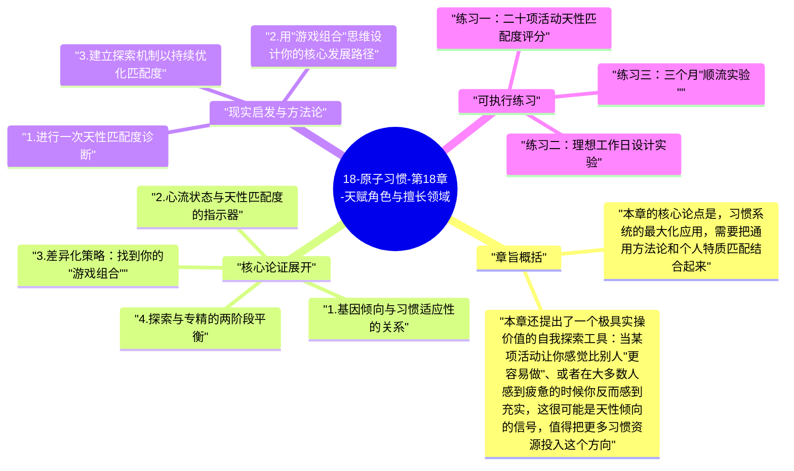

# 18-原子习惯-第18章-天赋角色与擅长领域

习惯系统是普遍的，但习惯的内容不应该是普遍的。这是詹姆斯·克利尔在第十八章提出的一个重要但容易被忽视的区分。四条习惯定律提供的是一套可以应用于任何行为的通用框架，但这套框架的使用者是有差异的——不同的人有不同的基因倾向、不同的自然优势、不同的心理特质，这些差异深刻影响着什么类型的习惯在什么人身上更容易建立、更容易维持、以及更容易转化为卓越成就。克利尔在这一章试图回答的问题是：在习惯建立的通用方法论之外，如何找到最适合自己的那条特定路径？

基因的影响是本章的起点。克利尔引用了行为遗传学的研究，指出人格特质（如开放性、尽责性、外向性、随和性和神经质）有约40%到60%的遗传性，这意味着人们在天性上对不同类型的活动有不同的适应倾向。外向的人在需要大量社交互动的环境中更容易保持高动力；高开放性的人在需要持续学习和尝试新事物的领域更容易保持好奇心；高尽责性的人在需要长期系统性执行的任务上有天然优势。这些特质不决定命运，但它们确实会影响在哪些领域"做了就会感觉好"，而"做了感觉好"正是习惯能够持久的核心条件之一。

这个分析引出了本章最重要的实践建议：选择适合自己天性的游戏，而不是总在对自己最不擅长的领域强迫自己表现。克利尔用一个简单而有力的比喻说明这一点：迈克尔·菲尔普斯和海尔·格布鲁赛拉西耶都是世界级的运动员，但如果他们互换运动项目，就都会变得平庸——菲尔普斯拥有为游泳量身定做的身体比例，格布鲁赛拉西耶拥有为长跑设计的生理结构。基因并没有决定他们能不能成为运动员，而是影响了他们在哪个运动项目上能发挥最大潜力。理解并利用这种对应关系，不是在逃避挑战，而是在战略性地选择战场。

## 章旨概括

本章的核心论点是，习惯系统的最大化应用，需要把通用方法论和个人特质匹配结合起来。在选择培养哪些习惯时，应该优先选择那些与自己的天性倾向相契合的领域——在那些领域里，好习惯建立会更容易（因为执行本身更容易产生内在满足感），维持会更稳定（因为每次执行都更容易进入心流状态），转化为成就也会更显著（因为在优势领域的边际努力回报更高）。这并不意味着人只能做自己天生擅长的事，而是意味着在设计习惯系统时，应该尽量让努力与天性倾向对齐，而不是让它们对抗。

本章还提出了一个极具实操价值的自我探索工具：当某项活动让你感觉比别人"更容易做"、或者在大多数人感到疲惫的时候你反而感到充实，这很可能是天性倾向的信号，值得把更多习惯资源投入这个方向。克利尔用几个诊断性问题帮助读者识别自己的天性优势领域：什么事情对我来说感觉容易，而对其他人来说显然很难？我在什么类型的任务中感觉时间过得最快？我最自然地进入心流状态是在做什么的时候？这些问题的答案，指向的正是那些与个人基因倾向最为契合的活动类型。

## 核心论证展开

### 1. 基因倾向与习惯适应性的关系

基因影响行为的方式不是直接的（"这个基因让你成为运动员"），而是间接的（"这组基因让你在有氧运动中比其他人更容易感受到愉悦，从而更容易坚持运动习惯"）。克利尔把基因的影响描述为对特定行为的"适应性"（affinity）——某些人天生对某些活动有更高的适应性，意味着他们在执行这些活动时消耗的心理能量更少，获得的内在满足感更多，进入心流状态的门槛更低。这些差异在外表上呈现为"天赋"，但其深层机制是基因塑造的心理和生理结构与特定活动的要求之间的高匹配度。

这个框架有一个重要的解放性含义：当你在某个领域比普通人付出了更多努力却仍然难以取得同等进展时，这不一定意味着你需要更加努力，也可能意味着你的努力方向与天性不匹配。在匹配度低的领域，习惯建立需要消耗更多意志力，执行中更难获得内在满足，进入心流的频率更低——这些都会系统性地降低习惯的稳定性，即便你有足够的决心。克利尔的建议不是放弃挑战自我，而是有策略地分配努力：在与天性匹配的领域把习惯建立到高水平，再在需要的地方用这个强大基础支撑对不那么匹配的领域的补足。

### 2. 心流状态与天性匹配度的指示器

匈牙利心理学家米哈里·契克森米哈依（Mihaly Csikszentmihalyi）的心流研究提供了一个实用的天性匹配度指示器：心流状态（完全沉浸、时间感消失、高度专注的内在体验）在任务难度与能力水平处于最佳平衡时最容易出现，但这个最佳平衡因人因活动而异。对于与自己天性高度匹配的活动，进入心流所需的挑战难度阈值更低——也就是说，在这些活动的初级阶段，你就比其他人更容易体验到心流；而在与天性不匹配的活动中，即便经过大量练习，进入心流的频率仍然远低于天性匹配的人在类似阶段的体验。

这个差异为习惯选择提供了一个直观的启发法：在什么类型的任务中，你即便在初学者阶段就会偶尔进入心流状态？那些活动很可能与你的天性有较高的匹配度。对于建立长期习惯来说，匹配度高的活动有一个天然优势：心流状态本身是一种强大的内在奖励，而在匹配度高的领域，这种奖励的触发频率更高，使习惯的内在动力供给更为充足。克利尔把这总结为：选择让你比一般人更快感受到"做这件事有意义"的游戏。

### 3. 差异化策略：找到你的"游戏组合"

克利尔提出了一个精妙的策略思想：即便在某个单一维度上你不是最优秀的，但如果你能找到一种独特的组合，让你的不同优势叠加在同一个领域，你就能创造出一个几乎无法被直接复制的比较优势。他用自己的例子说明这一点：他既不是最顶级的习惯研究者，也不是最顶级的写作者，但他在习惯研究和清晰写作表达的组合上处于很高的位置，而这个组合的稀缺性比任何单一维度的顶级都更有价值。这个策略的精华在于：不是在别人已经确立的游戏中努力变得最好，而是找到一个自己独特优势组合所指向的新游戏。

这个策略对习惯建立有直接的指导意义：在选择发展哪些习惯时，不只是问"这个习惯是否对我有益"，还要问"这个习惯与我已有的优势如何组合？它能创造什么独特的叠加效果？"例如，一个既有分析思维倾向又有表达能力的人，如果在编程领域深入发展习惯，可能不只是成为一个好的程序员，而是成为那种能把复杂技术概念讲清楚的稀缺型人才。习惯的组合策略，是在天性倾向基础上进行战略性设计，而不是随机拼凑。

### 4. 探索与专精的两阶段平衡

克利尔区分了习惯建立的两个阶段：探索阶段（尝试不同类型的活动，找到与天性最匹配的领域）和专精阶段（在匹配度高的领域深入建立习惯并追求卓越）。很多人要么永远停留在探索阶段（永远在尝试新事物但从不深入），要么在没有充分探索的情况下就强迫自己在某个领域专精（可能恰好是与天性不匹配的）。这两种极端都会系统性地降低长期成就的潜力：前者缺乏积累，后者缺乏对天性优势的利用。

正确的策略是在生命的不同阶段有意识地在探索和专精之间切换。在资源允许的情况下（尤其是人生早期），广泛尝试不同类型的活动，用"感觉如何、心流多频繁、进展是否比同等投入的人更明显"作为指标，识别出与天性匹配度最高的几个领域。一旦找到这些领域，就集中习惯资源深入发展，进入专精阶段。专精阶段不意味着永远关闭探索，而是把探索的重心转移到如何在主要领域上持续创新，避免陷入机械重复而停止成长。

### 5. 天性不是借口，而是指南

克利尔在本章最后特别强调了一个容易被误解的边界：承认天性倾向的存在，不是在为逃避努力提供借口，而是在为战略性地分配努力提供依据。基因影响的是概率和倾向，而不是绝对的命运——没有基因能保证不经努力就取得成就，也没有基因能让所有努力都变得徒劳。天性告诉你的，是在哪些方向上，同等努力能产生更高回报；在哪些方向上，你需要比别人投入更多才能达到同等水平。理解这个差异，不是为了放弃后者，而是为了在资源有限时做出更明智的分配。

完全忽视天性倾向的习惯系统，会浪费大量的时间和意志力在低匹配度的领域强行积累，而那些精力本可以在高匹配度的领域产生更大的复利效应。反之，完全只在天性匹配的领域舒适地成长，则会错失很多必要的挑战性经历，而这些经历的跨越才能真正扩展能力边界。克利尔的平衡是：主轴在天性匹配的领域发展核心习惯，辅轴在必要的补足领域培养支撑习惯，前者贡献长期成就的高峰，后者保证能力结构的完整性。

## 现实启发与方法论

### 1. 进行一次天性匹配度诊断

花一个小时，用以下几个问题对你当前所有的主要活动进行天性匹配度评估：做这件事时，你是否比同等经验水平的人更快进入专注状态？在做这件事时，时间感是否会消失或明显减慢？做完这件事后，你是感觉充实还是感觉更疲惫？如果别人做这件事感觉很难，但你感觉相对容易，那很可能是高匹配度的信号。根据评估结果，把你当前的主要活动按照天性匹配度高低排序，然后反思：你的习惯投入分布是否与这个排序一致？如果不一致，意味着你可能正在把大量习惯资源投入在相对低回报的方向上。

### 2. 用"游戏组合"思维设计你的核心发展路径

识别你自身的两到三个相对独立的优势或倾向，然后探索这些优势的组合能在哪些特定的领域创造独特价值。这个"组合"不需要是别人从未想到的，但它应该指向一个让你能同时发挥多项优势的具体领域或角色。一旦识别出这个组合领域，把你的核心习惯建设（阅读、技能练习、创作、网络建立）都向这个组合领域靠拢，让日常的习惯积累逐渐加深这个独特组合的竞争深度，而不是在多个不相关的方向上分散积累。

### 3. 建立探索机制以持续优化匹配度

即便在专精阶段，也应该保留一定比例的探索资源（例如，把每周习惯时间的10%~15%分配给探索型活动）。探索型活动的目的是：发现新的技能或知识，评估其与当前核心路径的协同潜力，以及防止长期专精所带来的视野收窄。探索的结果应该定期与核心路径进行对照：这个新发现的兴趣是否能增强核心路径的某个维度？如果是，增加对它的投入；如果不是，保持轻量级接触即可。这种系统性的探索-整合机制，能在专精的同时保持对更好匹配机会的开放性。

## 可执行练习

### 练习一：二十项活动天性匹配度评分

列出你在过去三年内持续接触过的二十项活动或技能领域，对每一项用1到5分评估以下三个维度：进入专注状态的容易程度（5分=非常容易，1分=非常困难）、执行后的充实感（5分=非常充实，1分=非常疲惫）、与同等投入者相比的相对进展速度（5分=明显更快，1分=明显更慢）。计算每项活动的总分，然后观察高分项目与低分项目的分布规律。高分项目很可能是你的天性匹配领域，而你当前的习惯投入是否充分集中在这些高分领域，是这个练习要帮你审视的核心问题。

### 练习二：理想工作日设计实验

描述一个你认为理想的工作日（或理想的成长日）：这一天你主要做什么类型的工作？你与谁互动？在什么样的环境中？处理什么类型的问题？把这个描述尽量具体化，然后与你当前的实际工作日进行对比：两者在活动类型上有多大的差异？差异最大的地方，很可能是你的当前习惯分配与天性倾向之间的错位所在。基于这个分析，识别一到两个你可以在不大幅改变生活结构的情况下进行调整的方向，使日常习惯更接近理想工作日的结构。

### 练习三：三个月"顺流实验"

选出你天性匹配度评分最高的一个领域，在接下来三个月内，把对这个领域的习惯投入增加50%（例如，原来每天投入三十分钟，增加到四十五分钟）。同时，把投入质量的标准放低一点（不追求完美，但增加总量），让大脑在这个高匹配度领域有更多的沉浸时间。三个月结束后，评估三件事：你在这个领域的技能进展是否比预期更显著？你的整体精力和满足感是否有所改善？这三个月的总体执行率是否高于你在低匹配度领域同等投入时的执行率？这个实验的目的是让你亲身感受在天性匹配领域加大投入的复利效应，为未来的长期习惯分配提供真实的数据基础。

---

## Mermaid 思维导图

### 图1

