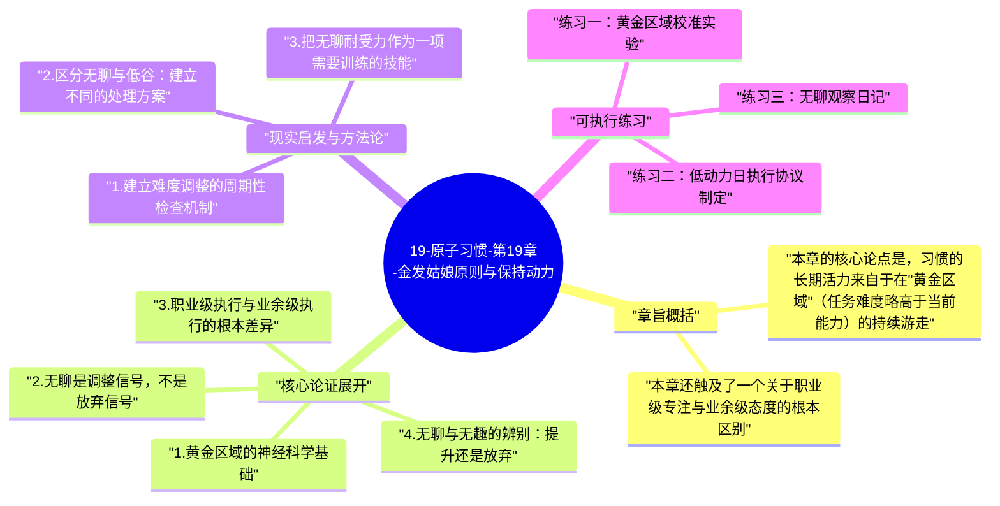

# 19-原子习惯-第19章-金发姑娘原则与保持动力

在格林童话《金发姑娘》的故事里，小姑娘在进入熊的小屋后尝试了三碗粥——一碗太烫，一碗太凉，只有中间那碗温度刚刚好。詹姆斯·克利尔把这个童话意象转化为一个精确的行为科学原理：人类在任务挑战水平与当前能力水平完美匹配时，能维持最高的动力水平和最深度的投入状态。任务太难，产生挫败感和焦虑，动力崩溃；任务太简单，产生无聊感和倦怠，动力消散；只有在"刚刚好有一点挑战、但又不到令人沮丧的程度"这个黄金区域，大脑才会保持最大的参与度和最持久的内在驱动力。这就是"金发姑娘原则"（the Goldilocks Rule）的核心。

理解这个原则能解答一个困扰很多习惯建立者的问题：为什么一个习惯在最初建立时会让人充满热情，但随着时间的推移，热情逐渐消退，执行变得越来越被动？克利尔的解释是：在习惯建立的早期，任务难度与能力水平的匹配通常是自然的——你刚开始接触一件事，挑战恰好略高于你的初始能力。但随着能力的提升，如果任务的难度没有相应调整，就会逐渐滑入"太简单"的区间，而太简单的任务会让大脑失去参与的理由。换句话说，习惯的长期活力需要持续的微调——不是偶尔的大幅升级，而是持续的小幅提升，让任务难度始终在能力水平的黄金匹配区内游走。

真正的问题在于无聊。克利尔在本章提出了一个他认为是习惯建立中被最低估的障碍：不是困难，不是失去动力，而是无聊。当一个习惯变得足够熟练、执行足够自动之后，它就不再提供任何新的挑战，而没有挑战的重复会逐渐变得乏味。无聊是一种微妙的信号——它告诉你当前的任务难度已经落后于你的能力发展，需要调整了。但很多人在面对习惯的无聊感时，会把它误解为"我不适合这件事"或者"这件事不值得做"，从而放弃一个本来可以用升级难度来重新激活的好习惯。识别无聊作为调整信号而不是放弃信号，是保持长期动力的关键认知转变。

## 章旨概括

本章的核心论点是，习惯的长期活力来自于在"黄金区域"（任务难度略高于当前能力）的持续游走。这需要两种能力的配合：一是感知能力——能察觉自己何时进入了太难或太简单的区间；二是调整能力——能在察觉到偏离后及时调整任务难度，重新进入黄金区域。对于大多数长期习惯建立者来说，挑战不是难度太高，而是随着能力的提升，忘记同步提升任务的难度，从而让习惯悄悄滑入"太简单"区间，最终以无聊感导致的停止而告终。

本章还触及了一个关于职业级专注与业余级态度的根本区别。克利尔指出，真正的高水平表现者与普通习惯者的核心区别之一，不在于他们是否有更多动力（高水平表现者也会在某些日子感到乏味和低落），而在于他们对"坚持执行"这件事有职业级的承诺，而不依赖于当天的动力水平。职业级的习惯执行者明白：无聊、疲惫、低动力是执行过程中的常态，而不是应该停止执行的理由。真正重要的区别不是在状态好时能做到多好，而是在状态差时仍然能够维持基本执行——这才是分隔高水平习惯者与普通习惯者的关键能力。

## 核心论证展开

### 1. 黄金区域的神经科学基础

金发姑娘原则有直接的神经科学依据。心理学家米哈里·契克森米哈依的研究表明，心流状态（深度投入、高度专注、时间感消失的体验）最容易在任务难度比当前能力水平高出约4%的情况下出现。这个4%的数字本身不是绝对精确的，但它捕捉了一个重要的量级：挑战必须足够高，让大脑意识到需要调动资源认真对待；但又不能高到触发威胁反应（焦虑、恐惧），因为威胁反应会关闭探索性思维和高效处理模式，反而降低表现质量。在黄金区域内，大脑的多巴胺系统处于一种"高度期待"的激活状态——预期奖励（成功完成挑战）触发的多巴胺释放，比确定奖励（简单任务的必然成功）触发的更强，这就是为什么略有挑战的任务更令人沉浸。

这个神经机制解释了为什么重复同一难度的任务会产生动力下降：当一个任务变得完全可以预测（你已经非常确定自己能做好），大脑的多巴胺"期待"系统就不再被充分激活，任务的内在吸引力随之下降。从神经角度来看，适度的不确定性（"我不完全确定今天能做好"）是保持高度投入的必要条件。这也是为什么高水平运动员会持续调整训练难度，艺术家会持续探索新的表达形式，优秀教育者会持续在学生处于能力边界的位置安排挑战——他们都在直觉上利用这个神经机制，尽管未必能用科学语言描述它。

### 2. 无聊是调整信号，不是放弃信号

克利尔特别强调了无聊在习惯动力系统中被误解的问题。在流行文化中，无聊被视为一种需要立刻消除的不舒适状态，因此人们在感到无聊时的第一反应是切换到另一件更有刺激性的事情。但在习惯建立的语境中，这种反应会产生系统性的破坏：每当某个习惯开始变得重复性太强、刺激性下降，就切换到下一个新鲜的习惯，结果是所有习惯都在获得初步的多巴胺奖励后就被抛弃，没有一个能够积累到真正深厚的程度。这种"永远在开始"的模式是很多人习惯清单很长但实质积累很少的根本原因。

正确的理解是把无聊视为一个调整信号：当某个习惯开始让你感到无聊，这是大脑在告诉你，当前的任务难度已经低于你的能力水平，需要提升了。在这个时刻，正确的响应不是放弃这个习惯，而是在保持这个习惯的基础上提升其难度或深度——增加量、引入变化、提升标准、尝试更高级别的挑战。这个调整应该小而频繁，而不是偶尔的大幅跃升，因为小调整能让任务难度始终维持在黄金区域附近，避免突然进入太难区域而产生挫败感。

### 3. 职业级执行与业余级执行的根本差异

本章中克利尔提出的最有力的观点之一，是职业级和业余级习惯执行者之间的根本差异。业余者依赖动力——当动力高时高强度执行，当动力低时放弃执行；职业者依赖系统——无论今天动力高低，都维持基本执行标准，因为他们把执行视为一种职业承诺，而不是情绪状态的表达。这个差异在表面上看是"意志力"的差异，但实际上是"对执行本质理解"的差异：业余者认为执行是动力驱动的结果，因此在没有动力时感到执行是不合理的；职业者认为执行是专业承诺的体现，动力只是一个额外的助力而非必要条件。

职业级执行的具体表现是：即便在感到无聊、疲惫或低动力的日子，也能维持一个最低执行标准（可以是两分钟法则的微型版本）。这种在低谷日的最低执行，对习惯的长期稳定性有不成比例的重要性——因为习惯连续性的破坏几乎总是在这些低谷日发生，而一旦连续性被破坏，重建需要更多的努力和时间。职业级执行者通过保住低谷日，保护了整个习惯体系的完整性，从而让高水平日的表现能够真正积累为长期成就，而不是被零散的放弃所侵蚀。

### 4. 无聊与无趣的辨别：提升还是放弃

克利尔提出了一个需要精细辨别的判断：习惯的无聊感有两种根本不同的来源，需要不同的处理方式。第一种是"能力超越难度的无聊"——你的能力已经超过了当前任务的难度，习惯变得太容易了，缺乏挑战性的刺激。这种无聊的正确处理是提升难度，让挑战重新进入黄金区域。第二种是"习惯本身不适合你的无聊"——习惯的性质本身就和你的天性倾向不匹配（参见第十八章），无论难度如何调整，都难以产生真正的投入感。这种无聊的正确处理是重新评估这个习惯是否值得继续发展，而不是简单地提升难度。

辨别这两种无聊的方法是：在提升难度后，投入感是否有所恢复？如果提升难度后确实感觉更有挑战性、更投入，那是第一种无聊，继续调整难度即可；如果即便提升了难度，仍然感觉这件事缺乏真正的内在吸引力，那可能是第二种无聊，值得从天性匹配度的角度重新评估这个习惯的长期投入价值。这个辨别对于高效分配习惯资源至关重要——不是所有的无聊都应该靠坚持来克服，有些无聊是系统性错配的信号，值得认真对待。

### 5. 无聊的耐受力作为高水平能力的组成部分

克利尔在本章最后引入了一个深刻的洞见：能够在无聊中保持执行的能力，本身就是卓越表现的核心组成部分。大多数技能领域的高水平表现，都需要大量的重复性练习——而重复性练习的本质特征之一就是它会变得重复且平淡。能够忍受这种平淡，能够在没有新鲜感刺激的情况下继续精益求精，是区分停留在中等水平和突破进入卓越水平的关键能力。这种能力不是天生的，而是可以被培养的——每一次在感到无聊却仍然选择执行，都是对无聊耐受力的一次小训练。

克利尔把这种能力的发展描述为"爱上无聊"（falling in love with boredom）——不是字面意义上喜欢无聊，而是发展出一种能够在无聊的重复中找到细节层面的乐趣和满足的能力。顶级运动员在做了成千上万次同样的技术动作之后，开始关注那些只有高度熟练者才能注意到的细微差异；顶级音乐家在弹奏了无数遍同一首曲子之后，开始探索微小的表情变化和情绪诠释的深度；顶级作家在写了无数段文字之后，开始感受到词语选择的细微质感差异。这种能力的培养需要大量的重复作为前提，因此，能够持续执行习惯的人，才有机会发展出这种在平淡中发现细节之美的高阶感知能力。

## 现实启发与方法论

### 1. 建立难度调整的周期性检查机制

在习惯追踪系统中增加一个"难度检查"维度：每两到三周，专门评估一次当前习惯的难度是否仍然处于黄金区域。如果发现某个习惯的执行越来越机械、越来越"不用动脑就能完成"，这是需要提升难度的信号。提升的幅度应该小而具体：不是从新手直接跳到专家级别，而是在当前水平上增加一个可感知的新挑战。例如，固定每天跑步三公里的人，可以每两周在同样的三公里里加入一段变速跑；固定每天写三百字的人，可以每月尝试一次不同类型或不同主题的写作形式。小幅调整能让黄金区域在不产生压力的情况下持续维持。

### 2. 区分无聊与低谷：建立不同的处理方案

为"无聊天"和"低谷天"建立不同的处理方案，而不是用同一种策略应对两种完全不同的状态。无聊天（能力已超过当前难度，缺乏挑战）的应对是：提升今天的难度标准，在日常执行中引入一个小的新挑战，为当天的执行增加一层额外的关注维度。低谷天（精力低落、动力不足，但任务难度本身没有问题）的应对是：执行两分钟版本，维持最低存在感，不求表现而求连续。这两种状态的混淆，是很多人在不该放弃的时候（只是低谷）放弃习惯的原因，也是应该调整难度时（需要提升）却用坚持硬撑的原因。

### 3. 把无聊耐受力作为一项需要训练的技能

把"在感到无聊时仍然完成习惯"本身视为一种需要主动培养的技能，而不是期待它自然而然地从意志力中涌现。每次在低趣味日仍然完成执行，都在训练这个能力；每次在低趣味日放弃，都在削弱这个能力。建立一个简单的记录：每周识别出一到两天你感觉"特别不想做但仍然做了"的日子，给自己一个额外的标记，以示对无聊耐受力训练的承认和奖励。随着时间推移，你会发现自己越来越能在缺乏新鲜感的日子里维持执行，而这种能力的积累，正是区分高水平习惯者与普通习惯者的关键差异之一。

## 可执行练习

### 练习一：黄金区域校准实验

选出你当前三个主要习惯，分别对它们的当前难度进行评估：用1分（太容易，可以完全自动完成）到10分（太难，经常无法完成）的量表评分。目标是让每个习惯的难度评分维持在6到7分之间（略有挑战，需要专注，但基本能完成）。对于评分低于5分的习惯，在接下来两周内刻意增加一个新的难度维度；对于评分高于8分的习惯，暂时降低标准，确保基本执行的连续性，然后再逐步提升。每两周重新评分，持续调整，让三个习惯的难度评分始终维持在黄金区域。

### 练习二：低动力日执行协议制定

提前为自己制定一份"低动力日执行协议"：当你在某天感到完全提不起劲时，该如何处理每个关键习惯？协议应该为每个习惯规定一个比平时标准低但仍然有意义的最低执行标准（例如：平时写五百字，低动力日写一百字；平时跑三公里，低动力日只走五分钟）。把这份协议打印出来，放在每天能看到的地方。当低动力日来临时，不需要临场决定"今天要不要执行"，只需要按协议执行低标准版本即可。这个协议的存在，把低动力日的决定成本从"是否执行"降低为"直接按最低标准执行"，大幅提高了这些日子的执行率。

### 练习三：无聊观察日记

在接下来的三周内，每次在执行某个习惯时感到明显的无聊感，就在习惯追踪记录旁边做一个"B"标记（boredom）。三周后，统计各个习惯的"B"标记数量，分析哪些习惯最频繁触发无聊感。对于"B"最多的习惯，进行一次深入分析：这种无聊更像是"太容易了需要提升"，还是"根本不匹配需要重新评估"？基于分析结果，制定相应的调整计划。这个练习的目的是把通常被忽视或被情绪化处理的无聊感，转化为一种系统性的习惯优化数据，让调整决策有据可依而不是依赖直觉。

---

## Mermaid 思维导图

### 图1

