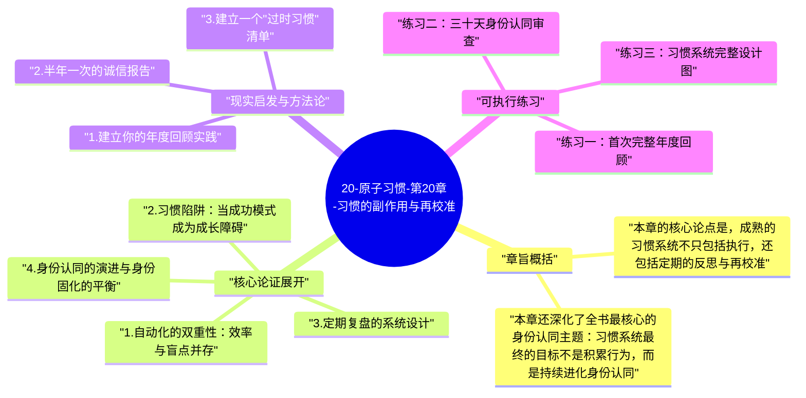

# 20-原子习惯-第20章-习惯的副作用与再校准

习惯是一把双刃剑。在整本书的前十九章，詹姆斯·克利尔深入阐述了习惯的构建机制和强化策略，展示了好习惯如何成为个人成长和卓越表现的基础。但第二十章以一种诚实的清醒转身，直视习惯系统本身的内在局限——自动化是习惯最大的礼物，同时也是习惯最隐蔽的陷阱。当一个行为经过足够多的重复而变得高度自动化之后，它不再需要意识的参与，这释放了大量认知资源，使人能够在执行熟悉任务的同时把注意力投入到更高层次的活动上。但自动化也带来了一个代价：随着有意识的注意减少，对细节的感知减弱，对错误的察觉延迟，对环境变化的适应性下降。

这个悖论的深刻之处在于，它意味着习惯越成功——越自动、越轻松、越不需要意识参与——它产生副作用的风险就越高。一个刚刚建立运动习惯的人，每次锻炼都会认真感受自己的身体状态，注意哪些部分有进步、哪些部分有不适；但一个运动了十年的人，很可能在自动化的执行中失去这种精细的自我感知，甚至没有意识到某些动作模式已经开始产生积累性的损伤。同样，一个刚开始执行某个工作流程的人，会不断评估这个流程是否有效；但当这个流程高度自动化之后，他可能在整个世界已经变化的情况下仍然用旧流程处理新问题，而没有察觉到不匹配的存在。这就是克利尔所说的"自动化带来的盲点"。

解决这个困境的工具，是克利尔在本章提出的定期反思与复盘系统。反思不是对习惯的怀疑或否定，而是一种对习惯质量和适用性的持续校准——确保习惯的执行不只是自动化的重复，而是与当前目标和现实情境保持动态对齐的有意识行动。克利尔分享了他自己使用的两种定期复盘工具：年度回顾（Annual Review）和诚信报告（Integrity Report），前者关注过去一年的总体进展，后者关注价值观和身份认同是否仍然与当前行为一致。这两个工具共同构成了一个习惯系统的"元层面维护"机制——不只是执行习惯，还要定期评估习惯是否仍然是对的习惯。

## 章旨概括

本章的核心论点是，成熟的习惯系统不只包括执行，还包括定期的反思与再校准。所有习惯都有一个自然的生命周期：建立期（从零开始，需要刻意努力）、自动化期（习惯变得顺畅，执行成本大幅降低）、以及可能的陈旧期（习惯仍然在执行，但已经不再服务于当前最重要的目标）。没有定期复盘的习惯系统，会系统性地在陈旧期延续过时的行为，消耗时间和精力，同时让真正需要建立的新习惯因为资源被占用而无法得到充分发展。定期复盘的功能，是把习惯从"一旦建立就永远保留"的静态资产，变成"持续优化以服务当前目标"的动态工具。

本章还深化了全书最核心的身份认同主题：习惯系统最终的目标不是积累行为，而是持续进化身份认同。当一个人把强大的习惯系统和清晰的身份认同结合在一起时，会发展出一种既稳定又灵活的自我感——稳定，是因为核心价值观和基本行为模式经过长期积累已经深入骨髓；灵活，是因为通过定期的诚信报告，他能察觉到身份认同是否需要更新，是否有些曾经有用的"我是什么样的人"的叙事已经开始限制而非推动成长。克利尔把这种成熟状态描述为：对身份认同既有足够的坚持（不被每一阵风吹动），又有足够的开放（能随着成长而演进）。

## 核心论证展开

### 1. 自动化的双重性：效率与盲点并存

认知科学中有一个基本模型，把思维分为"系统一"（自动的、快速的、无意识的）和"系统二"（缓慢的、刻意的、有意识的）。习惯化的本质是把行为从系统二转移到系统一——这个转移让执行变得轻松，释放了系统二的资源，同时也意味着行为的执行不再经过仔细的意识审查。在执行环境稳定、行为本身仍然适用的情况下，这个转移是纯粹的收益；但在环境发生变化或行为需要调整的情况下，系统一的执行会延迟这些变化的被察觉，产生"应该调整但没有调整"的系统性滞后。

这个滞后在轻微的情况下只是效率的微小损失，但在重要的情况下可能是方向性的错误。一个销售人员用多年积累的一套话术高度自动化地处理客户，在市场环境没有变化时效率极高；但当客户群体的需求模式发生根本变化时，自动化的话术执行会在很长时间内掩盖适应需求的必要性，导致业绩不知不觉地下滑，而直到下滑相当严重时才会触发系统二的警报。定期复盘的价值，正是强制性地把系统一在执行的某些重要行为，拉回到系统二的有意识审查范围内，以弥补自动化带来的感知盲点。

### 2. 习惯陷阱：当成功模式成为成长障碍

克利尔指出了一种他称为"成功悖论"的习惯陷阱：一套能带来初期成功的习惯，如果在没有反思的情况下长期延续，可能会成为更高层次成长的障碍。这是因为习惯形成了一套固定的处理世界的方式，而世界是在变化的，过去有效的方式不保证在新的情境中同样有效。更危险的是，正是因为过去有效，人会对这套方式产生更强的依恋，更难接受需要改变的信号。克利尔把这个现象称为"认同固化"——当一个人过于紧密地把自己与某套特定的习惯和行为模式认同在一起时，改变那些行为就感觉像是对自我的否定，因此会产生比实际调整所需更大的心理阻力。

解决成功悖论的方法，是在保持核心价值观认同的同时，放松对具体行为模式的认同。克利尔的建议是：把自我认同建立在更高的抽象层次上——不是"我是一个每天跑三公里的人"，而是"我是一个重视身体健康的人"；不是"我是一个早起写作的人"，而是"我是一个重视持续创作的人"。当认同建立在价值层次而非行为层次时，调整具体行为就不再威胁身份认同，而只是在更好地服务于相同的价值观，这大幅降低了适应性调整的心理阻力。

### 3. 定期复盘的系统设计

克利尔分享了他个人使用的两种复盘工具，并详细解释了它们的设计逻辑。年度回顾（Annual Review）是一年一次的全面评估，包括三个核心问题：这一年里做得好的地方有哪些？这一年里做得不好的地方有哪些？从这一年中学到的最重要的经验是什么？年度回顾的目的不是给自己打分，而是在时间的高度上看清自己的整体轨迹——识别正在向好的趋势（需要强化），识别开始偏离的趋势（需要纠正），以及识别已经陈旧不再适用的模式（需要更新）。

诚信报告（Integrity Report）是每半年一次的价值观核对，包括更深层的问题：我当前最核心的价值观是什么？我当前的行为模式是否真正体现了这些价值观？在哪些地方，我说自己重视某件事，但实际的日常习惯却与此不一致？这些问题触及的不只是行为层面，而是身份认同与行为一致性的层面——它是一种元复盘，不只评估"我做了什么"，而是评估"我做的事情是否仍然是我想成为的人会做的事情"。对于很多人来说，这类问题的答案会揭示一些日常中被忙碌掩盖的深层不一致，而这些不一致正是长期停滞感和空洞感的来源。

### 4. 身份认同的演进与身份固化的平衡

全书在最后一章回到了第一章提出的核心主题：身份认同是习惯建立的最深层基础，也是习惯系统成熟后最需要持续维护的维度。克利尔提出，身份认同需要在两个张力之间保持动态平衡：一方面，足够稳固的身份认同是长期坚持习惯的心理锚——"这就是我"的感受提供了行为的内在一致性，使人不需要在每个早晨重新决定自己是谁；另一方面，过于僵化的身份认同会阻碍必要的成长和调整——"我一直都是这样的人"的固化叙事，会让人拒绝那些与过去自我认同不一致但对未来成长必要的变化。

平衡这两个张力的关键，是把身份认同建立在足够高的抽象层次上。"我是一个努力学习的人"比"我是一个每天读一本书的人"更持久，因为前者在具体行为上有更大的适应性空间；"我是一个重视健康的人"比"我是一个素食主义者"更灵活，因为前者不会因为某一次改变饮食选择而遭受认同危机。高层次的身份认同能容纳多种具体的实现形式，因此在具体行为需要调整时不会产生认同崩溃。这种弹性，是习惯系统能够随着人生阶段的变化而持续适配的根本保证。

### 5. 全书论点的收敛：系统性卓越的完整面貌

第二十章作为全书的终章，在某种程度上是对整本书论点的综合收敛。克利尔通过这一章传达的最终信息是：原子习惯系统的完整形态，不只是关于如何建立好习惯和打破坏习惯，而是关于如何构建一套持续学习、持续适应、持续进化的个人系统。四条习惯定律提供的是行为改变的机制；身份认同理论提供的是方向；而本章提出的定期反思与再校准，提供的是保证整个系统长期有效性的维护机制。这三个层次共同构成了克利尔所描绘的"系统性卓越"——不是靠一次正确的决定，而是靠一套持续自我优化的系统，一点一点地、原子级别地、不可逆地向卓越累积。

这个终章的存在，也是克利尔对"完成主义"思维的最后一次挑战。习惯建立不是一个有终点的项目——建立了就完成了，然后可以停止维护。习惯建立是一个持续的过程，就像一台精密机器的维护，需要定期检查、调整和优化。但与机器不同的是，习惯系统的维护不是为了防止磨损和退化，而是为了持续进化和提升——每一次复盘和再校准，都是把系统提升到更高水平的机会。理解了这一点，才能真正理解詹姆斯·克利尔在书名中那个"原子"的深意：不是微不足道的小事，而是构成更大事物的基本单元，在正确的方向上，以正确的机制，持续不断地积累，直至发生量变到质变的转化。

## 现实启发与方法论

### 1. 建立你的年度回顾实践

在今年年末（或今年任何一个节点），进行第一次正式的年度回顾。选择一个安静的半天，准备一本笔记本，按照克利尔的三个核心问题展开回顾：这一年做得好的地方（至少列出十件，不只是重大成就，也包括小的坚持和改善）、做得不好的地方（诚实列出三到五个，不是为了自责，而是为了信息提取）、以及这一年学到的最重要的经验（对自己、对他人、对系统设计的认识）。基于这些答案，为下一年识别出三个最值得重点培养的习惯，以及一个最值得有意识放弃或调整的过时习惯。这个年度回顾的产出，是下一年习惯系统设计的基础数据。

### 2. 半年一次的诚信报告

除了年度回顾，每半年进行一次更深层的诚信报告。核心问题是：我当前生活的哪些方面，说明了我真正在意的是什么？我在日常行为中投入最多时间和精力的事情，是否与我口头上说自己最重视的事情一致？如果两者不一致，这个差距在告诉我什么？诚信报告不需要做出立即的改变，它的首要目的是创造一个清醒认识的空间——让你看见实际生活与理想生活之间的真实差距，而不是被日常的忙碌淹没这种清醒。在这种清醒的基础上做出的调整，比在模糊状态下靠意志力驱动的改变更具有持久性。

### 3. 建立一个"过时习惯"清单

在年度回顾或诚信报告之后，建立一个"过时习惯"评估清单，列出你所有当前的主要习惯，并对每一个提出这个问题：这个习惯是否仍然服务于我当前最重要的目标？如果一个习惯的答案是"不确定"或"不再如此"，不需要立刻放弃它，但需要把它列入重新设计的考量范围。过时习惯的处理方式有三种：升级（调整内容或标准以适应新目标）、替换（用更相关的习惯取代）、或者维持但降低优先级（从核心习惯降级为背景习惯）。定期清理过时习惯，能把有限的习惯承载资源持续重新分配到最重要的发展方向上，避免整个习惯系统被陈旧模式占据而无法更新。

## 可执行练习

### 练习一：首次完整年度回顾

无论现在处于什么时间节点，进行一次覆盖过去十二个月的年度回顾（如果没有完整的十二个月数据，就用当前记忆能回溯的最长时段）。把回顾结果写成三页：第一页列出过去一年所有坚持下来的习惯和积极变化（无论多么微小）；第二页诚实地列出反复尝试但未能建立或多次崩溃的习惯；第三页写一份"致未来十二个月自己的信"，说明你基于这次回顾最想改变的一件事，以及你打算如何不同地处理它。这封信要保存好，在十二个月后重新阅读，比较当时的计划与实际发生的事情，以评估你的自我认识和计划质量是否在提升。

### 练习二：三十天身份认同审查

在接下来三十天内，每天晚上花两分钟回答这个问题：今天，我成为了哪种人的证据是什么？也就是，今天的具体行为中，哪些证明了我想成为的那种人的存在？哪些与我想成为的那种人不一致？不需要对不一致的行为进行自责，只需要记录。三十天后，阅读这三十天的记录，寻找模式：哪种行为最频繁地出现在"证据"栏？哪种不一致最频繁地重复？这个练习会逐渐建立起一种持续的自我观察能力，让你对自己习惯行为与身份认同之间的关系有越来越清晰的感知，而这种清晰正是长期再校准能力的基础。

### 练习三：习惯系统完整设计图

在一张大纸或电子白板上，画出你当前习惯系统的完整图景：列出所有当前在执行的主要习惯，标注每个习惯的执行稳定性（高/中/低）、与当前核心目标的相关度（高/中/低）、以及建立至今的时间。基于这个图景，识别：哪些习惯是高稳定、高相关的"核心资产"？哪些是高稳定但相关度已经降低的"惯性遗留"？哪些是高相关但稳定性仍低的"需要投资"？这个分类会清晰地指向你的习惯资源应该如何重新分配：核心资产维持即可，惯性遗留考虑重新设计或降级，需要投资的习惯应该获得更多系统支持。每季度更新一次这个图景，让它成为习惯系统持续进化的视觉控制台。

---

## Mermaid 思维导图

### 图1

