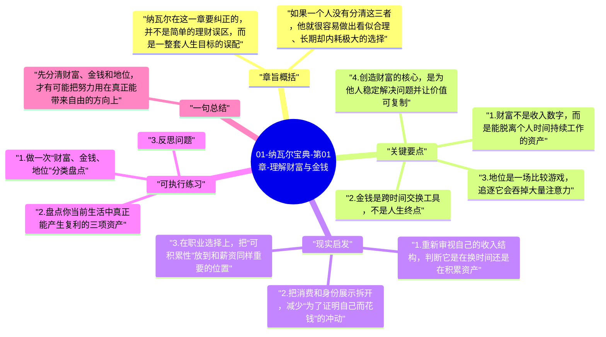

# 01-纳瓦尔宝典-第01章-理解财富与金钱

本章先澄清纳瓦尔整本书最重要的前提：财富、金钱和地位不是一回事。很多人之所以越努力越迷茫，不是因为不够拼，而是因为从一开始就把目标混在一起了，以为收入增加等于财富增长，以为别人认可等于自己走在正确道路上。

只有先把概念分开，后面关于特定知识、杠杆、长期主义和幸福的讨论才站得住。否则，一个人可能嘴上说想要自由，实际追逐的却是薪资数字；表面上在创造价值，内心真正焦虑的却是输给别人。这种目标错位，会让人不断加速，却越来越偏离自己真正想要的生活。

## 章旨概括

纳瓦尔在这一章要纠正的，并不是简单的理财误区，而是一整套人生目标的误配。财富指向的是选择权，是一种即使你不继续出售时间，价值仍然可以持续积累和回流的状态。金钱更多是交换媒介和记账单位，它重要，但它本身并不等于自由。地位则更像社会比较中的排序，它经常建立在“我比别人更高”的感受上，因此天然带有竞争性和不稳定性。

如果一个人没有分清这三者，他就很容易做出看似合理、长期却内耗极大的选择。例如，他可能为了更高收入接受一份完全不积累能力与资产的工作，也可能为了显得更成功而不断消费和比较，最终看起来拥有很多，实际上却没有更大的选择权。

## 关键要点

### 1. 财富不是收入数字，而是能脱离个人时间持续工作的资产

财富最容易被误解成“账户上的钱很多”，但纳瓦尔强调的财富，更接近于一种结构性结果。真正的财富，是那些即使你暂时不工作，也仍能继续创造价值的东西，例如企业股权、可持续产生现金流的资产、可被规模化复制的代码和内容、长期可信赖的专业声誉等。

这一定义的关键在于，它把注意力从“当期收入”转向“未来选择权”。一个月薪很高的人未必富有，如果他必须持续高强度出售时间才能维持生活；相反，一个收入看起来不算夸张，但持续积累资产、作品和信誉的人，反而更接近财富的本质。财富不是表面热闹，而是长期独立性。

### 2. 金钱是跨时间交换工具，不是人生终点

金钱当然重要，因为现实生活中的资源配置离不开它。它帮助人保存劳动成果、跨时间调度资源、在复杂社会里提高交换效率。从这个角度看，金钱是一种必要工具，而不是敌人。问题在于，很多人会把工具误当终点，结果人生被“更高数字”绑架。

如果只盯着金钱本身，就很容易忽略金钱背后的代价。你赚到钱的方式是否可持续，你是否为此损害了健康、关系和判断力，你获得的收入究竟是在增强自由，还是仅仅支撑更高的消费负担，这些都比数字本身更关键。金钱真正有价值的地方，在于它能帮助你建立更大的弹性，而不是迫使你不断升级生活成本。

### 3. 地位是一场比较游戏，追逐它会吞掉大量注意力

地位之所以危险，不是因为它完全没有价值，而是因为它极容易伪装成“上进心”。很多时候，人并不是在追求真正适合自己的生活，而是在追求一种能被别人看见和认可的位置感。问题是，地位天然依赖比较，只要标准来自外部，满足感就很难稳定。

这会造成一个很现实的后果：你可能做出许多不是为自己长期利益，而是为面子、头衔、评价和身份标签服务的决定。你选择某份工作，不是因为它积累了特定知识和所有权，而是因为说出去更体面；你买某些东西，不是因为真的需要，而是因为它代表某种地位暗号。久而久之，注意力会被拉进一个没有终点的排名系统里。

### 4. 创造财富的核心，是为他人稳定解决问题并让价值可复制

纳瓦尔对于财富的理解并不神秘，它并不是“靠某种秘诀赚钱”，而是更有效地为社会提供价值，并且能通过规模化机制把价值放大。如果一个人的产出永远只能一对一交付，那么再优秀也会受到时间上限限制；如果他能把自己的能力转化成产品、系统、内容、品牌或组织机制，回报结构就会发生变化。

这也是为什么纳瓦尔强调创造而不是分配。真正可持续的财富来自新增价值，来自把事情做得更好、更快、更低成本，或者提供别人难以替代的解决方案。当一个人开始用这个视角看职业和项目，他的关注点就会从“哪里给的钱更多”转向“哪里更适合创造长期价值”。

### 5. 真正值得追求的是自由，而不是账面上的胜利感

本章真正的落点，是帮助读者重新定义成功。财富之所以重要，不是因为它能带来炫耀资本，而是因为它能换来自由选择的空间。你可以决定和谁合作、住在哪里、做什么项目、花多少时间陪伴家人、是否有能力拒绝不合适的机会。没有这种选择权，再漂亮的数字也可能只是一种高成本束缚。

因此，纳瓦尔并不是让人轻视赚钱，而是提醒人把赚钱放回正确位置。钱应该服务于更清醒的人生结构，而不是反过来决定你的人生方向。

## 现实启发

### 1. 重新审视自己的收入结构，判断它是在换时间还是在积累资产

对于大多数上班族来说，最容易忽略的问题不是收入多少，而是收入模式本身。如果你的主要收入始终来自当下劳动，那么生活一旦离开工位，就会迅速失去现金流。这并不意味着打工没有价值，而是说明在职业发展过程中，需要有意识地把一部分精力转向资产化积累，例如可复用的作品、可迁移的能力、长期可信的专业声誉、股权或能规模化的输出形式。

### 2. 把消费和身份展示拆开，减少“为了证明自己而花钱”的冲动

很多消费并不是由真实需求驱动，而是由地位焦虑驱动。当一个人长期处于比较状态，他会习惯性地用外在标识来确认自己是否“混得不错”。但这种确认感非常短暂，往往只能带来下一轮更高成本的比较。意识到这一点之后，消费决策会更清晰：这笔支出是在提升生活质量，还是只是在购买短暂的身份安慰。

### 3. 在职业选择上，把“可积累性”放到和薪资同样重要的位置

一份短期报酬更高的工作，如果不能积累关键能力、作品、信誉或所有权，长期看未必更优。相反，一些起点没有那么耀眼但能持续沉淀专业壁垒和行业理解的路径，更可能在未来几年形成复利。看清这一点后，人就不会轻易被短期待遇牵着走。

## 可执行练习

### 1. 做一次“财富、金钱、地位”分类盘点

拿出纸笔，把你最近一年最重视的十个目标写下来，然后分别标记它更偏向财富、金钱还是地位。这个练习通常会暴露出很明显的偏差：有些你以为是在追求自由的目标，其实更多是在追求面子；有些你以为只是赚钱的行为，实际上可能在积累很有价值的长期资产。

### 2. 盘点你当前生活中真正能产生复利的三项资产

这三项资产不一定是金融资产，也可以是专业作品库、稳定合作关系、公开声誉、系统化知识库或长期健康习惯。关键是问自己：它会不会随着时间和持续投入变得更有价值？如果答案是否定的，那么它更可能只是短期收益，而不是财富。

### 3. 反思问题

你现在最想要的东西，究竟是更高收入、更强认可，还是更大自由？如果这三者发生冲突，你愿意优先保留哪一个？这个问题没有标准答案，但它能暴露你当下最真实的人生排序。

## 一句总结

先分清财富、金钱和地位，才有可能把努力用在真正能带来自由的方向上。

---

## Mermaid 思维导图

### 图1

