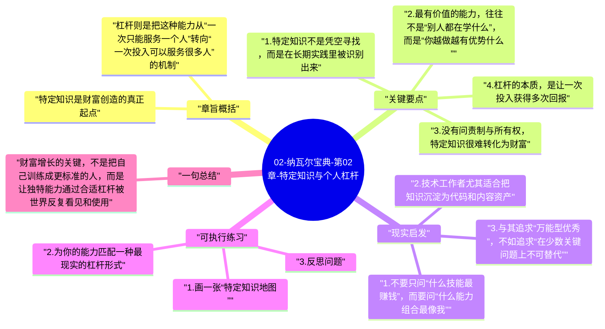

# 02-纳瓦尔宝典-第02章-特定知识与个人杠杆

如果说第 01 章解决的是“应该追求什么”，那么这一章解决的就是“靠什么创造出来”。纳瓦尔的答案非常鲜明：真正高价值的，不是标准化、可批量培训的能力，而是你在天赋、兴趣、性格、经历和长期实践交叉点上形成的特定知识。只有先找到这类独特能力，杠杆才有放大的对象；否则，所谓杠杆只是在放大普通劳动。

因此，本章并不是鼓励人去神秘化自己的天赋，而是提醒读者认真对待个体差异。很多长期回报极高的路径，并不是先设定一个热门目标再硬学进去，而是在持续实践中逐渐看清：我在哪些问题上天然有感觉、愿意长期投入，而且外部世界又确实愿意为此付费。

## 章旨概括

特定知识是财富创造的真正起点。它不是某个证书、头衔或通用技能列表，而是你做起来相对自然、别人做起来却明显更费力的能力结构。它通常诞生于长期兴趣、真实项目、个人经历和反复试错之中，所以很难被复制，也很难用统一课程直接制造出来。

杠杆则是把这种能力从“一次只能服务一个人”转向“一次投入可以服务很多人”的机制。纳瓦尔特别看重代码、媒体和资本，因为这三类杠杆都具有边际复制成本低、影响范围大、可在你不持续在线时继续工作的特点。两者结合起来，才会形成真正的增长飞轮：独特能力决定价值密度，杠杆决定放大倍数。

## 关键要点

### 1. 特定知识不是凭空寻找，而是在长期实践里被识别出来

很多人一听到“特定知识”，就想马上列出自己的核心优势，仿佛这是一个可以通过自我盘问立即得出的标准答案。但现实通常不是这样。真正的特定知识往往不是从抽象思考里凭空找出来的，而是在长期做事过程中逐渐显形的。你会发现，有些问题你愿意反复琢磨，有些领域你学起来不觉得苦，某些别人觉得复杂的事你却能迅速进入状态，这些线索比空泛的自我定位更可靠。

特定知识的形成，通常既依赖天赋，也依赖环境。它往往出现在你独特的人生轨迹里，例如某段长期积累的行业经验、某类复杂问题的解决能力、某种把技术与表达结合起来的方式。正因为它带有强烈个人历史色彩，所以它很难被标准化复制，也很难在简历模板里完整展示。

### 2. 最有价值的能力，往往不是“别人都在学什么”，而是“你越做越有优势什么”

大众化技能当然有用，它们能帮助你进入行业、完成基本协作、获得稳定工作。但纳瓦尔强调的是，真正拉开差距的，通常不是这些可替代能力，而是你能持续积累并越做越强的能力组合。它可能是技术与行业理解的结合，也可能是产品判断与写作表达的结合，或者是研究、销售、组织协作与审美能力的叠加。

这意味着，职业成长不应该只围绕“市场现在流行什么”来规划。热门技能会变化，但个人优势的复利，往往发生在你愿意长期投入、还能持续领先的地方。与其每年都从头追逐新风口，不如寻找那些随着时间推移会更体现你独特性的方向。

### 3. 没有问责制与所有权，特定知识很难转化为财富

这一章还有一个常被忽略的点：即便你有特定知识，如果始终不愿意承担责任，不愿意让结果和自己的名字绑定，回报仍然可能停留在工资层面。纳瓦尔反复强调问责制和所有权，就是因为世界对真正承担结果的人给出的回报结构完全不同。

问责制意味着你愿意为决策和交付结果负责，而不是总躲在组织、流程和集体名义背后。所有权则意味着你不仅领取当下报酬，还参与未来价值的分配，例如股权、分成、署名作品、长期品牌声誉。没有这两者，一个人再能干，也可能只是高效率地替别人创造资产。

### 4. 杠杆的本质，是让一次投入获得多次回报

纳瓦尔将杠杆视为现代财富创造的核心机制。传统劳动模式的特点是线性，你做多少，拿多少；一旦停止，回报也停止。而杠杆则改变了这条曲线。写一段代码、录一门课程、发布一篇高质量文章、参与一个拥有长期股权价值的项目，都可能在之后反复被消费、复制、传播或变现。

不同杠杆之间也有差异。劳动力杠杆依赖组织和管理，人越多，协调成本越高；资本杠杆效率很高，但建立在既有信用和资源基础上；代码与媒体杠杆则更适合普通人在互联网时代起步，因为它们越来越不需要许可。一个人只要有清晰能力和持续输出能力，就能逐步构建属于自己的影响力与资产。

### 5. 杠杆不是捷径，而是对长期积累结果的放大

很多人喜欢“杠杆”这个词，是因为它听起来像快速放大的秘诀。但纳瓦尔的意思并不是轻松取巧，而是强调在独特能力打磨到一定程度之后，要学会用更优结构交付价值。如果能力本身还不成熟，杠杆放大的就可能只是噪音；如果缺乏信誉与判断，杠杆也可能把错误放大。

所以，特定知识和杠杆不能拆开理解。前者决定你有没有真正值得放大的内容，后者决定这份内容能不能越过时间边界，进入更大规模的回报系统。

## 现实启发

### 1. 不要只问“什么技能最赚钱”，而要问“什么能力组合最像我”

职业规划里一个常见误区，是直接从市场热门列表倒推自己的方向。这种方式能帮助你迅速行动，却不一定能帮助你建立长期优势。更有价值的问题是：哪些事情我愿意长期钻研，哪些问题我解决起来明显比周围人轻松，哪些经历让我拥有独特视角。只有把这些线索串起来，才更容易找到真正具备复利潜力的能力组合。

### 2. 技术工作者尤其适合把知识沉淀为代码和内容资产

对程序员、工程师、研究者和技术写作者而言，代码和媒体几乎是最容易获得的杠杆。一个调试脚本、一套文档、一篇系统化教程、一份开源工具，表面上只是一次输出，长期却可能成为可信度、影响力和合作机会的来源。与其把经验停留在脑子里，不如尽量把它们外化成别人可复用的资产。

### 3. 与其追求“万能型优秀”，不如追求“在少数关键问题上不可替代”

现实竞争中，全面均衡并不一定比鲜明优势更有价值。尤其在知识型工作里，别人之所以愿意与你合作、为你付费或给你机会，往往不是因为你样样都懂一点，而是因为你在某类问题上确实值得信任。因此，职业发展并不需要把所有短板都补成平均线，更重要的是让关键长板真正突出出来。

## 可执行练习

### 1. 画一张“特定知识地图”

把以下四类信息各写五条：你天然感兴趣的主题、你做起来最投入的工作、别人最常向你请教的问题、你过去几年反复投入过的领域。然后找这些列表的交集。这个过程未必一次就有答案，但它会帮助你从模糊的自我感觉，走向更具体的能力识别。

### 2. 为你的能力匹配一种最现实的杠杆形式

问自己三个问题：我的能力更适合写成代码、讲成内容，还是嵌入到某种长期所有权项目里；我现阶段最容易启动的杠杆是哪一种；接下来一个月我能产出什么最小版本。把杠杆想象成一条起跑线，而不是遥远口号，行动会容易得多。

### 3. 反思问题

如果把你现在最重要的工作内容全部列出来，其中哪些是在积累特定知识，哪些只是完成可替代劳动？如果两者比例严重失衡，那么你可能需要重新调整职业投入结构。

## 一句总结

财富增长的关键，不是把自己训练成更标准的人，而是让独特能力通过合适杠杆被世界反复看见和使用。

---

## Mermaid 思维导图

### 图1

