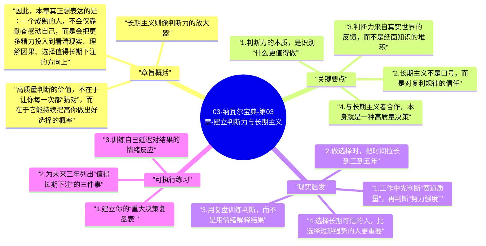
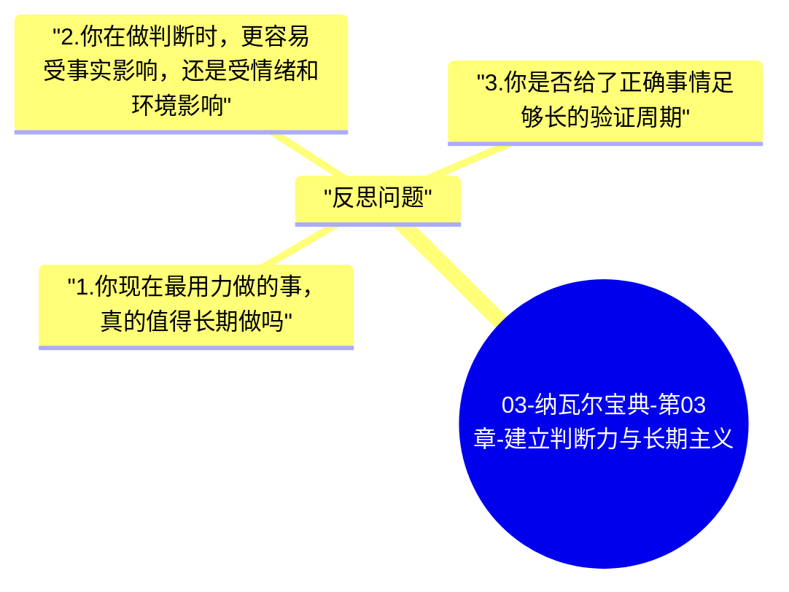

# 03-纳瓦尔宝典-第03章-建立判断力与长期主义

本章讨论纳瓦尔极为强调的判断力。对他来说，努力当然重要，但真正决定结果上限的，往往不是“做了多少事”，而是“是否在正确方向上做正确的事”。

纳瓦尔把判断力和长期主义放在一起，是因为两者本质上都要求人跳出短期噪音，不被情绪、群体压力和即时反馈牵着走，而是根据更深层的因果关系做选择。一个人的判断力越成熟，越能忍受短期不显眼；一个人越能坚持长期主义，越有机会让正确判断穿过时间，产生复利效果。

## 章旨概括

高质量判断的价值，不在于让你每一次都“猜对”，而在于它能持续提高你做出好选择的概率。人生中真正重要的结果，例如职业方向、合作伙伴、是否创业、是否持续学习、是否建立个人信誉，往往不是靠蛮力堆出来的，而是靠少数关键决策拉开差距。

长期主义则像判断力的放大器。很多正确选择在最初阶段并不会立刻带来奖励，甚至还会让人看起来走得更慢。例如持续阅读、建立专业声誉、积累可信赖的人脉、打磨难以替代的能力，这些事情都需要先付出，再等待时间兑现价值。没有长期主义，判断力就容易被短期波动打断；没有判断力，长期主义又可能变成盲目坚持。两者必须同时成立。

因此，本章真正想表达的是：一个成熟的人，不会仅靠勤奋感动自己，而是会把更多精力投入到看清现实、理解因果、选择值得长期下注的方向上。

## 关键要点

### 1. 判断力的本质，是识别“什么更值得做”

多数人理解努力时，默认重点在执行力，比如是否勤奋、是否自律、是否能熬时间。但纳瓦尔更看重的是，在行动之前，你能不能先判断清楚：这件事是否值得做、是否值得长期做、是否值得由你来做。

这背后有一个很重要的现实：世界并不会平均奖励所有努力。很多努力之所以回报普通，不是因为投入不够，而是因为方向本身就不具备高回报结构。比如在一个没有复利空间、没有规模效应、没有能力壁垒的路径上加倍努力，最终也可能只是更辛苦地重复低价值工作。

所以判断力首先意味着筛选。它帮助你把有限的时间、注意力和信誉，集中到更重要、更长期、更可积累的事情上。真正厉害的人，并不是做得最多的人，而是删掉了大量低质量选项的人。

### 2. 长期主义不是口号，而是对复利规律的信任

长期主义经常被误解成“慢慢来”或者“以后再说”，但纳瓦尔所说的长期主义并不是拖延，也不是空泛的耐心，而是一种对复利过程的理解。你清楚知道，有些成果必须经过漫长积累才能显现，所以愿意在前期没有掌声时仍然稳定投入。

这在现实中非常关键，因为大多数高价值成果都有明显的“延迟满足”特征。阅读多年后才会在思维深度上产生差异，专业信誉往往在别人连续验证你可靠之后才建立，代码资产和内容资产也要在长期发布后才形成影响力。如果一个人总是要求即时反馈，他就很容易在价值还没有显现前中途放弃。

真正的长期主义不是盲等结果，而是在长期里不断校准方向、迭代方法，同时保持耐心。这种“耐心中的主动性”才是长期主义最难的部分。

### 3. 判断力来自真实世界的反馈，而不是纸面知识的堆积

纳瓦尔并没有把判断力理解成“会说很多大道理”。真正的判断力来自长期阅读、独立思考、真实决策和错误复盘。阅读能拓宽模型，思考能连接模型，实践能提供反馈，复盘能修正偏差。四者缺一不可。

很多人读了不少书，却依然做不好决策，原因就在于知识还停留在信息层，没有进入“模型层”和“选择层”。当你面对现实问题时，判断力要求你把抽象知识转化为具体判断：这个机会的本质是什么？这个人值不值得长期合作？这个方向的护城河在哪里？现在应该坚持，还是应该止损？

只有在一次次真实选择中验证、修正，你的判断力才会变得越来越稳。它不是背诵出来的，而是打磨出来的。

### 4. 与长期主义者合作，本身就是一种高质量决策

纳瓦尔特别强调与长期视角一致的人合作，因为长期主义不只是时间观念，也是一种人格结构。重视长期的人，更珍惜信誉，更愿意在合作中保持诚实，更少为了眼前利益做损害关系的行为。

这点在工作和人生里都极其重要。短期主义者往往在表面上行动很快、反馈很强、承诺很多，但他们一旦遇到短期利益诱惑，就容易改变立场、压缩质量、透支信任。长期主义者不一定最会包装自己，却更有可能在关键时刻守住原则。

从这个角度看，判断力不仅用于选项目，也用于选人。选错方向最多浪费时间，选错伙伴往往会连时间、资源和信誉一起受损。

### 5. 真正的长期主义，必须允许自己穿过“沉默期”

很多值得做的事都有一个共同特征：前期回报很低，甚至会让人怀疑自己是否做错了。比如持续写作、长期锻炼、积累一个细分领域的专业能力、经营信任关系，这些事在前面一段时间都很难得到明显奖励。

纳瓦尔提醒我们，沉默期并不一定意味着方向错误，它也可能只是复利尚未到达显性阶段。如果一件事的逻辑正确、路径清晰、反馈机制健康，那么早期的缓慢并不是否定，而是正常过程。

这要求人具备一种比激情更稀缺的能力：在看不到结果的时候，依然稳定地做正确的事。很多人的问题不是方向错了，而是没有熬到方向开始显现价值的时刻。

## 现实启发

### 1. 工作中先判断“赛道质量”，再判断“努力强度”

很多人一谈成长就立刻进入执行模式，例如报名课程、加班补项目、学习更多工具，但很少先问自己：我现在投入的方向，会不会在三到五年后产生更高的复利？

如果你长期做的是容易被替代、缺乏沉淀、没有外部可见成果的工作，那么再努力也很难形成明显优势。相反，如果你在积累难以替代的领域知识、跨系统排障能力、复杂项目的决策经验，那么这些能力会随着时间变得越来越稀缺。

对于技术从业者来说，这种判断尤其重要。比起单纯追逐流行技术，更值得思考的是：哪些能力能形成长期壁垒，哪些能力能够迁移到更多场景，哪些输出能成为公开可见的个人资产。

### 2. 做选择时，把时间拉长到三到五年

短期看起来很诱人的机会，常常靠的是速度、热度和即时回报；长期真正有价值的机会，更多依赖结构、积累和持续性。把时间尺度从三个月拉到三年，很多决策会变得异常清晰。

例如，一份短期薪资更高但成长停滞的工作，和一份短期更辛苦但能快速积累关键能力的工作，哪一个更好？如果只看眼前三个月，很容易被前者吸引；如果看三年后的能力复利和选择权，答案通常会变化。

时间尺度一旦拉长，很多即时诱惑都会自动失真。长期主义的一个实用价值，就是帮助人看见短期表象背后的真实结构。

### 3. 用复盘训练判断，而不是用情绪解释结果

很多人遇到结果不好时，第一反应是自责、后悔或者归因于运气，但这对提升判断力帮助很小。更有效的方式是系统复盘：我当时基于什么信息做了这个决定？哪些前提判断是对的？哪些假设后来被事实推翻？我忽略了哪些信号？

这种复盘方式能够把一次结果，转化成下一次更成熟的判断。久而久之，你会越来越能分辨“坏结果但好决策”和“好结果但坏决策”。前者值得保留逻辑并继续优化，后者则要警惕偶然成功带来的误导。

### 4. 选择长期可信的人，比选择短期强势的人更重要

在合作关系里，专业能力当然重要，但长期看，价值观、信誉和时间视角往往更关键。一个短期爆发力很强但经常失信的人，会把团队拖入反复修复关系的成本；一个愿意长期交付、对结果负责、不过度透支信用的人，往往才是能一起走远的人。

因此，在合作和招聘时，不能只看“会不会做”，还要看“会不会长期稳定地把事情做好”。这是判断力在现实组织中的重要体现。

## 可执行练习

### 1. 建立你的“重大决策复盘表”

把过去一年做过的关键决策写下来，例如换工作、接项目、学习方向、合作选择、投资决策。每个决策都记录四项内容：当时的目标、当时掌握的信息、做判断的核心依据、现在回头看最大的偏差是什么。

这个练习的重点不是责备自己，而是识别你最常见的判断偏差，例如过度乐观、过分相信短期反馈、忽视合作对象的人品、把忙碌误认为高价值等。只要你能识别反复出现的偏差，判断力就开始进步。

### 2. 为未来三年列出“值得长期下注”的三件事

不要列太多，只列三件。例如：深耕一个细分技术领域、稳定输出技术写作、建立系统的健康习惯。然后为每件事写下三个问题：它为什么值得长期做？它的复利体现在哪里？我接下来三个月最小可执行动作是什么？

这样做的目的是把长期主义从抽象口号变成现实承诺。长期不是空泛等待，而是今天就开始的持续投入。

### 3. 训练自己延迟对结果的情绪反应

以后每当你遇到一件短期不顺的事，先不要立刻给它贴上“失败”标签，而是先问：这件事的时间尺度是什么？我是不是只是还处在沉默期？如果底层逻辑没错，我现在真正该调整的是方法、节奏，还是目标本身？

这个练习能帮助你减少因为短期噪音而做出的错误修正，让判断更稳，行动更连续。

## 反思问题

### 1. 你现在最用力做的事，真的值得长期做吗

很多人真正的问题不是不努力，而是把努力投向了不具备复利结构的方向。可以问自己：如果把今天的投入延长三年，它会形成更强能力、更多选择权和更高信誉吗？如果不会，那么当前的勤奋很可能只是高强度重复。

### 2. 你在做判断时，更容易受事实影响，还是受情绪和环境影响

回看自己最近几次重要决定，看看你是如何下结论的。你依据的是长期逻辑、底层因果和可验证事实，还是别人都在做、短期反馈很强、自己一时情绪上头？这个问题能帮助你识别判断力真正薄弱的环节。

### 3. 你是否给了正确事情足够长的验证周期

长期主义不是无限等待，但也不是稍有波动就换方向。反思一下，你过往放弃的一些事情，究竟是逻辑错误，还是只是因为你没等到复利出现。分清这两者，往往比单纯坚持更重要。

---

## Mermaid 思维导图

### 图1

### 图2

