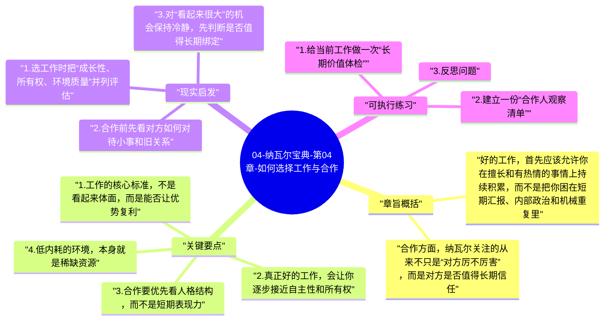

# 04-纳瓦尔宝典-第04章-如何选择工作与合作

这一章把前面关于财富、特定知识、杠杆和判断力的原则，进一步落到现实世界里最难的两件事上：选工作和选合作对象。很多人职业上看似很努力，实际上长期结果并不理想，问题往往不在个人不够拼，而在于进入了错误环境、接受了不匹配激励，或者与不值得长期同行的人绑定过深。

纳瓦尔在这一章反复强调，职业质量不能只用收入衡量，因为工作不仅决定你今天怎么赚钱，也决定你正在变成什么样的人。环境会塑造习惯，合作关系会塑造判断力，激励机制会塑造行为边界。选错方向，努力可能只是让错误累积得更快。

## 章旨概括

好的工作，首先应该允许你在擅长和有热情的事情上持续积累，而不是把你困在短期汇报、内部政治和机械重复里。真正值得长期投入的职业路径，通常具备几个共同特征：能积累特定知识，能形成外部可见作品或信誉，能逐步接近所有权和更大自主性，并且和你的性格、价值观及长期目标相容。

合作方面，纳瓦尔关注的从来不只是“对方厉不厉害”，而是对方是否值得长期信任。能力可以补，资源可以找，性格结构和时间视角却很难在短期内被修正。与错误的人合作，往往不是少赚一点钱那么简单，而是会消耗时间、信誉、情绪和机会成本。

## 关键要点

### 1. 工作的核心标准，不是看起来体面，而是能否让优势复利

很多人在选择工作时，会本能地优先考虑薪资、头衔、公司名气或外部评价。这些因素当然有现实意义，但如果一个岗位无法让你持续积累真正重要的能力，即便短期条件很好，也可能只是高配版的时间交换。长期看，职业质量更应该由“是否形成优势复利”来判断。

所谓优势复利，指的是你在这份工作里投入越多，越能沉淀专业判断、解决复杂问题的经验、行业理解、作品、声誉和长期关系。如果做了几年之后，你依然很难说明自己到底积累了什么别人难以替代的东西，那么这份工作很可能只是让你熟练，却没有让你变强。

### 2. 真正好的工作，会让你逐步接近自主性和所有权

纳瓦尔一直反对只盯着“工资”看职业，因为工资再高，本质上仍是用时间换钱的机制。一个更成熟的视角是问：这份工作会不会让我逐渐拥有更强议价权、更大决策空间、更明确的成果归属和更高质量的长期回报。所谓所有权，不一定一开始就是股权，也可以是作品署名、客户资源、行业声誉、品牌积累或独立做事能力。

当一个岗位既能学习又能积累所有权，它就更容易成为复利起点。相反，如果一份工作要求你持续高压投入，却让所有成果都停留在组织内部、无法沉淀为你的长期资产，那么你获得的可能只是眼前稳定，而不是未来自由。

### 3. 合作要优先看人格结构，而不是短期表现力

在现实合作中，人很容易被聪明、强势、表达有感染力的人吸引。但纳瓦尔更看重的是更深层的东西：这个人是否讲信用，是否愿意长期博弈，是否在压力下仍能守住边界，是否低戏剧化、少内耗、能稳定处理分歧。这些特质在合作初期不一定最耀眼，却决定了关系能不能走远。

很多失败合作不是因为方向不好，而是因为参与者时间视角不同。有些人只想抓住眼前收益，愿意为了局部利益透支关系；另一些人则把信誉当作长期资产，宁可短期少拿一点，也要把事情做扎实。两种人放在一起，几乎注定会在关键时刻分裂。

### 4. 低内耗的环境，本身就是稀缺资源

除了薪资和成长空间，工作环境还需要看一个常被低估的指标：内耗程度。频繁的组织政治、信息不透明、目标反复摇摆、责任边界模糊，都会持续吞掉人的注意力。人在这样的环境里，即便技能在提升，也很难保持长期稳定输出，因为大量精力都被防御、猜测和协调消耗掉了。

纳瓦尔会倾向于选择那些说话直接、标准清晰、价值交换透明、能让人专注做事的环境。一个低戏剧化、信任基础好的团队，不仅效率更高，也更有利于个人判断力成熟，因为你不需要把大脑长期用在防范混乱上。

### 5. 选错游戏时，及时止损比硬撑更重要

长期主义常被误解为“无论如何都坚持”，但纳瓦尔并不鼓励在明显错误的环境里耗损自己。真正的长期主义，是在方向正确时给予足够时间，在方向错误时尽快退出。区别就在于：这件事是暂时难，还是底层逻辑就不对；这段合作只是磨合期，还是价值观和激励机制根本不一致。

如果一个工作长期让你远离擅长领域、看不到积累路径、没有可信任伙伴、只有越来越重的疲惫感，那么继续坚持未必是成熟，反而可能是在延长沉没成本。

## 现实启发

### 1. 选工作时把“成长性、所有权、环境质量”并列评估

现实决策里，收入当然不能忽略，但把收入放在唯一位置，会使判断非常短视。更好的方式是同时评估三个维度：这份工作能让我长出什么能力，它是否给我未来更大的自主性或成果归属，以及我每天所处的环境是否足够健康和高效。三者平衡得越好，长期越可能值得投入。

### 2. 合作前先看对方如何对待小事和旧关系

一个人的长期可信度，往往体现在细节上。对承诺的履行、对错误的承担、对过去合作伙伴的评价、对边界和分工的尊重，这些都比公开场合的漂亮表达更能说明问题。尤其在重要合作里，最好通过小项目先验证，而不是一开始就把大量资源和信誉押上去。

### 3. 对“看起来很大”的机会保持冷静，先判断是否值得长期绑定

有些机会表面上资源丰富、节奏很快、声量很大，但如果激励机制短期化、团队价值观混乱，进入之后反而可能把人拖进高损耗循环。真正值得做的，不只是当下看起来热闹，而是未来几年仍然会感谢今天的选择。

## 可执行练习

### 1. 给当前工作做一次“长期价值体检”

从五个维度给自己打分：是否积累特定知识、是否产生外部可见成果、是否接近所有权、团队是否低内耗、合作关系是否长期可信。分数不需要绝对准确，但能帮助你识别问题究竟出在能力、平台还是环境。

### 2. 建立一份“合作人观察清单”

清单可以包括：是否守时守约、是否愿意承担责任、是否在利益面前改变说法、是否能坦诚沟通分歧、是否尊重长期信誉。把它用于小范围合作验证，远比事后补救更划算。

### 3. 反思问题

你现在最重要的工作或合作关系，究竟是在放大你的优势，还是在不断消耗你的注意力与判断力？如果继续维持三年，你会更强还是更疲惫？

---

## Mermaid 思维导图

### 图1

