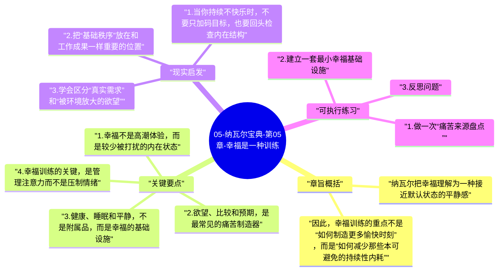

# 05-纳瓦尔宝典-第05章-幸福是一种训练

从这一章开始，全书的重心从外部世界的财富与选择，逐渐转向内部世界的秩序与平静。纳瓦尔的观点很有辨识度：幸福不是一连串目标实现后的终极奖赏，也不是外部条件凑齐时自然掉下来的结果，而是一种可以被训练、被维护、也会被破坏的内在能力。

这章真正有冲击力的地方在于，它把很多人默认的生活逻辑反过来了。很多人认为，先足够成功、足够安全、足够被认可，之后才有资格谈幸福；纳瓦尔则认为，如果一个人的心智结构没有经过训练，那么即便条件越来越好，他也会用新的欲望、新的比较和新的担忧继续制造痛苦。外部拥有更多，并不会自动带来内部安稳。

## 章旨概括

纳瓦尔把幸福理解为一种接近默认状态的平静感。它不等于持续兴奋，也不等于对现实没有要求，而是在不必要的心理噪音减少之后，人自然能体验到的清明、稳定和满足。阻碍幸福的，不只是现实困境，更是过量欲望、比较心、错误预期、对未来的反复担忧，以及对过去的执拗纠缠。

因此，幸福训练的重点不是“如何制造更多愉快时刻”，而是“如何减少那些本可避免的持续性内耗”。这是一种相对朴素但很强大的转变：从向外索取更多，转为管理自己的注意力、预期和反应模式。

## 关键要点

### 1. 幸福不是高潮体验，而是较少被打扰的内在状态

很多人把幸福理解成高强度的快乐感受，于是不断追求刺激、奖励和阶段性成就。但纳瓦尔更接近一种减法思路。他所说的幸福，不是每一天都兴奋满足，而是你没有长期处在恐惧、焦躁、怨恨、嫉妒和自我拉扯之中。换句话说，幸福更像底噪降低后的安静，而不是不断制造新的高潮。

这种理解很重要，因为它会改变人的策略。如果你以为幸福来自更多刺激，那么你的生活会越来越依赖外部输入；如果你意识到幸福更像稳定状态的恢复，你就会把重点放在睡眠、身体、关系、注意力、节奏和欲望管理上。

### 2. 欲望、比较和预期，是最常见的痛苦制造器

纳瓦尔经常说，欲望是与不满足打包出售的。你拥有一个强烈欲望的同时，也在签收相应的焦虑、等待、落空和比较。如果一个人没有看见这一点，就会本能地相信：只要再得到一点，就会好起来。结果是欲望不断更新，满足感却非常短暂。

比较心会进一步放大这个循环。很多原本普通的需求，一旦放进社会比较环境里，就会变成高压任务。你想要的未必真是那个结果，而是那个结果所代表的身份感和优越感。预期也是类似机制，现实之所以令人痛苦，很多时候不是因为它绝对糟，而是因为它没有符合我们提前编好的剧本。

### 3. 健康、睡眠和平静，不是附属品，而是幸福的基础设施

这一章一个非常务实的部分，是纳瓦尔始终把身体状态放在极高优先级。很多人谈幸福时喜欢直接进入哲学层面，但现实里，睡眠不足、长期疲劳、饮食混乱、身体炎症、持续高压，本身就会显著扭曲人的情绪与判断。一个长期失眠的人，很难靠纯意志维持稳定幸福感。

同样，高质量关系与平静的生活节奏也属于基础设施。它们未必像事业成就那样耀眼，却决定了你每天的心理背景音。幸福往往不是由某件大事带来，而是由一整套稳定支撑系统托住。

### 4. 幸福训练的关键，是管理注意力而不是压制情绪

训练幸福，并不意味着假装积极或强迫自己乐观。纳瓦尔更强调的是对心智过程的觉察能力：我现在在想什么，我为什么会陷入这类念头，我的注意力是不是又被欲望、比较、幻想和恐惧抓走了。一个人越能观察自己的心理活动，越不容易被每一个情绪瞬间拖着跑。

这也是为什么冥想、独处、散步、写日记、降低信息噪音等方法会有价值。它们并不神秘，本质上是在帮助你把注意力从外界牵引中收回来，让反应速度变慢，让念头和行动之间出现一点空间。

### 5. 幸福与成就并不矛盾，但成就不能替代幸福能力

很多人会担心，一旦减少欲望、追求平静，是不是就会失去进取心。纳瓦尔的意思并不是反对成长，而是反对把所有价值感都绑在结果上。一个人当然可以有目标、想创造更多价值、想做更重要的事，但如果他的情绪稳定性完全依赖外部结果，他就会活在持续紧张里。

更成熟的状态，是既能投入目标，也不把自我价值完全押在成败上。这样的人往往反而更稳定，因为他不是靠焦虑驱动，而是靠清醒和内在一致性驱动。

## 现实启发

### 1. 当你持续不快乐时，不要只加码目标，也要回头检查内在结构

很多人情绪低落时的第一反应，是再给自己安排一个新目标，仿佛只要解决当前外部问题，幸福就会回来。但如果根源是长期比较、错误预期、睡眠崩坏或信息过载，那么增加目标只会让系统更紧。与其继续加码，不如先排查真正的干扰源。

### 2. 把“基础秩序”放在和工作成果一样重要的位置

规律作息、适度运动、干净饮食、稳定关系、安静独处时间，这些看起来很普通，却是幸福感最现实的承载面。尤其对长期高压工作者来说，如果这些底层秩序长期失守，即便工作上不断拿到成果，主观体验也可能越来越差。

### 3. 学会区分“真实需求”和“被环境放大的欲望”

并不是所有想要的东西都值得追。很多所谓目标，只是在特定环境里被不断暗示之后形成的反射性欲望。越能识别这种差别，越能把时间和精力还给真正重要的事情。

## 可执行练习

### 1. 做一次“痛苦来源盘点”

把最近一个月反复让你不舒服的事情列出来，然后分别判断它更接近现实问题、错误预期、社会比较、信息过载，还是身体状态失衡。这个动作能帮助你看见：很多痛苦并不是客观事实本身造成的，而是被某种心理机制放大了。

### 2. 建立一套最小幸福基础设施

不需要一次做很多，只选三件最重要的事，例如固定睡眠时间、每天二十分钟步行、睡前不刷高刺激信息、每周留出半天安静时间。幸福训练不是靠豪华仪式，而是靠能长期坚持的基础秩序。

### 3. 反思问题

你最近最执着的一个目标，如果暂时拿不到，它究竟会影响什么？是会真正破坏你的长期生活，还是只是让你的自我评价受挫？把这两者分开，往往能显著降低焦虑。

---

## Mermaid 思维导图

### 图1

