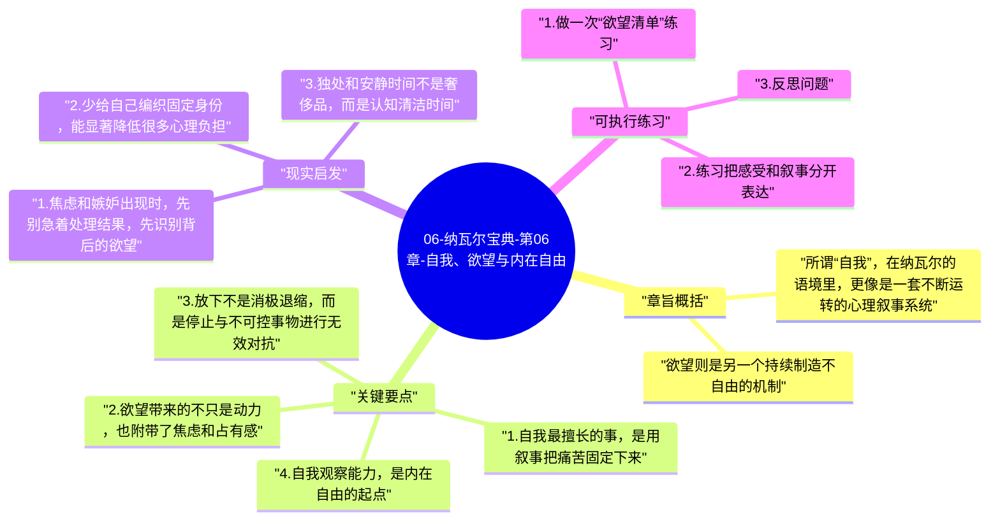

# 06-纳瓦尔宝典-第06章-自我、欲望与内在自由

如果说上一章讨论的是如何训练幸福，那么这一章更进一步，开始追问幸福为什么会反复被破坏。纳瓦尔把很多持续性痛苦都归结到两个深层来源上：一是对“自我故事”的过度认同，二是对欲望链条的无意识跟随。只要这两个结构不被看见，人就会不断用新的目标、新的解释、新的比较，为自己制造下一轮不安。

这章的难点在于，它不再只是给出行为建议，而是在挑战一种更深的生活习惯：我们几乎默认自己就是脑海里的念头、情绪和叙事本身。纳瓦尔想做的，是让人从这种自动认同里后退半步。不是否定自我和欲望的存在，而是学会不被它们完全占据。

## 章旨概括

所谓“自我”，在纳瓦尔的语境里，更像是一套不断运转的心理叙事系统。它会解释过去、想象未来、维护身份、比较高低，并且习惯把一切体验都拉回“这对我意味着什么”。这种能力在现实中有功能，但一旦失控，就会把很多普通经历都加工成压力、委屈、嫉妒、恐惧和执念。

欲望则是另一个持续制造不自由的机制。欲望本身并不邪恶，人需要目标、偏好和行动方向；问题在于，如果一个人没有觉察自己正在被什么欲望驱动，他就会默认“想要 = 必须得到”“得不到 = 我不完整”。真正的内在自由，不是永远没有欲望，而是有能力看见欲望、评估欲望，并在冲动和行动之间保留选择空间。

## 关键要点

### 1. 自我最擅长的事，是用叙事把痛苦固定下来

现实里很多负面情绪本来只是短暂波动，但一旦进入自我叙事，就会被拉长、放大并合理化。例如一次被忽视，可能迅速被解释为“我不被尊重”；一次失败，可能被扩展成“我就是不行”；别人的进展，也可能被翻译成“我又落后了”。自我不是简单记录事实，而是在持续为事实附加意义。

这种叙事能力之所以危险，是因为它常常带着强烈的主观确定感。人会误以为自己只是在如实描述现实，实际上却是在被自己制造的故事困住。纳瓦尔提醒的正是这一点：很多痛苦并不完全来自事件本身，而来自你对事件的持续解释。

### 2. 欲望带来的不只是动力，也附带了焦虑和占有感

一个欲望一旦被你强烈认同，它就会自动附带几样东西：对结果的等待、对落空的恐惧、对得到之后的短暂上瘾，以及对失去的持续担忧。这就是为什么满足欲望往往并不能真正终结痛苦，它只是把痛苦从“想得到”转移成“怕失去”，或者干脆升级成新的欲望。

纳瓦尔并不是让人完全放弃追求，而是提醒人正视欲望的成本。每增加一个强烈执着，就等于给自己的心理系统再加一个不稳定源。如果没有判断和节制，欲望越多，心就越散。

### 3. 放下不是消极退缩，而是停止与不可控事物进行无效对抗

很多人把“放下”理解成软弱或不作为，仿佛只要还想过得更好，就不能谈接纳。但纳瓦尔更接近一种现实主义态度：你当然可以行动、努力和改变能改变的部分，但没有必要把不可控的事情也强行纳入掌控幻觉。越是试图控制每一件事，人越容易陷入挫败和愤怒。

放下的价值，不在于让人失去行动，而在于把能量从无效内耗中释放出来。你不再需要为每个评价辩解，不再需要为每次波动过度解释，也不再把所有结果都当作自我证明的战场。这恰恰会让行动更干净。

### 4. 自我观察能力，是内在自由的起点

一个人什么时候最不自由？往往不是被外界强迫的时候，而是他明明在被情绪、冲动、嫉妒、欲望拖着走，却完全没有觉察。自我观察能力的重要性就在这里。只要你能在某个念头刚出现时意识到“我又开始比较了”“我现在是因为害怕失去才这么执着”“这不是事实，只是我的解释”，你就已经不再完全等同于那个念头。

这种能力不会一夜形成，它需要通过冥想、独处、书写和反复自我提问来慢慢建立。但一旦形成，人对自己内在世界的关系就会改变：不是彻底消灭情绪，而是学会不让情绪直接接管行动。

### 5. 内在自由的本质，是把选择权拿回到意识层面

纳瓦尔谈自由时，并不只指财务自由或时间自由。他更关心一种更细微的自由：你是不是非得满足某种欲望才能安心，是不是非得赢得某种比较才觉得自己有价值，是不是非得控制外部局面才能维持稳定。如果答案总是“是”，那说明你依然被外物高度绑定。

真正的自由不是拥有无限可能，而是即便外部世界并不完美，你仍然有能力不把自己交给每一个冲动和评价。这种自由听起来很安静，但它会深刻影响一个人的幸福能力和决策质量。

## 现实启发

### 1. 焦虑和嫉妒出现时，先别急着处理结果，先识别背后的欲望

很多情绪之所以难化解，是因为人总在处理表面事件，而没有看见背后的欲望结构。比如嫉妒往往不只是“别人比我好”，而是“我也想要那个位置、那个认可、那个生活”。一旦看见真正的欲望，情绪就不再那么模糊，你才能判断它是否值得追、代价是什么。

### 2. 少给自己编织固定身份，能显著降低很多心理负担

如果一个人过度认同某个身份标签，比如“我必须一直优秀”“我不能犯错”“我必须被看作成熟的人”，那么任何偏离标签的经历都会引发强烈痛苦。适当松动这些叙事，会让人更灵活，也更能面对真实变化。

### 3. 独处和安静时间不是奢侈品，而是认知清洁时间

在持续被信息、社交和反馈填满的环境里，人很容易分不清哪些想法来自自己，哪些只是外界刺激留下的回响。固定的独处时间，能帮助大脑从外界输入里退出，重新看见哪些欲望是真实的，哪些叙事只是惯性。

## 可执行练习

### 1. 做一次“欲望清单”练习

把你当前最强烈的五个欲望写下来，然后分别回答三个问题：我为什么想要它；得不到它我最害怕什么；即便得到它，我还会担心什么。这个练习不是为了否定欲望，而是为了看清它带来的整套心理成本。

### 2. 练习把感受和叙事分开表达

下次遇到强烈情绪时，先尝试只描述事实，再描述感受，最后才描述解释。比如不是直接说“他们不尊重我”，而是先说“会议中我的意见没有被回应，我感到愤怒和失落，我脑子里出现了‘我不被重视’的解释”。这种分层表达有助于减少自我叙事的自动绑架。

### 3. 反思问题

你现在最放不下的一件事，如果不是因为面子、比较、身份或控制欲，它还会同样重要吗？这个问题往往能让很多执念露出真正的来源。

---

## Mermaid 思维导图

### 图1

