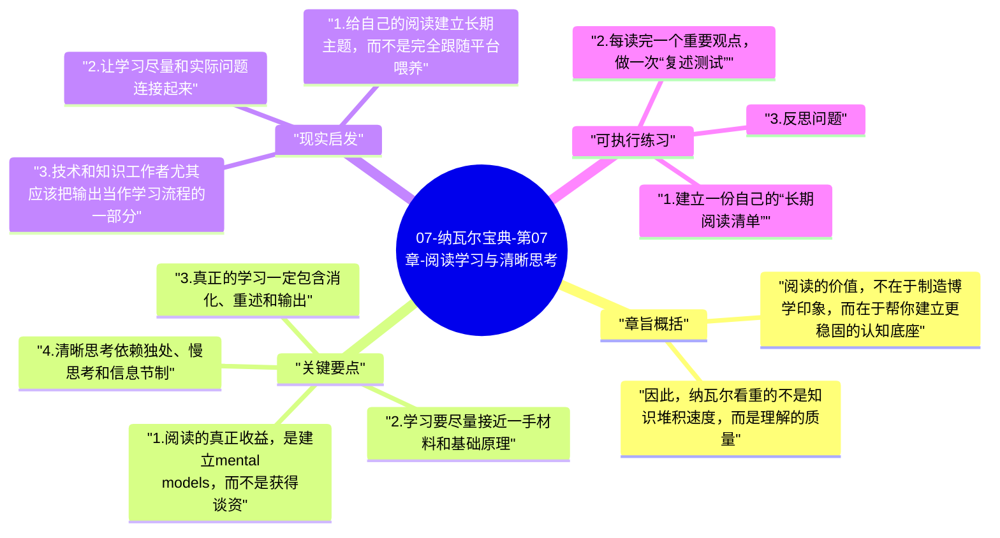

# 07-纳瓦尔宝典-第07章-阅读学习与清晰思考

纳瓦尔一直把阅读和独立思考视为回报极高的长期投资，因为判断力并不是凭空长出来的，它需要足够多的高质量输入、足够深的消化过程，以及把知识转化为内在模型的能力。这一章讨论的表面主题是学习方法，底层主题其实是认知质量：你究竟是在收集信息，还是在构建能穿透复杂现实的思维框架。

在信息过载时代，这一章尤其重要。人很容易误把“看过很多内容”当成“真正学会了”，也很容易把快速浏览、观点转发、课程收藏当成成长本身。纳瓦尔在这里强调的，恰恰是与这种环境相反的学习方式：读得慢一点、深一点、基础一点，少受热点牵引，多建立自己的理解系统。

## 章旨概括

阅读的价值，不在于制造博学印象，而在于帮你建立更稳固的认知底座。好的阅读会增加模型、扩大参照系、提升分辨力，让你在面对复杂问题时，不必只依赖情绪和流行观点做判断。学习如果不能转化为更清楚的思考、更准确的问题意识和更成熟的决策，它就仍停留在表层输入阶段。

因此，纳瓦尔看重的不是知识堆积速度，而是理解的质量。他偏爱基础学科、经典文本和一手思想，是因为这些内容更接近事物的底层规律，不容易随着舆论周期迅速失效。学习的最终产物，不是背下多少结论，而是形成一套能自己推理、自己验证、自己修正的思考结构。

## 关键要点

### 1. 阅读的真正收益，是建立 mental models，而不是获得谈资

许多人读书时最在意的是“我学到了什么新观点”，但纳瓦尔更在意“我是否因此多了一种理解世界的模型”。观点常常是碎片化的，今天有用，明天就可能被新的说法替代；模型则更像一套可迁移的认知工具，它能帮助你在不同场景下识别本质、看清因果、做出更稳的判断。

这也是为什么一些看起来不够“实用”的基础学科，长期回报反而很高。物理、数学、进化论、经济学、逻辑学和哲学，并不总能立刻回答当下问题，但它们会不断训练你用更清楚的方式理解系统、约束、激励、概率和人性。

### 2. 学习要尽量接近一手材料和基础原理

二手总结和短视频速读并非完全没有价值，但它们有一个明显问题：往往已经替你做了大量删减、解释和立场加工。你接触到的不是原始思考，而是别人的理解版本。对于简单入门可以接受，但如果长期依赖，就容易在不知不觉中失去独立判断。

纳瓦尔更推崇去读经典著作、原始论文、真正有思想密度的人写下的长文本，因为这些材料更接近问题的根部。它们可能更难，也更慢，但正因为难，才会逼着你建立自己的理解，而不是只消费别人包装好的结论。

### 3. 真正的学习一定包含消化、重述和输出

很多人读完一段内容后，会产生“我懂了”的感觉，但这种感觉经常是不可靠的。只有当你尝试把它重新讲出来、写出来、用于分析现实问题时，才会发现理解有没有真正扎根。纳瓦尔重视清晰表达，本质上也是因为表达会暴露思维的含混之处。

一旦你发现自己解释不清一个观点，往往不是表达能力差，而是理解本身还没有到位。这个时候返回去重读、拆解、对照现实验证，学习才算真正开始。输出不是附属动作，而是内化的重要环节。

### 4. 清晰思考依赖独处、慢思考和信息节制

学习并不是不停摄入，而是让输入经过充分处理之后成为自己的认知结构。这个过程需要安静和留白。持续被消息流、短内容和即时反馈打断的人，很难维持足够长的思考链条，也很难让多个概念在脑中发生稳定连接。

纳瓦尔推崇阅读和思考，某种程度上也是在反对被环境过度牵引。只有当一个人能与信息噪音拉开距离，他才能知道自己到底在想什么，而不只是平台和算法让他想什么。

### 5. 学会如何学习，比囤积课程和证书更重要

学校式学习常常让人习惯于外部安排：别人给教材、给考试、给标准答案，你只需要沿着结构完成即可。但成年后的高价值学习，往往没有这么清晰的路线图。你需要自己决定学什么、为什么学、如何验证是否学会，以及如何把知识接到现实问题上。

这就是纳瓦尔强调自我教育的重要原因。未来真正稀缺的，不是获得信息的机会，而是把海量信息筛选、组织、验证并转化为判断力的能力。会学习的人，会随着时间越来越强；不会学习的人，即使接触再多内容，也可能长期停留在表面兴奋。

## 现实启发

### 1. 给自己的阅读建立长期主题，而不是完全跟随平台喂养

如果阅读内容全部由外部推荐决定，人就很容易陷入碎片和热点循环。更有效的方式，是围绕几个长期主题持续读下去，例如系统设计、认知心理学、经济学原理、历史中的决策模式、某一技术栈的底层机制。主题一旦稳定，阅读就更容易积累成结构，而不是留下一堆零散印象。

### 2. 让学习尽量和实际问题连接起来

很多内容之所以转化率低，不是它不重要，而是没有接上现实场景。读到一个观点时，最好立刻追问：它能解释我最近遇到的哪个问题；它会改变我做什么判断；我能不能用自己的话写一段总结。只有把知识放进现实，理解才会变得立体。

### 3. 技术和知识工作者尤其应该把输出当作学习流程的一部分

写笔记、画结构图、做实验、写博客、整理文档、录解说视频，本质上都不是额外负担，而是帮助知识定型的方式。越是复杂的主题，越需要通过输出把隐性理解显化出来。

## 可执行练习

### 1. 建立一份自己的“长期阅读清单”

从三个维度各选两本或两个主题：基础原理类、专业深化类、拓展视角类。不要追求数量，关键是连续性。连续阅读同一主题六个月，通常比随机看几十篇文章更能改变认知结构。

### 2. 每读完一个重要观点，做一次“复述测试”

合上书，用自己的话写下这个观点在说什么、为什么重要、适用在什么场景、哪里可能不适用。如果写不出来，就说明理解还停留在识别层，而没有进入掌握层。

### 3. 反思问题

你最近摄入的大量信息里，有多少真正改变了你的判断方式？如果很少，问题可能不在信息不够，而在缺少筛选、深读和输出环节。

---

## Mermaid 思维导图

### 图1

