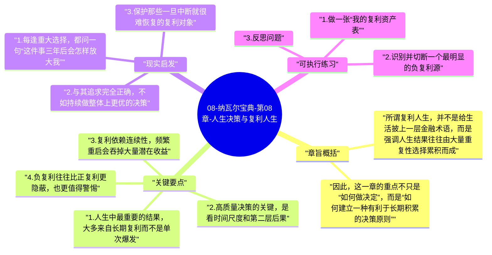

# 08-纳瓦尔宝典-第08章-人生决策与复利人生

全书走到最后，纳瓦尔想表达的核心其实可以浓缩成一句话：让人生进入复利轨道。前面谈财富，是为了获得更大选择权；谈杠杆，是为了让能力被放大；谈判断力，是为了做对少数关键选择；谈幸福和自由，是为了让人不被内耗拖垮。所有这些最终都指向一个问题：你有没有在经营一个会随着时间变得更好的自己和人生结构。

这也是“复利人生”真正吸引人的地方。它不是鼓励人变得极端高效，而是提醒人注意很多成果都不是线性出现的。健康、知识、关系、信誉、资本、作品和内在稳定性，往往都带有明显的延迟回报特征。前期看似普通，长期却会拉开巨大的差距。反过来，坏习惯、错误合作、持续透支、短期主义决策也会以负复利方式不断累积。

## 章旨概括

所谓复利人生，并不是给生活披上一层金融术语，而是强调人生结果往往由大量重复性选择累积而成。真正重要的不是某一次短期爆发，而是你有没有把健康、认知、职业方向、合作关系和生活秩序放在能越滚越大的轨道上。人一旦进入良性复利系统，很多事情会越做越轻松；如果陷入负复利系统，即便短期看起来没问题，时间久了也会越来越难修复。

因此，这一章的重点不只是“如何做决定”，而是“如何建立一种有利于长期积累的决策原则”。这要求人既能看清眼前利益，也能看见第二层、第三层后果；既能有耐心，也能在错误方向上及时调整；既能专注少数关键事项，也能抵抗无意义的切换和比较。

## 关键要点

### 1. 人生中最重要的结果，大多来自长期复利而不是单次爆发

大部分有分量的成果都不是靠某一次灵光乍现得到的。健康来自长期作息和训练，知识来自持续阅读与实践，关系来自反复兑现的信任，声誉来自长期稳定交付，财富来自长期积累资产和高质量决策。这些东西的共同点是：短期很难制造戏剧性变化，但时间一长，会形成难以逆转的优势。

这意味着，人生策略不应该过度迷信短期翻盘叙事。真正成熟的人生设计，更像是在管理一系列缓慢但强大的积累过程。把注意力放回这些可复利对象，人会更稳定，也更不容易被短期噪音牵着走。

### 2. 高质量决策的关键，是看时间尺度和第二层后果

很多决策之所以事后后悔，不是因为当时不知道更多信息，而是因为只看到了第一层结果。比如一份高薪工作，第一层结果是收入增加，第二层可能是学习停滞、健康透支和时间被完全锁死；一个短期讨好关系的决定，第一层结果是避免冲突，第二层可能是长期边界被侵蚀。

纳瓦尔推崇的判断方式，是尽量把时间尺度拉长，把第二层、第三层影响一起考虑。越重要的问题，越不能只看眼前回报。很多人生分水岭，正是由这种看远一点的能力决定的。

### 3. 复利依赖连续性，频繁重启会吞掉大量潜在收益

很多人看起来很忙，实际却没有什么积累，一个重要原因就是太容易频繁重启。今天追一个方向，明天换一个工具，后天又被新的机会吸走，结果每件事都只碰到前期最艰难、回报最低的阶段。复利最怕的不是慢，而是反复中断。

这并不意味着永远不能转向，而是说每一次切换都应该有足够强的理由。否则，人生会被迫不断支付学习成本、信誉重建成本和心理波动成本，难以进入真正的滚雪球状态。

### 4. 负复利往往比正复利更隐蔽，也更值得警惕

人们通常更容易想象资产增值，却不太容易意识到坏东西也在复利。长期熬夜、持续分心、反复妥协边界、用焦虑驱动工作、和不可信的人绑定、在错误赛道上硬撑，这些都可能不会立刻出大问题，但会一点点侵蚀未来几年的人生质量。

真正成熟的决策，不只是追求增加什么，也包括果断减少什么。少做错误的事，本身就是一种强大的复利策略。

### 5. 最好的复利系统，是让外部成果和内部状态互相支撑

纳瓦尔的完整框架之所以有力量，在于它没有把财富和幸福割裂。一个外部成果不断增长、内部却越来越混乱的人，并不是真的在经历良性复利；同样，一个只追求内心平静、却完全不经营现实选择权的人，也很难长期稳定。更理想的状态是：财富提升自由，自由保护判断力，判断力帮助做对选择，幸福和内在自由又让你更能持续积累。

一旦这几个系统彼此支持，人生就会呈现出一种稳固感。你不是靠单点爆发维持，而是靠结构本身在变好。

## 现实启发

### 1. 每逢重大选择，都问一句“这件事三年后会怎样放大我”

无论是换工作、接项目、建立合作还是学习新方向，都可以把问题从“它现在看起来划不划算”改成“它会不会在未来几年持续放大我的能力、信誉、关系和选择权”。这个问题很简单，却能过滤掉很多只解决眼前焦虑的决策。

### 2. 与其追求完全正确，不如持续做整体上更优的决策

没有人能保证每一次都选对。真正重要的是建立一种长期上更优的决策习惯：少做明显伤害长期利益的事，多选择具有复利结构的事，在犯错后能及时复盘并修正。只要这个系统稳定，你的整体人生轨迹就会越来越好。

### 3. 保护那些一旦中断就很难恢复的复利对象

健康、信誉、亲密关系和深度专注能力，都是脆弱但高价值的复利对象。它们不像某些工作指标那样能迅速补回来，一旦严重受损，修复成本很高。因此，很多看似“理所当然”的透支，其实是在牺牲未来非常昂贵的部分。

## 可执行练习

### 1. 做一张“我的复利资产表”

把健康、知识、作品、关系、声誉、资本、内在稳定感分别列出来，给每一项打分：我现在是在正复利、停滞，还是负复利。这个表最大的价值不在分数，而在于逼你承认哪些部分正在被忽视。

### 2. 识别并切断一个最明显的负复利源

它可以是长期熬夜、信息过载、总接低质量合作、反复切换任务、对边界过度妥协，也可以是某种持续性的自我消耗。选一个最明显的负复利点，在接下来一个月里专门做减法。很多时候，人生改善不是从增加更多开始，而是从停止错误开始。

### 3. 反思问题

如果把你现在每天的时间分配和决策习惯完整延续五年，它会把你带到哪里？这个问题往往比任何愿景口号都更诚实。

---

## Mermaid 思维导图

### 图1

