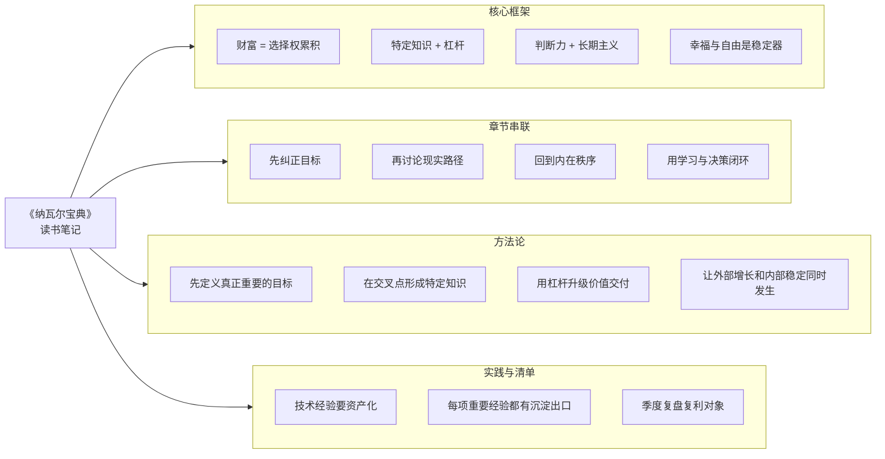

# 《纳瓦尔宝典》读书笔记

完整分章入口见 [00-纳瓦尔宝典-目录索引.md](./00-纳瓦尔宝典-目录索引.md)，适合先读本页把握整体框架，再按章节展开细读。

《纳瓦尔宝典》并不是一本按严密学术体系写成的理论书，而更像一份经过整理的长期思考清单。它把财富、杠杆、判断力、幸福、自我、学习和人生决策这些看似分散的话题串在一起，核心想回答的是同一件事：一个人怎样既活得更自由，又活得更清醒。

这也是它容易被误读的原因。如果只挑几句金句来看，它像成功学；如果把各章放回完整结构里看，就会发现它讨论的其实是“如何建立一个长期可复利的人生系统”。对我来说，这本书最大的价值不是提供答案，而是逼人重新整理自己的目标排序、努力方向和内在秩序。

## 一、核心框架

### 1. 财富不是收入标签，而是选择权的累积

纳瓦尔先把“财富、金钱、地位”拆开，这一步非常关键。财富对应的是能脱离个人时间而持续创造价值的资产结构，金钱是交换媒介，地位则是比较游戏。这个区分一旦清楚，很多职业和人生选择就会重新排序。真正该追求的不是看起来赢，而是逐步拥有更大的自由度和更少被迫妥协的处境。

### 2. 特定知识决定价值密度，杠杆决定价值放大倍数

财富不会仅靠勤奋自然产生，它需要“独特能力 + 放大机制”的组合。特定知识来自个人兴趣、天赋、经验和长期实践的交叉点，难以被标准化复制；杠杆则让一次高质量投入能够被更多人反复消费和使用。代码、媒体、资本、所有权，本质上都在解决同一个问题：如何让个人产出越过时间上限。

### 3. 判断力决定方向，长期主义决定结果能否显现

纳瓦尔特别强调，真正拉开差距的不是所有努力总量，而是少数关键选择的质量。判断力让人知道什么值得做，长期主义让人愿意把正确的事做得足够久。前者解决“方向”，后者解决“持续性”，两者叠加，才有可能让复利发生。

### 4. 幸福、自由与清晰思考，是整个系统的稳定器

如果只有财富与效率，没有内在秩序，一个人很可能在外部积累增加的同时，内部越来越失衡。纳瓦尔把幸福定义为可训练的能力，把内在自由定义为不再被欲望和自我叙事完全控制，把阅读和清晰思考定义为判断力的燃料。换句话说，内在系统不是附属主题，而是外部成长能否持续的保障。

## 二、章节串联

### 第 01 章到第 02 章：先纠正目标，再讨论路径

整本书的第一步不是教人怎么赚钱，而是先纠正“要追什么”。第 01 章把财富、金钱和地位拆开后，第 02 章才有意义，因为一旦明白目标是积累选择权与资产，而不是只追求薪资和身份，就自然会去关心特定知识、问责制和杠杆这些真正决定长期回报的因素。

### 第 03 章到第 04 章：从宏观原则落到现实选择

知道财富逻辑之后，接下来最关键的是能不能在现实里做对决定。第 03 章强调判断力与长期主义，第 04 章则把这种判断落到工作与合作。也就是说，全书不是停在理念层，而是在不断追问：你如何选赛道，如何选伙伴，如何在复杂环境里保护长期利益。

### 第 05 章到第 06 章：从外部成就转向内部秩序

这两章是整本书很容易被低估的部分。很多读者最初是被财富和杠杆吸引进来，但真正决定人生质量的，往往是幸福能力、欲望管理和内在自由。第 05 章谈如何训练幸福，第 06 章进一步指出为什么人总会被自我叙事和欲望牵着走。这两章实际上是在提醒：如果内在系统不稳定，外部积累也可能无法转化为真正的生活质量。

### 第 07 章到第 08 章：用学习和决策把整套系统闭环

第 07 章解释判断力从哪里来，第 08 章说明这些判断如何在时间中形成复利。前者提供认知燃料，后者提供长期框架。读到这里会发现，整本书的逻辑其实很完整：先定义目标，再找到方法，然后校准心智，最后把一切放到复利时间轴上重新理解。

## 三、这本书的方法论

### 1. 先定义什么叫对你真正重要

如果不先回答“我究竟想要自由、财富、成就、安稳还是认可”，后面的努力就很容易跑偏。纳瓦尔的方法论首先要求人诚实面对自己的目标排序，而不是默认沿用社会脚本。

### 2. 在兴趣、能力和现实需求交叉处形成特定知识

方法论的第二步不是盲目追风口，而是识别自己在哪些问题上具备长期投入动力和天然优势。只有这种能力才可能真正积累成护城河。

### 3. 用所有权和杠杆把价值交付结构升级

能力本身并不足够，还需要让它接入更好的回报结构。纳瓦尔的思路非常清晰：尽量让成果可复制、可传播、可保留归属，而不是永远只停留在线性劳动阶段。

### 4. 用长期主义筛选项目、工作和关系

长期主义不是慢吞吞做事，而是用更大的时间尺度看待收益和代价。它会直接影响你选择什么工作、接受什么合作、放弃什么短期诱惑。

### 5. 用阅读、复盘和安静时间持续修正判断

判断力不会自动升级，它需要高质量输入，也需要安静消化和现实反馈。纳瓦尔强调阅读和思考，本质上是在构建一种不断自我校正的机制。

### 6. 让外部增长与内部稳定同时发生

如果方法论最终只剩下“如何更快获得结果”，那就不是纳瓦尔真正想表达的内容。他的方法论完整形态应该是：既提高外部选择权，也减少内部内耗，让成长和幸福相互支撑。

## 四、适用边界

这本书很适合知识型工作者、创业者、自由职业者、技术从业者和需要长期做复杂决策的人，因为这些群体更容易把特定知识、杠杆和长期主义转化为现实结构。但它并不是一套脱离现实约束的万能公式。对于一些处在高负担阶段、短期必须优先保障收入和稳定的人来说，书中的很多原则可能需要分阶段吸收，而不是直接照搬。

另外，纳瓦尔的表达常常非常凝练，容易给人一种“只要想通了就能做到”的错觉。现实中，很多问题并不是认知一更新就能立刻解决，它还涉及家庭责任、行业周期、资源门槛、身体状况和机会窗口。因此，我更愿意把这本书当作“校准方向的原则集”，而不是“立即套用的操作手册”。

还有一点需要提醒：纳瓦尔对幸福、欲望和自我自由的讨论很有启发，但带有明显个人哲学风格。阅读这些部分时，适合把它们当成高质量提问，而不是必须全部认同的答案。真正重要的是借这些提问看清自己，而不是把别人的价值观原封不动搬进来。

## 五、我的实践启发

对我自己所在的嵌入式、Linux、多媒体和 AI 技术学习路径而言，这本书最直接的启发有三层。第一层是重新理解“特定知识”的价值。很多底层调试经验、芯片平台差异、协议落地问题、跨模块排障方法，看起来不如通用热门技能显眼，但恰恰可能是最难被复制、最能形成长期壁垒的部分。

第二层启发是要把经验尽量资产化。单纯把问题解决掉，只完成了一次劳动；把解决过程整理成结构化笔记、调试指令、脚本、流程图、案例复盘，才是在把劳动沉淀成未来能重复发挥作用的资产。对技术工作者来说，这几乎就是最现实的代码/媒体杠杆。

第三层启发来自幸福和内在自由的部分。技术领域很容易陷入“问题一个接一个，永远不够”的节奏，如果没有稳定的作息、注意力管理和对欲望的节制，人会逐渐变成高输出但高内耗状态。纳瓦尔提醒我，长期积累不只是工作系统要复利，身体、情绪和判断力也要一起复利，否则外部收获会被内部损耗抵消。

## 六、可执行清单

### 1. 建立自己的长期能力地图

把你过去几年真正积累过、而且愿意继续深挖的主题列出来，看看哪些具备特定知识雏形，哪些只是短期跟风学习。这个动作能帮助你明确未来三到五年的主战场。

### 2. 让每一项重要经验都有沉淀出口

对我来说，这意味着把排障过程、平台差异、命令清单、实验记录和原理理解继续整理成可检索笔记。对其他人来说，也可以是博客、播客、公开项目、教程、研究卡片等。重点不是形式，而是让经验从脑内消失风险中解放出来。

### 3. 每季度复盘一次“我的复利对象有没有变好”

至少检查五项：健康、知识积累、作品资产、关键关系、内在稳定感。如果其中两三项持续恶化，就说明当前节奏可能正在制造负复利，需要及时调结构，而不是单纯继续硬扛。

## 七、相关笔记链接

- [穷查理宝典](../../投资书籍/36-穷查理宝典/读书笔记.md)
- [深度工作](../深度工作/读书笔记.md)
- [原则](../../人性与社会/原则/读书笔记.md)

## 更新记录

- 最后更新：2026-05-14

## Mermaid 结构图

