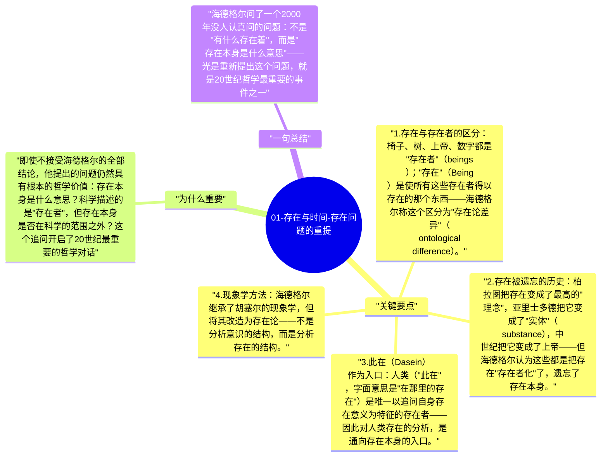

# 01-存在与时间-存在问题的重提

海德格尔的《存在与时间》开篇就提出了它的核心任务：重新提出"存在（Sein）的意义"这个问题。在他看来，西方哲学自柏拉图以来虽然研究了各种存在者（beings），却遗忘了"存在本身"（Being as such）——这个遗忘是西方形而上学最根本的问题。

## 关键要点

1. **存在与存在者的区分**：椅子、树、上帝、数字都是"存在者"（beings）；"存在"（Being）是使所有这些存在者得以存在的那个东西——海德格尔称这个区分为"存在论差异"（ontological difference）。
2. **存在被遗忘的历史**：柏拉图把存在变成了最高的"理念"，亚里士多德把它变成了"实体"（substance），中世纪把它变成了上帝——但海德格尔认为这些都是把存在"存在者化"了，遗忘了存在本身。
3. **此在（Dasein）作为入口**：人类（"此在"，字面意思是"在那里的存在"）是唯一以追问自身存在意义为特征的存在者——因此对人类存在的分析，是通向存在本身的入口。
4. **现象学方法**：海德格尔继承了胡塞尔的现象学，但将其改造为存在论——不是分析意识的结构，而是分析存在的结构。
5. **这本书的未完成性**：《存在与时间》实际上是一个未完成的计划，完成的部分只涉及前半段——海德格尔本人后来对这本书做了根本性的修正，称之为"转向"（Kehre）。

## 为什么重要

即使不接受海德格尔的全部结论，他提出的问题仍然具有根本的哲学价值：存在本身是什么意思？科学描述的是"存在者"，但存在本身是否在科学的范围之外？这个追问开启了20世纪最重要的哲学对话。

## 一句总结

海德格尔问了一个2000年没人认真问的问题：不是"有什么存在着"，而是"存在本身是什么意思"——光是重新提出这个问题，就是20世纪哲学最重要的事件之一。

---

## Mermaid 思维导图

### 图1

