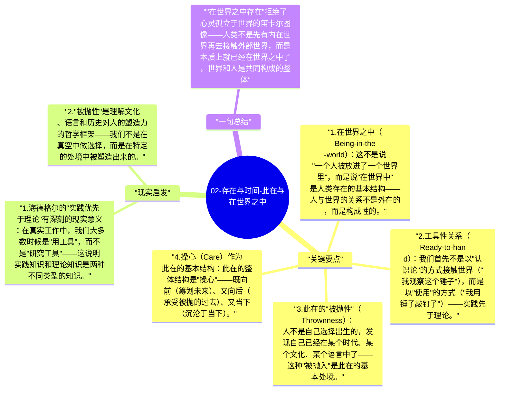

# 02-存在与时间-此在与在世界之中

海德格尔对此在（Dasein，人类存在）的分析，从"在世界之中存在"（Being-in-the-world）开始。这个概念拒绝了笛卡尔的心身二元论——人不是一个"在脑袋里"的心灵与外部世界关系，而是本质上就是"在世界之中"的存在。

## 关键要点

1. **在世界之中（Being-in-the-world）**：这不是说"一个人被放进了一个世界里"，而是说"在世界中"是人类存在的基本结构——人与世界的关系不是外在的，而是构成性的。
2. **工具性关系（Ready-to-hand）**：我们首先不是以"认识论"的方式接触世界（"我观察这个锤子"），而是以"使用"的方式（"我用锤子敲钉子"）——实践先于理论。
3. **此在的"被抛性"（Thrownness）**：人不是自己选择出生的，发现自己已经在某个时代、某个文化、某个语言中了——这种"被抛入"是此在的基本处境。
4. **操心（Care）作为此在的基本结构**：此在的整体结构是"操心"——既向前（筹划未来）、又向后（承受被抛的过去）、又当下（沉沦于当下）。
5. **共在（Being-with）**：此在本质上是与他人共在的——孤立的个人不是原初状态，而是共在的一种缺陷形态。

## 现实启发

1. 海德格尔的"实践优先于理论"有深刻的现实意义：在真实工作中，我们大多数时候是"用工具"，而不是"研究工具"——这说明实践知识和理论知识是两种不同类型的知识。
2. "被抛性"是理解文化、语言和历史对人的塑造力的哲学框架——我们不是在真空中做选择，而是在特定的处境中被塑造出来的。

## 一句总结

"在世界之中存在"拒绝了心灵孤立于世界的笛卡尔图像——人类不是先有内在世界再去接触外部世界，而是本质上就已经在世界之中了，世界和人是共同构成的整体。

---

## Mermaid 思维导图

### 图1

