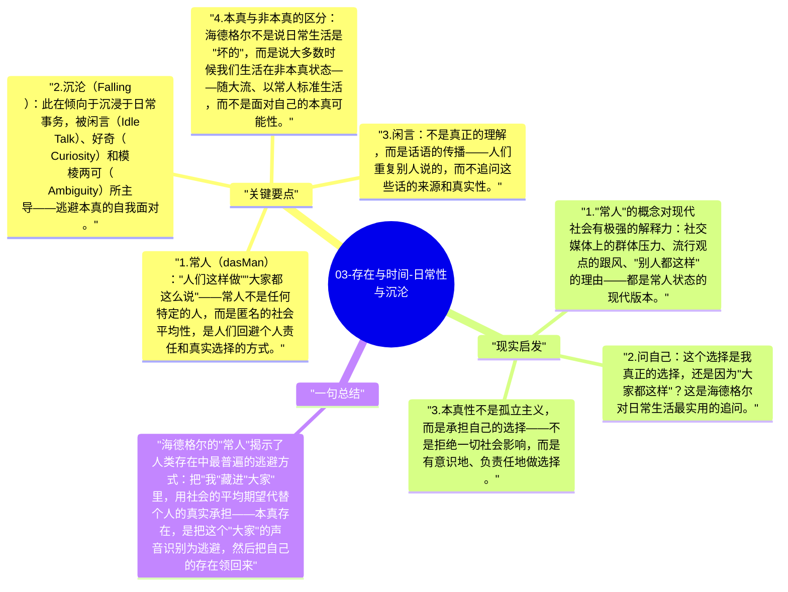

# 03-存在与时间-日常性与沉沦

海德格尔分析了此在的日常状态，发现日常中的人并不是"本真的"——大多数时候，我们以"常人"（das Man，the They）的方式存在，被社会的平均性和匿名性所吸收。

## 关键要点

1. **常人（das Man）**："人们这样做""大家都这么说"——常人不是任何特定的人，而是匿名的社会平均性，是人们回避个人责任和真实选择的方式。
2. **沉沦（Falling）**：此在倾向于沉浸于日常事务，被闲言（Idle Talk）、好奇（Curiosity）和模棱两可（Ambiguity）所主导——逃避本真的自我面对。
3. **闲言**：不是真正的理解，而是话语的传播——人们重复别人说的，而不追问这些话的来源和真实性。
4. **本真与非本真的区分**：海德格尔不是说日常生活是"坏的"，而是说大多数时候我们生活在非本真状态——随大流、以常人标准生活，而不是面对自己的本真可能性。
5. **良知的呼唤（Call of Conscience）**：此在会在某些时刻（如畏的情态中）听到"良知的呼唤"，被召唤回到本真的自我承担。

## 现实启发

1. "常人"的概念对现代社会有极强的解释力：社交媒体上的群体压力、流行观点的跟风、"别人都这样"的理由——都是常人状态的现代版本。
2. 问自己：这个选择是我真正的选择，还是因为"大家都这样"？这是海德格尔对日常生活最实用的追问。
3. 本真性不是孤立主义，而是承担自己的选择——不是拒绝一切社会影响，而是有意识地、负责任地做选择。

## 一句总结

海德格尔的"常人"揭示了人类存在中最普遍的逃避方式：把"我"藏进"大家"里，用社会的平均期望代替个人的真实承担——本真存在，是把这个"大家"的声音识别为逃避，然后把自己的存在领回来。

---

## Mermaid 思维导图

### 图1

