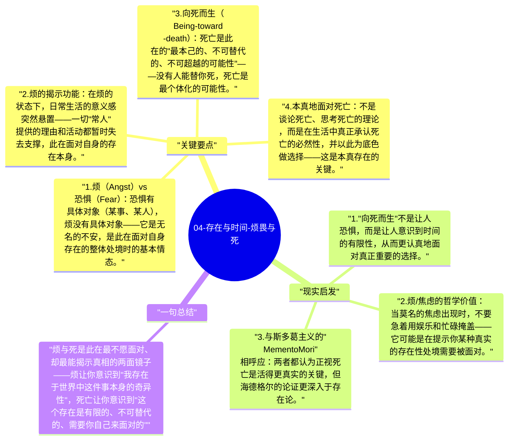

# 04-存在与时间-烦畏与死

海德格尔认为此在的基本情态包括"烦"（Anxiety/Angst）和对死亡的面对。这两者不是负面情绪，而是揭示此在真实处境的"显现者"——通过烦，此在领会到自己在世界中的被抛处境；通过面对死亡，此在获得了最本真的整体性。

## 关键要点

1. **烦（Angst）vs 恐惧（Fear）**：恐惧有具体对象（某事、某人），烦没有具体对象——它是无名的不安，是此在面对自身存在的整体处境时的基本情态。
2. **烦的揭示功能**：在烦的状态下，日常生活的意义感突然悬置——一切"常人"提供的理由和活动都暂时失去支撑，此在面对自身的存在本身。
3. **向死而生（Being-toward-death）**：死亡是此在的"最本己的、不可替代的、不可超越的可能性"——没有人能替你死，死亡是最个体化的可能性。
4. **本真地面对死亡**：不是谈论死亡、思考死亡的理论，而是在生活中真正承认死亡的必然性，并以此为底色做选择——这是本真存在的关键。
5. **存在的整体性**：正是因为有死亡作为终点，此在才能作为一个整体被把握——没有死亡，存在就只是无限漂流而没有整体意义。

## 现实启发

1. "向死而生"不是让人恐惧，而是让人意识到时间的有限性，从而更认真地面对真正重要的选择。
2. 烦/焦虑的哲学价值：当莫名的焦虑出现时，不要急着用娱乐和忙碌掩盖——它可能是在提示你某种真实的存在性处境需要被面对。
3. 与斯多葛主义的"Memento Mori"相呼应：两者都认为正视死亡是活得更真实的关键，但海德格尔的论证更深入于存在论。

## 一句总结

烦与死是此在最不愿面对、却最能揭示真相的两面镜子——烦让你意识到"我存在于世界中这件事本身的奇异性"，死亡让你意识到"这个存在是有限的、不可替代的、需要你自己来面对的"。

---

## Mermaid 思维导图

### 图1

