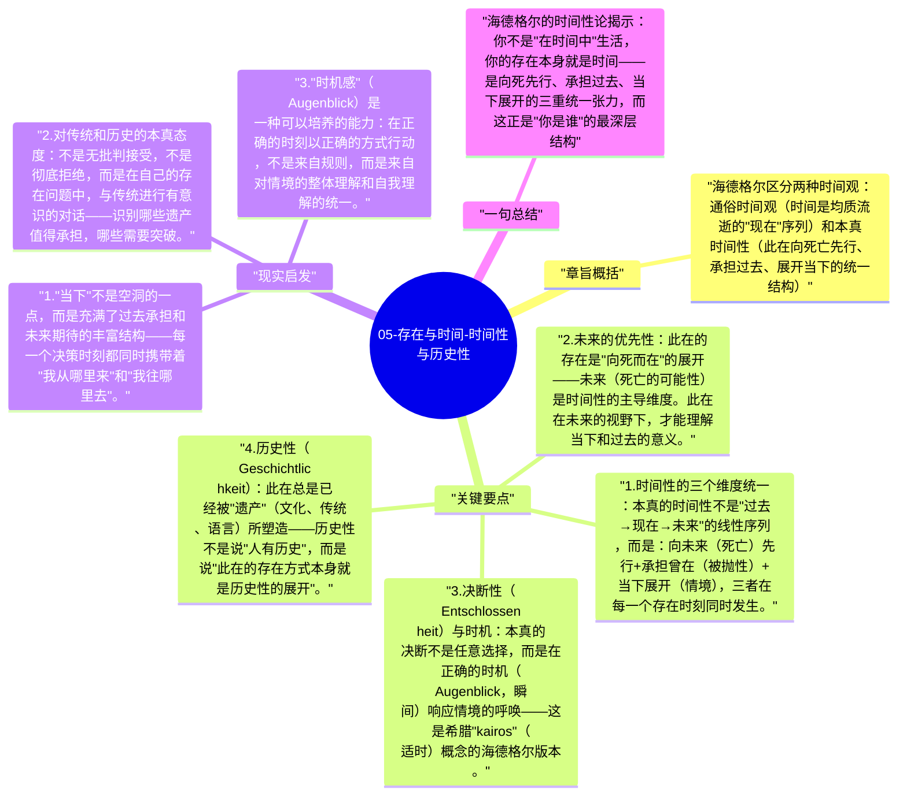

# 05-存在与时间-时间性与历史性

海德格尔在前四部分揭示了此在的存在结构之后，在第五部分汇聚为核心论题：时间性（Zeitlichkeit）是此在存在的基本意义。此在不是"在时间中"的存在者，而是本身就是时间性的展开。历史性（Geschichtlichkeit）则揭示此在总是已经处于传承之中。

## 章旨概括

海德格尔区分两种时间观：通俗时间观（时间是均质流逝的"现在"序列）和本真时间性（此在向死亡先行、承担过去、展开当下的统一结构）。本真的时间性不是线性的，而是在未来-曾在-当下的统一张力中展开的。

## 关键要点

1. **时间性的三个维度统一**：本真的时间性不是"过去→现在→未来"的线性序列，而是：向未来（死亡）先行 + 承担曾在（被抛性）+ 当下展开（情境），三者在每一个存在时刻同时发生。
2. **未来的优先性**：此在的存在是"向死而在"的展开——未来（死亡的可能性）是时间性的主导维度。此在在未来的视野下，才能理解当下和过去的意义。
3. **决断性（Entschlossenheit）与时机**：本真的决断不是任意选择，而是在正确的时机（Augenblick，瞬间）响应情境的呼唤——这是希腊"kairos"（适时）概念的海德格尔版本。
4. **历史性（Geschichtlichkeit）**：此在总是已经被"遗产"（文化、传统、语言）所塑造——历史性不是说"人有历史"，而是说"此在的存在方式本身就是历史性的展开"。
5. **本真的历史性**：不是把传统当作固定的知识接受，而是在自己的存在可能性中，有选择地"接手"（Überlieferung）遗产——与传统的创造性对话，而非被动继承。
6. **时间性与通俗时间的关系**：日常工具性的"时间"（约好几点见面，任务需要多少小时）是本真时间性在"常人"状态下的衍生形态——是时间性的"抹平"和"匿名化"。

## 现实启发

1. "当下"不是空洞的一点，而是充满了过去承担和未来期待的丰富结构——每一个决策时刻都同时携带着"我从哪里来"和"我往哪里去"。
2. 对传统和历史的本真态度：不是无批判接受，不是彻底拒绝，而是在自己的存在问题中，与传统进行有意识的对话——识别哪些遗产值得承担，哪些需要突破。
3. "时机感"（Augenblick）是一种可以培养的能力：在正确的时刻以正确的方式行动，不是来自规则，而是来自对情境的整体理解和自我理解的统一。

## 一句总结

海德格尔的时间性论揭示：你不是"在时间中"生活，你的存在本身就是时间——是向死先行、承担过去、当下展开的三重统一张力，而这正是"你是谁"的最深层结构。

---

## Mermaid 思维导图

### 图1

