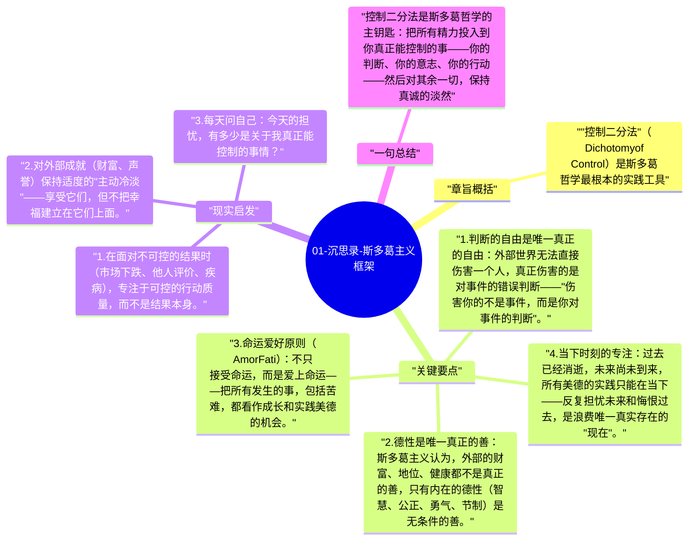

# 01-沉思录-斯多葛主义框架

斯多葛哲学的核心是一个区分：有些事情在我们的控制之内，有些事情不在我们的控制之内。马可·奥勒留全书一再回到这个区分——幸福和道德的基础，在于只追求控制之内的事，对控制之外的事保持淡然。

## 章旨概括

"控制二分法"（Dichotomy of Control）是斯多葛哲学最根本的实践工具。在我们控制之内的：我们的判断、意图、欲望、意志；不在我们控制之内的：身体、声誉、财产、他人的行为、外部结果。奥勒留认为，把精力投入在"不可控"的事物上，是一切痛苦和失败的根源。

## 关键要点

1. **判断的自由是唯一真正的自由**：外部世界无法直接伤害一个人，真正伤害的是对事件的错误判断——"伤害你的不是事件，而是你对事件的判断"。
2. **德性是唯一真正的善**：斯多葛主义认为，外部的财富、地位、健康都不是真正的善，只有内在的德性（智慧、公正、勇气、节制）是无条件的善。
3. **命运爱好原则（Amor Fati）**：不只接受命运，而是爱上命运——把所有发生的事，包括苦难，都看作成长和实践美德的机会。
4. **当下时刻的专注**：过去已经消逝，未来尚未到来，所有美德的实践只能在当下——反复担忧未来和悔恨过去，是浪费唯一真实存在的"现在"。
5. **理性是人类的本质**：人与动物的区别在于理性能力，按照理性和自然法则生活，是人类最高的使命。

## 现实启发

1. 在面对不可控的结果时（市场下跌、他人评价、疾病），专注于可控的行动质量，而不是结果本身。
2. 对外部成就（财富、声誉）保持适度的"主动冷淡"——享受它们，但不把幸福建立在它们上面。
3. 每天问自己：今天的担忧，有多少是关于我真正能控制的事情？

## 一句总结

控制二分法是斯多葛哲学的主钥匙：把所有精力投入到你真正能控制的事——你的判断、你的意志、你的行动——然后对其余一切，保持真诚的淡然。

---

## Mermaid 思维导图

### 图1

