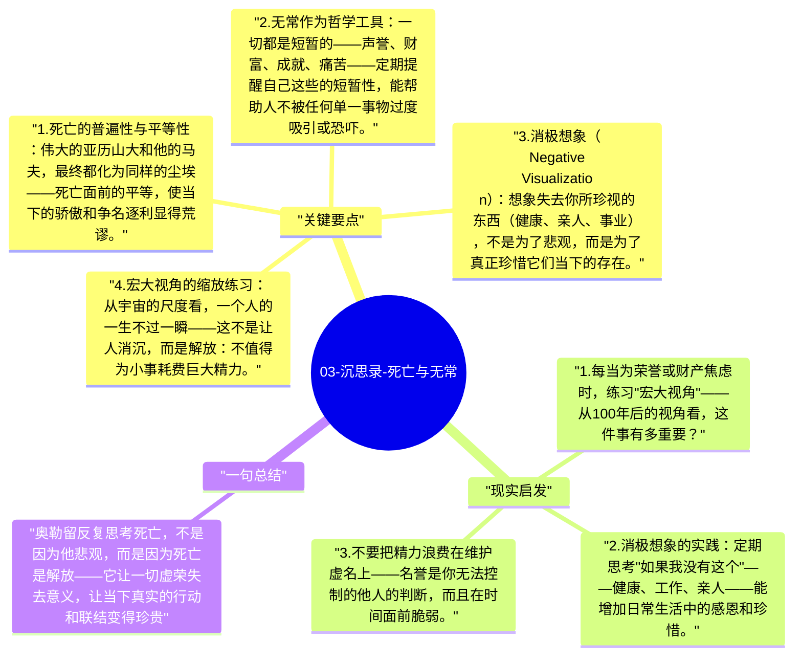

# 03-沉思录-死亡与无常

马可·奥勒留在《沉思录》中反复思考死亡——不是出于病态，而是作为一种哲学实践："记住你会死"（Memento mori）。正视死亡的必然性，是斯多葛哲学矫正人生优先序、抵抗虚荣心的最有力工具。

## 关键要点

1. **死亡的普遍性与平等性**：伟大的亚历山大和他的马夫，最终都化为同样的尘埃——死亡面前的平等，使当下的骄傲和争名逐利显得荒谬。
2. **无常作为哲学工具**：一切都是短暂的——声誉、财富、成就、痛苦——定期提醒自己这些的短暂性，能帮助人不被任何单一事物过度吸引或恐吓。
3. **消极想象（Negative Visualization）**：想象失去你所珍视的东西（健康、亲人、事业），不是为了悲观，而是为了真正珍惜它们当下的存在。
4. **宏大视角的缩放练习**：从宇宙的尺度看，一个人的一生不过一瞬——这不是让人消沉，而是解放：不值得为小事耗费巨大精力。
5. **为死亡做准备的日常化**：斯多葛哲学建议把每一天都当作可能的最后一天来生活，但不是以恐惧，而是以完全的专注和充实。

## 现实启发

1. 每当为荣誉或财产焦虑时，练习"宏大视角"——从100年后的视角看，这件事有多重要？
2. 消极想象的实践：定期思考"如果我没有这个"——健康、工作、亲人——能增加日常生活中的感恩和珍惜。
3. 不要把精力浪费在维护虚名上——名誉是你无法控制的他人的判断，而且在时间面前脆弱。

## 一句总结

奥勒留反复思考死亡，不是因为他悲观，而是因为死亡是解放——它让一切虚荣失去意义，让当下真实的行动和联结变得珍贵。

---

## Mermaid 思维导图

### 图1

