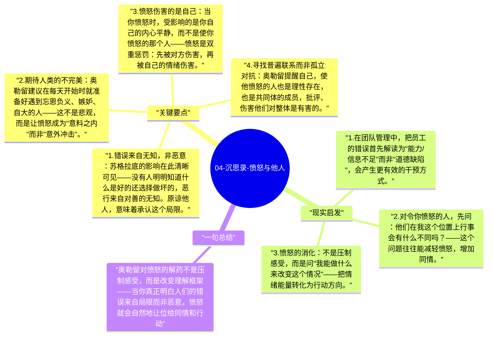

# 04-沉思录-愤怒与他人

《沉思录》中最反复出现的主题之一，是如何对待令人愤怒、令人失望的人。奥勒留不止一次地提醒自己：人们作恶是因为无知，不是因为恶意；理解这一点，愤怒就会转化为同情。

## 关键要点

1. **错误来自无知，非恶意**：苏格拉底的影响在此清晰可见——没有人明明知道什么是好的还选择做坏的，恶行来自对善的无知。原谅他人，意味着承认这个局限。
2. **期待人类的不完美**：奥勒留建议在每天开始时就准备好遇到忘恩负义、嫉妒、自大的人——这不是悲观，而是让愤怒成为"意料之内"而非"意外冲击"。
3. **愤怒伤害的是自己**：当你愤怒时，受影响的是你自己的内心平静，而不是使你愤怒的那个人——愤怒是双重惩罚：先被对方伤害，再被自己的情绪伤害。
4. **寻找普遍联系而非孤立对抗**：奥勒留提醒自己，使他愤怒的人也是理性存在，也是共同体的成员，批评、伤害他们对整体是有害的。
5. **角色换位的思考**：在愤怒时，思考"如果我站在他的位置，我可能也会这样做"——这不是为对方辩护，而是拓宽理解，减少自义感。

## 现实启发

1. 在团队管理中，把员工的错误首先解读为"能力/信息不足"而非"道德缺陷"，会产生更有效的干预方式。
2. 对令你愤怒的人，先问：他们在我这个位置上行事会有什么不同吗？——这个问题往往能减轻愤怒，增加同情。
3. 愤怒的消化：不是压制感受，而是问"我能做什么来改变这个情况"——把情绪能量转化为行动方向。

## 一句总结

奥勒留对愤怒的解药不是压制感受，而是改变理解框架——当你真正明白人们的错误来自局限而非恶意，愤怒就会自然地让位给同情和行动。

---

## Mermaid 思维导图

### 图1

