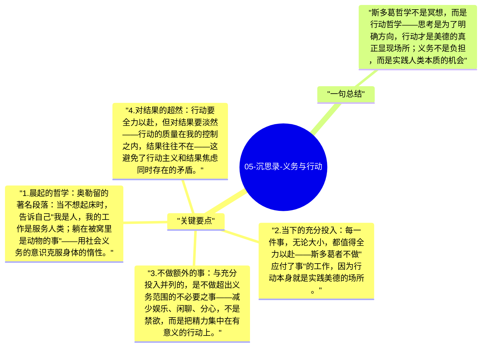

# 05-沉思录-义务与行动

斯多葛哲学是高度行动导向的。奥勒留反复批评自己的拖延、懒惰和逃避，并用哲学论证来推动自己起床、做事、履行作为皇帝和人类的义务。对斯多葛者来说，沉思是为了更好地行动，不是逃避行动的借口。

## 关键要点

1. **晨起的哲学**：奥勒留的著名段落：当不想起床时，告诉自己"我是人，我的工作是服务人类；躺在被窝里是动物的事"——用社会义务的意识克服身体的惰性。
2. **当下的充分投入**：每一件事，无论大小，都值得全力以赴——斯多葛者不做"应付了事"的工作，因为行动本身就是实践美德的场所。
3. **不做额外的事**：与充分投入并列的，是不做超出义务范围的不必要之事——减少娱乐、闲聊、分心，不是禁欲，而是把精力集中在有意义的行动上。
4. **对结果的超然**：行动要全力以赴，但对结果要淡然——行动的质量在我的控制之内，结果往往不在——这避免了行动主义和结果焦虑同时存在的矛盾。
5. **义务的宇宙维度**：对斯多葛者来说，每个行动都是在贡献或损害整体的宇宙秩序——义务不只是对上司或社区，而是对整个理性共同体。

## 一句总结

斯多葛哲学不是冥想，而是行动哲学——思考是为了明确方向，行动才是美德的真正显现场所；义务不是负担，而是实践人类本质的机会。

---

## Mermaid 思维导图

### 图1

