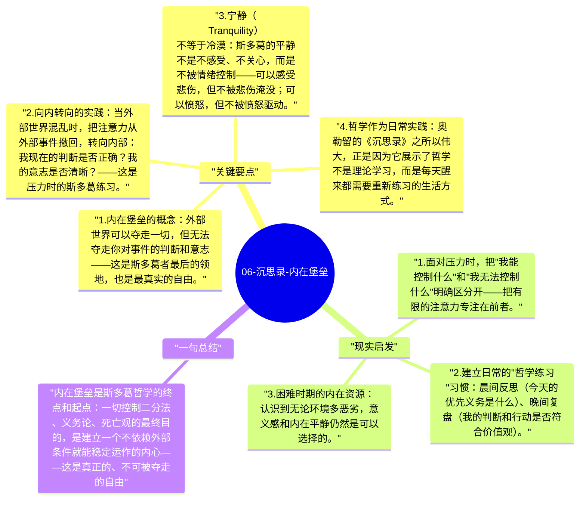

# 06-沉思录-内在堡垒

斯多葛哲学的终极目标，是建立一个无论外部世界如何动荡，内心都能保持平静与力量的"内在堡垒"。马可·奥勒留身为皇帝，面对战争、瘟疫、背叛和自身的病痛，始终把内心的平静视为最后的防线。

## 关键要点

1. **内在堡垒的概念**：外部世界可以夺走一切，但无法夺走你对事件的判断和意志——这是斯多葛者最后的领地，也是最真实的自由。
2. **向内转向的实践**：当外部世界混乱时，把注意力从外部事件撤回，转向内部：我现在的判断是否正确？我的意志是否清晰？——这是压力时的斯多葛练习。
3. **宁静（Tranquility）不等于冷漠**：斯多葛的平静不是不感受、不关心，而是不被情绪控制——可以感受悲伤，但不被悲伤淹没；可以愤怒，但不被愤怒驱动。
4. **哲学作为日常实践**：奥勒留的《沉思录》之所以伟大，正是因为它展示了哲学不是理论学习，而是每天醒来都需要重新练习的生活方式。
5. **无法被剥夺的自由**：即使在最极端的处境（被囚禁、被迫害），判断和意志的自由仍在——这是斯多葛主义在历史上吸引监狱人士（从古代到现代）的根本原因。

## 现实启发

1. 面对压力时，把"我能控制什么"和"我无法控制什么"明确区分开——把有限的注意力专注在前者。
2. 建立日常的"哲学练习"习惯：晨间反思（今天的优先义务是什么）、晚间复盘（我的判断和行动是否符合价值观）。
3. 困难时期的内在资源：认识到无论环境多恶劣，意义感和内在平静仍然是可以选择的。

## 一句总结

内在堡垒是斯多葛哲学的终点和起点：一切控制二分法、义务论、死亡观的最终目的，是建立一个不依赖外部条件就能稳定运作的内心——这是真正的、不可被夺走的自由。

---

## Mermaid 思维导图

### 图1

