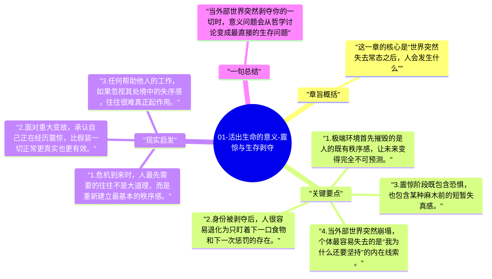

# 01-活出生命的意义-震惊与生存剥夺

全书从集中营初期的震惊开始。弗兰克尔首先写的不是抽象哲学，而是人如何在极端剥夺中失去身份、尊严和熟悉秩序。

## 章旨概括

这一章的核心是“世界突然失去常态之后，人会发生什么”。囚犯刚进入集中营时，面对暴力、羞辱和未知命运，会经历强烈震惊和心理断裂。原本支撑人格的社会身份在短时间内被剥夺，人被迫降到最原始的生存状态。弗兰克尔借此说明，意义问题从来不是抽象题目，而是在极端处境中直接关乎人能否继续活下去。

## 关键要点

1. 极端环境首先摧毁的是人的既有秩序感，让未来变得完全不可预测。
2. 身份被剥夺后，人很容易退化为只盯着下一口食物和下一次惩罚的存在。
3. 震惊阶段既包含恐惧，也包含某种麻木前的短暂失真感。
4. 当外部世界突然崩塌，个体最容易失去的是“我为什么还要坚持”的内在线索。

## 现实启发

1. 危机到来时，人最先需要的往往不是大道理，而是重新建立最基本的秩序感。
2. 面对重大变故，承认自己正在经历震惊，比假装一切正常更真实也更有效。
3. 任何帮助他人的工作，如果忽视其处境中的失序感，往往很难真正起作用。

## 一句总结

当外部世界突然剥夺你的一切时，意义问题会从哲学讨论变成最直接的生存问题。

---

## Mermaid 思维导图

### 图1

