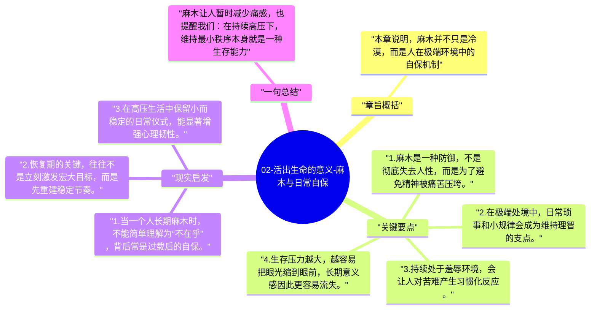

# 02-活出生命的意义-麻木与日常自保

在持续高压之下，人不会一直保持同样强度的震惊。第二阶段出现的是麻木，一种既让人得以活下去、又让人部分失去感受力的心理防御。

## 章旨概括

本章说明，麻木并不只是冷漠，而是人在极端环境中的自保机制。面对大量死亡、羞辱和痛苦，囚犯如果持续全量感受，很快会被击垮，于是心理会主动降低敏感度。与此同时，日常微小秩序和习惯动作开始变得重要，因为它们帮助人维持最基本的精神连续性。

## 关键要点

1. 麻木是一种防御，不是彻底失去人性，而是为了避免精神被痛苦压垮。
2. 在极端处境中，日常琐事和小规律会成为维持理智的支点。
3. 持续处于羞辱环境，会让人对苦难产生习惯化反应。
4. 生存压力越大，越容易把眼光缩到眼前，长期意义感因此更容易流失。

## 现实启发

1. 当一个人长期麻木时，不能简单理解为“不在乎”，背后常是过载后的自保。
2. 恢复期的关键，往往不是立刻激发宏大目标，而是先重建稳定节奏。
3. 在高压生活中保留小而稳定的日常仪式，能显著增强心理韧性。

## 一句总结

麻木让人暂时减少痛感，也提醒我们：在持续高压下，维持最小秩序本身就是一种生存能力。

---

## Mermaid 思维导图

### 图1

