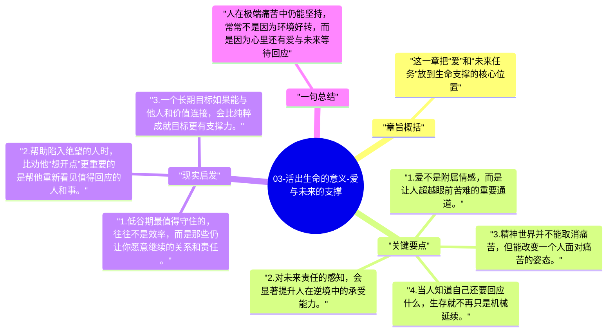

# 03-活出生命的意义-爱与未来的支撑

在看似完全绝望的环境中，弗兰克尔不断发现：人之所以还能坚持，往往不是因为眼前条件改善了，而是因为内心还有一个指向未来的人或使命。

## 章旨概括

这一章把“爱”和“未来任务”放到生命支撑的核心位置。弗兰克尔意识到，即便与爱人分离，人仍能通过对其形象的凝视获得精神力量；即便身处囚禁，只要还有未完成的工作和责任，生命就还保有方向。意义因此不是抽象观念，而是一种让人不被当下完全吞没的内在指向。

## 关键要点

1. 爱不是附属情感，而是让人超越眼前苦难的重要通道。
2. 对未来责任的感知，会显著提升人在逆境中的承受能力。
3. 精神世界并不能取消痛苦，但能改变一个人面对痛苦的姿态。
4. 当人知道自己还要回应什么，生存就不再只是机械延续。

## 现实启发

1. 低谷期最值得守住的，往往不是效率，而是那些仍让你愿意继续的关系和责任。
2. 帮助陷入绝望的人时，比劝他“想开点”更重要的是帮他重新看见值得回应的人和事。
3. 一个长期目标如果能与他人和价值连接，会比纯粹成就目标更有支撑力。

## 一句总结

人在极端痛苦中仍能坚持，常常不是因为环境好转，而是因为心里还有爱与未来等待回应。

---

## Mermaid 思维导图

### 图1

