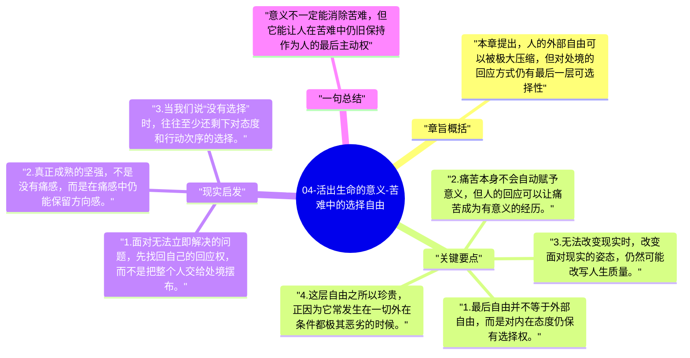

# 04-活出生命的意义-苦难中的选择自由

这是全书最著名的命题来源：人最后的自由，是在任何处境中仍可选择自己采取何种态度。它不是说现实不重要，而是说现实无法彻底剥夺人的精神主动性。

## 章旨概括

本章提出，人的外部自由可以被极大压缩，但对处境的回应方式仍有最后一层可选择性。弗兰克尔并不浪漫化苦难，他只是坚持：当痛苦不可避免时，人仍能决定自己是否把痛苦转化为堕落、怨恨，还是转化为责任、尊严与见证。这也是意义疗法最核心的伦理基础。

## 关键要点

1. 最后自由并不等于外部自由，而是对内在态度仍保有选择权。
2. 痛苦本身不会自动赋予意义，但人的回应可以让痛苦成为有意义的经历。
3. 无法改变现实时，改变面对现实的姿态，仍然可能改写人生质量。
4. 这层自由之所以珍贵，正因为它常发生在一切外在条件都极其恶劣的时候。

## 现实启发

1. 面对无法立即解决的问题，先找回自己的回应权，而不是把整个人交给处境摆布。
2. 真正成熟的坚强，不是没有痛感，而是在痛感中仍能保留方向感。
3. 当我们说“没有选择”时，往往至少还剩下对态度和行动次序的选择。

## 一句总结

意义不一定能消除苦难，但它能让人在苦难中仍旧保持作为人的最后主动权。

---

## Mermaid 思维导图

### 图1

