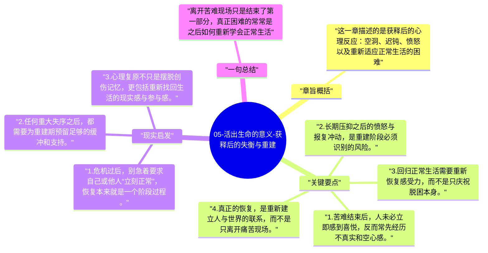

# 05-活出生命的意义-获释后的失衡与重建

集中营结束并不意味着一切自动恢复。弗兰克尔提醒，创伤之后最容易被忽视的部分，恰恰是“自由回来以后，人为什么仍然失衡”。

## 章旨概括

这一章描述的是获释后的心理反应：空洞、迟钝、愤怒以及重新适应正常生活的困难。长期极端处境让人形成了特殊的生存逻辑，离开之后不可能立刻回到平稳社会节奏。弗兰克尔借此说明，创伤之后的重建不是一句“已经结束了”就能完成，而需要重新学习感受、信任和日常生活。

## 关键要点

1. 苦难结束后，人未必立即感到喜悦，反而常先经历不真实和空心感。
2. 长期压抑之后的愤怒与报复冲动，是重建阶段必须识别的风险。
3. 回归正常生活需要重新恢复感受力，而不是只庆祝脱困本身。
4. 真正的恢复，是重新建立人与世界的联系，而不是只离开痛苦现场。

## 现实启发

1. 危机过后，别急着要求自己或他人“立刻正常”，恢复本来就是一个阶段过程。
2. 任何重大失序之后，都需要为重建期预留足够的缓冲和支持。
3. 心理复原不只是摆脱创伤记忆，更包括重新找回生活的现实感与参与感。

## 一句总结

离开苦难现场只是结束了第一部分，真正困难的常常是之后如何重新学会正常生活。

---

## Mermaid 思维导图

### 图1

