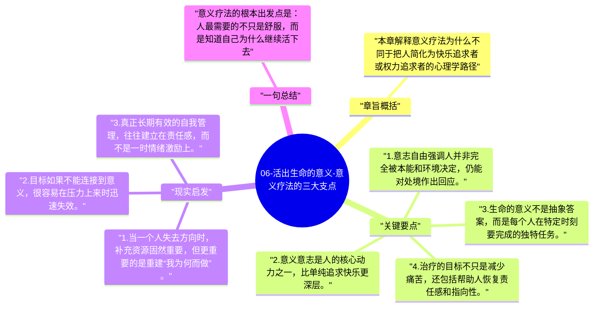

# 06-活出生命的意义-意义疗法的三大支点

从这里开始，全书由经验叙述转向理论提炼。弗兰克尔把意义疗法的基础概括为三个支点：意志自由、意义意志与生命的独特任务。

## 章旨概括

本章解释意义疗法为什么不同于把人简化为快乐追求者或权力追求者的心理学路径。弗兰克尔认为，人最核心的动力是寻找意义，而生命的意义并不由别人统一发放，而是由每个人在具体情境中去回应。只要这三个支点成立，治疗就不只是减轻症状，而是帮助人重新找到面向生活的方向。

## 关键要点

1. 意志自由强调人并非完全被本能和环境决定，仍能对处境作出回应。
2. 意义意志是人的核心动力之一，比单纯追求快乐更深层。
3. 生命的意义不是抽象答案，而是每个人在特定时刻要完成的独特任务。
4. 治疗的目标不只是减少痛苦，还包括帮助人恢复责任感和指向性。

## 现实启发

1. 当一个人失去方向时，补充资源固然重要，但更重要的是重建“我为何而做”。
2. 目标如果不能连接到意义，很容易在压力上来时迅速失效。
3. 真正长期有效的自我管理，往往建立在责任感，而不是一时情绪激励上。

## 一句总结

意义疗法的根本出发点是：人最需要的不只是舒服，而是知道自己为什么继续活下去。

---

## Mermaid 思维导图

### 图1

