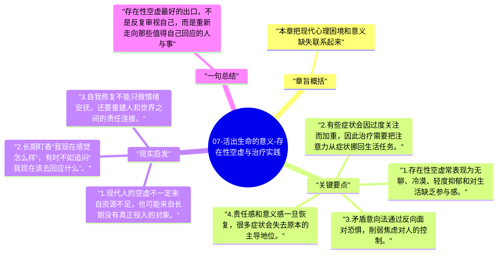

# 07-活出生命的意义-存在性空虚与治疗实践

弗兰克尔把现代人常见的空洞、无聊和方向丧失称为“存在性空虚”。这一章的重点是说明：很多心理困扰并非全都来自压抑，也可能来自找不到值得投入的意义。

## 章旨概括

本章把现代心理困境和意义缺失联系起来。人在传统秩序松动、外部命令减少之后，表面上更自由了，内心却可能更不知道该为何而活。意义疗法因此提供若干实践路径，例如矛盾意向法、去反省法和责任唤起，帮助人从对自我症状的过度盯视中转向更具方向性的生活回应。

## 关键要点

1. 存在性空虚常表现为无聊、冷漠、轻度抑郁和对生活缺乏参与感。
2. 有些症状会因过度关注而加重，因此治疗需要把注意力从症状挪回生活任务。
3. 矛盾意向法通过反向面对恐惧，削弱焦虑对人的控制。
4. 责任感和意义感一旦恢复，很多症状会失去原本的主导地位。

## 现实启发

1. 现代人的空虚不一定来自资源不足，也可能来自长期没有真正投入的对象。
2. 长期盯着“我现在感觉怎么样”，有时不如追问“我现在该去回应什么”。
3. 自我修复不能只做情绪安抚，还要重建人和世界之间的责任连接。

## 一句总结

存在性空虚最好的出口，不是反复审视自己，而是重新走向那些值得自己回应的人与事。

---

## Mermaid 思维导图

### 图1

