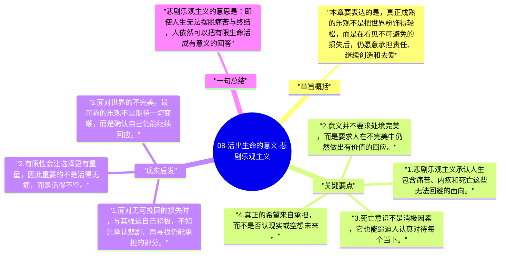

# 08-活出生命的意义-悲剧乐观主义

最后一章把全书提升到一种生命态度：并非否认痛苦、罪责和死亡，而是在承认它们存在的前提下，仍然选择面向生命。弗兰克尔把这种姿态称为悲剧乐观主义。

## 章旨概括

本章要表达的是，真正成熟的乐观不是把世界粉饰得轻松，而是在看见不可避免的损失后，仍愿意承担责任、继续创造和去爱。痛苦可以被转化为成就，罪责可以被转化为改过的机会，死亡则提醒人此刻的选择具有不可重复的重量。悲剧乐观主义因此不是情绪鸡血，而是一种深刻的现实主义勇气。

## 关键要点

1. 悲剧乐观主义承认人生包含痛苦、内疚和死亡这些无法回避的面向。
2. 意义并不要求处境完美，而是要求人在不完美中仍然做出有价值的回应。
3. 死亡意识不是消极因素，它也能逼迫人认真对待每个当下。
4. 真正的希望来自承担，而不是否认现实或空想未来。

## 现实启发

1. 面对无可挽回的损失时，与其强迫自己积极，不如先承认悲剧，再寻找仍能承担的部分。
2. 有限性会让选择更有重量，因此重要的不是活得无痛，而是活得不空。
3. 面对世界的不完美，最可靠的乐观不是期待一切变顺，而是确认自己仍能继续回应。

## 一句总结

悲剧乐观主义的意思是：即使人生无法摆脱痛苦与终结，人依然可以把有限生命活成有意义的回答。

---

## Mermaid 思维导图

### 图1

