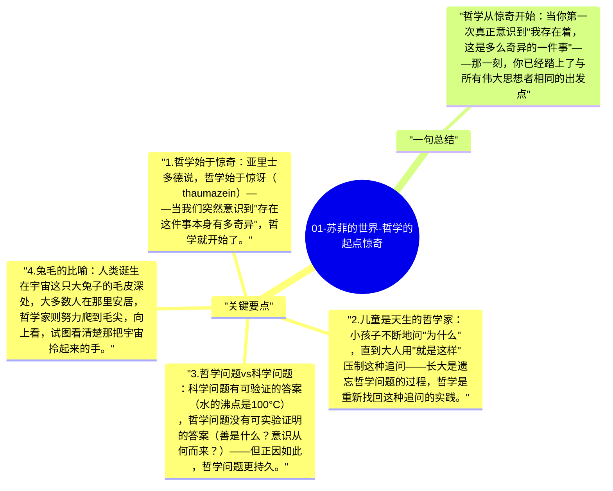

# 01-苏菲的世界-哲学的起点惊奇

苏菲收到第一封信，信上只有一个问题："你是谁？" 贾德用这个开头揭示了哲学最根本的特征：它从惊奇开始，从那些我们通常视为理所当然的事情开始追问——存在是什么？我为什么在这里？

## 关键要点

1. **哲学始于惊奇**：亚里士多德说，哲学始于惊讶（thaumazein）——当我们突然意识到"存在这件事本身有多奇异"，哲学就开始了。
2. **儿童是天生的哲学家**：小孩子不断地问"为什么"，直到大人用"就是这样"压制这种追问——长大是遗忘哲学问题的过程，哲学是重新找回这种追问的实践。
3. **哲学问题 vs 科学问题**：科学问题有可验证的答案（水的沸点是100°C），哲学问题没有可实验证明的答案（善是什么？意识从何而来？）——但正因如此，哲学问题更持久。
4. **兔毛的比喻**：人类诞生在宇宙这只大兔子的毛皮深处，大多数人在那里安居，哲学家则努力爬到毛尖，向上看，试图看清楚那把宇宙拎起来的手。
5. **哲学的实践价值**：不解答哲学问题也可以过日子，但不思考这些问题会让人在人生的关键转折点（死亡、意义丧失、道德困境）时毫无准备。

## 一句总结

哲学从惊奇开始：当你第一次真正意识到"我存在着，这是多么奇异的一件事"——那一刻，你已经踏上了与所有伟大思想者相同的出发点。

---

## Mermaid 思维导图

### 图1

