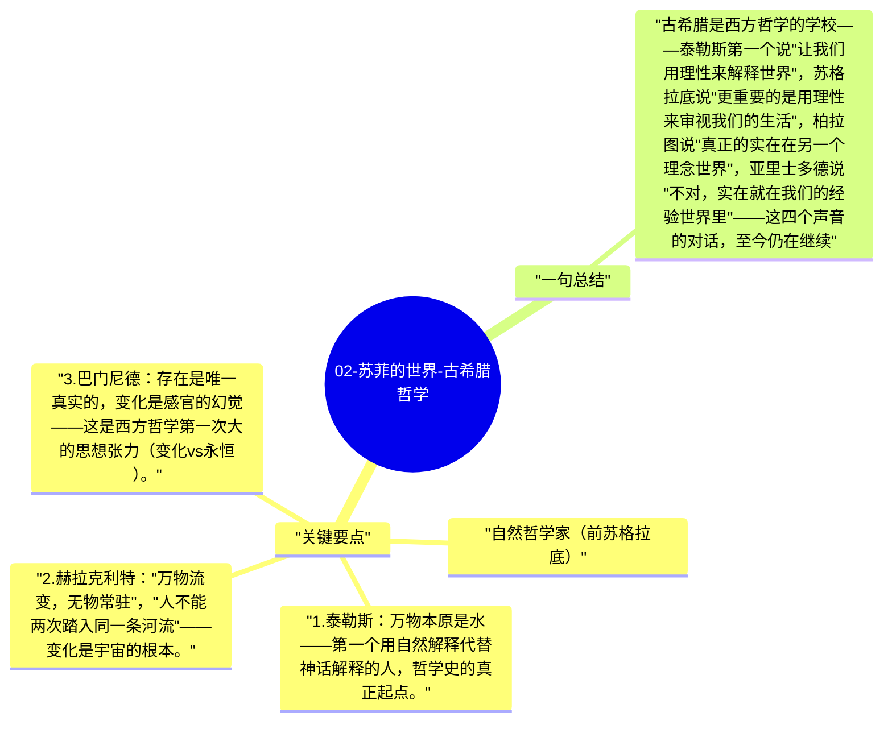

# 02-苏菲的世界-古希腊哲学

古希腊哲学是西方思想最重要的源头。从公元前6世纪的自然哲学家（寻找万物本原），到苏格拉底的伦理转向，到柏拉图的理念论，再到亚里士多德的系统化，西方哲学的核心问题在这500年里基本被提出。

## 关键要点

**自然哲学家（前苏格拉底）：**
1. **泰勒斯**：万物本原是水——第一个用自然解释代替神话解释的人，哲学史的真正起点。
2. **赫拉克利特**："万物流变，无物常驻"，"人不能两次踏入同一条河流"——变化是宇宙的根本。
3. **巴门尼德**：存在是唯一真实的，变化是感官的幻觉——这是西方哲学第一次大的思想张力（变化 vs 永恒）。
4. **恩培多克勒**：四元素（土、水、火、气）+ 爱与争的力量——接近近代化学的直觉。

**苏格拉底（约前470-399年）：**
1. **转向伦理**：从宇宙本原问题转向"什么是善""人该如何生活"——这是哲学史的第一次大转向。
2. **助产术（Maieutics）**：苏格拉底不教给答案，而是通过提问帮助对话者自己产生认识——"我只知道我什么都不知道"。
3. **知识即美德**：作恶是因为无知，如果一个人真正理解了什么是善，就不可能不去做善——这是他关于道德的基本信念。

**柏拉图（约前427-347年）：**
1. **理念论**：可见世界是理念（Ideas/Forms）世界的不完整复制，真正的实在是永恒不变的理念——桌子的"桌子性"比任何具体的桌子更真实。
2. **洞穴比喻**：大多数人被锁在洞穴里，只看到影子（感官世界），哲学家试图走出洞穴看到光（理念世界）。
3. **灵魂三分**：理性（头部）、意志（胸部）、欲望（腹部）——美德是三者的和谐比例。

**亚里士多德（前384-322年）：**
1. **形式与质料**：每个东西都由质料（物质）和形式（潜能、目的）构成，形式不在柏拉图的另一个世界，就在万物之中。
2. **四因说**：质料因、形式因、动力因、目的因——解释任何事物需要这四个维度。
3. **中庸美德**：美德是两种极端之间的中道——勇气是懦弱（不足）和鲁莽（过度）之间的中点。

## 一句总结

古希腊是西方哲学的学校——泰勒斯第一个说"让我们用理性来解释世界"，苏格拉底说"更重要的是用理性来审视我们的生活"，柏拉图说"真正的实在在另一个理念世界"，亚里士多德说"不对，实在就在我们的经验世界里"——这四个声音的对话，至今仍在继续。

---

## Mermaid 思维导图

### 图1

