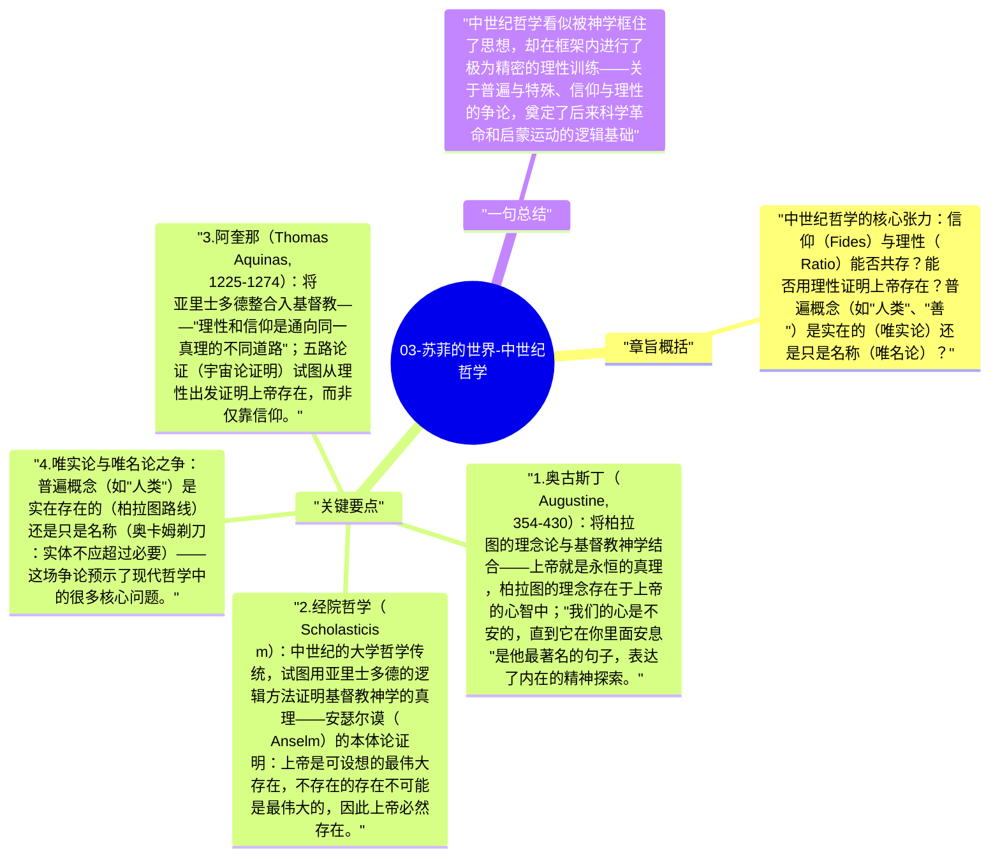

# 03-苏菲的世界-中世纪哲学

中世纪欧洲哲学（约500-1400年）发生在基督教神学的框架内：哲学不是独立的追问，而是"神学的婢女"。但即使在这个框架内，仍然产生了重要的哲学问题和思想成就——特别是关于信仰与理性关系的争论。

## 章旨概括

中世纪哲学的核心张力：信仰（Fides）与理性（Ratio）能否共存？能否用理性证明上帝存在？普遍概念（如"人类"、"善"）是实在的（唯实论）还是只是名称（唯名论）？

## 关键要点

1. **奥古斯丁（Augustine, 354-430）**：将柏拉图的理念论与基督教神学结合——上帝就是永恒的真理，柏拉图的理念存在于上帝的心智中；"我们的心是不安的，直到它在你里面安息"是他最著名的句子，表达了内在的精神探索。
2. **经院哲学（Scholasticism）**：中世纪的大学哲学传统，试图用亚里士多德的逻辑方法证明基督教神学的真理——安瑟尔谟（Anselm）的本体论证明：上帝是可设想的最伟大存在，不存在的存在不可能是最伟大的，因此上帝必然存在。
3. **阿奎那（Thomas Aquinas, 1225-1274）**：将亚里士多德整合入基督教——"理性和信仰是通向同一真理的不同道路"；五路论证（宇宙论证明）试图从理性出发证明上帝存在，而非仅靠信仰。
4. **唯实论与唯名论之争**：普遍概念（如"人类"）是实在存在的（柏拉图路线）还是只是名称（奥卡姆剃刀：实体不应超过必要）——这场争论预示了现代哲学中的很多核心问题。
5. **伊斯兰哲学的桥梁作用**：阿维森纳（Ibn Sina）和阿威罗伊（Ibn Rushd）保存并翻译了希腊哲学，使亚里士多德的著作重新传入欧洲——中世纪哲学的复兴部分来自伊斯兰学者的贡献。

## 一句总结

中世纪哲学看似被神学框住了思想，却在框架内进行了极为精密的理性训练——关于普遍与特殊、信仰与理性的争论，奠定了后来科学革命和启蒙运动的逻辑基础。

---

## Mermaid 思维导图

### 图1

