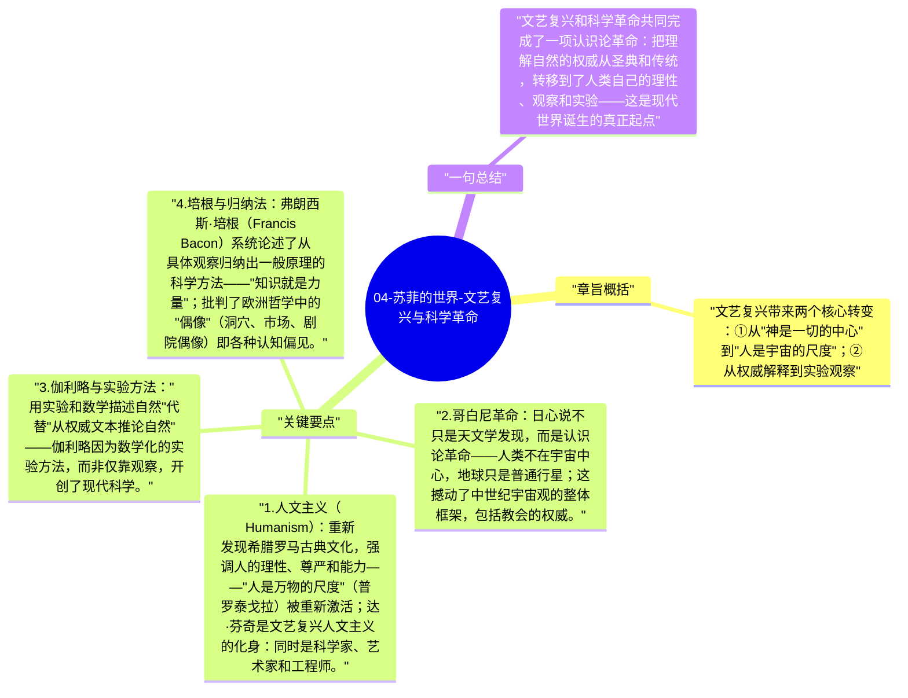

# 04-苏菲的世界-文艺复兴与科学革命

文艺复兴（14-17世纪）是人文主义的复苏：从神学中心转向人类中心，从抽象灵魂转向具体的人的能力和价值。科学革命则用数学和实验的方法彻底改造了人类对自然世界的理解方式。

## 章旨概括

文艺复兴带来两个核心转变：①从"神是一切的中心"到"人是宇宙的尺度"；②从权威解释到实验观察。这两个转变共同催生了现代科学和现代个人主义的基础。

## 关键要点

1. **人文主义（Humanism）**：重新发现希腊罗马古典文化，强调人的理性、尊严和能力——"人是万物的尺度"（普罗泰戈拉）被重新激活；达·芬奇是文艺复兴人文主义的化身：同时是科学家、艺术家和工程师。
2. **哥白尼革命**：日心说不只是天文学发现，而是认识论革命——人类不在宇宙中心，地球只是普通行星；这撼动了中世纪宇宙观的整体框架，包括教会的权威。
3. **伽利略与实验方法**："用实验和数学描述自然"代替"从权威文本推论自然"——伽利略因为数学化的实验方法，而非仅靠观察，开创了现代科学。
4. **培根与归纳法**：弗朗西斯·培根（Francis Bacon）系统论述了从具体观察归纳出一般原理的科学方法——"知识就是力量"；批判了欧洲哲学中的"偶像"（洞穴、市场、剧院偶像）即各种认知偏见。
5. **对自然的祛魅**：科学革命把自然从"充满精灵和神意的存在"变成"遵循数学规律的机器"——这是现代世界观的核心转变，也是韦伯所说的"祛魅"（Entzauberung）的起点。

## 一句总结

文艺复兴和科学革命共同完成了一项认识论革命：把理解自然的权威从圣典和传统，转移到了人类自己的理性、观察和实验——这是现代世界诞生的真正起点。

---

## Mermaid 思维导图

### 图1

