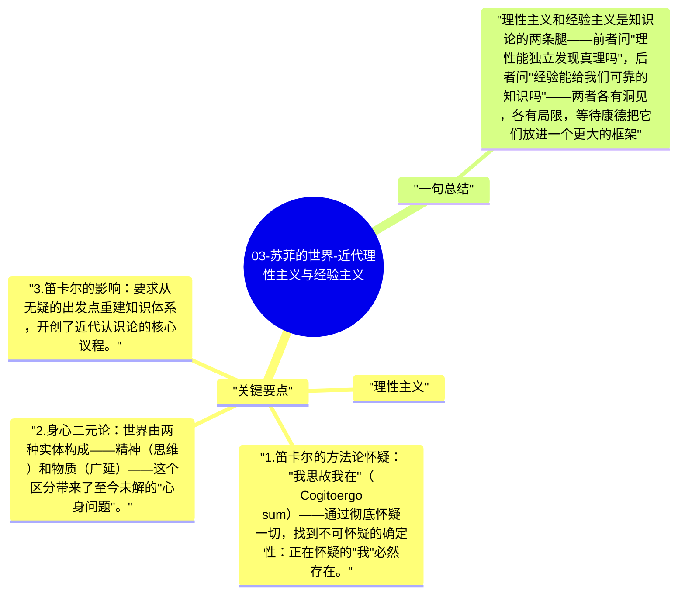

# 03-苏菲的世界-近代理性主义与经验主义

17-18世纪是西方哲学最激烈的认识论争论时期。理性主义者（笛卡尔、斯宾诺莎、莱布尼茨）认为知识来自理性本身；经验主义者（洛克、贝克莱、休谟）认为知识来自感官经验。这场争论最终由康德综合。

## 关键要点

**理性主义：**
1. **笛卡尔的方法论怀疑**："我思故我在"（Cogito ergo sum）——通过彻底怀疑一切，找到不可怀疑的确定性：正在怀疑的"我"必然存在。
2. **身心二元论**：世界由两种实体构成——精神（思维）和物质（广延）——这个区分带来了至今未解的"心身问题"。
3. **笛卡尔的影响**：要求从无疑的出发点重建知识体系，开创了近代认识论的核心议程。

**经验主义：**
1. **洛克的白板论**：人的心灵生来是白板（tabula rasa），所有知识来自感官经验——没有先天观念，知识是经验积累的结果。
2. **休谟的激进怀疑**：我们无法从经验中证明因果关系——"太阳过去每天升起"不能证明"太阳明天必然升起"，因果只是习惯联想，不是必然。
3. **休谟的"是"与"应该"问题**：从描述性陈述（是什么）无法逻辑推出规范性陈述（应该做什么）——这个"休谟鸿沟"至今是伦理学的核心挑战。

## 一句总结

理性主义和经验主义是知识论的两条腿——前者问"理性能独立发现真理吗"，后者问"经验能给我们可靠的知识吗"——两者各有洞见，各有局限，等待康德把它们放进一个更大的框架。

---

## Mermaid 思维导图

### 图1

