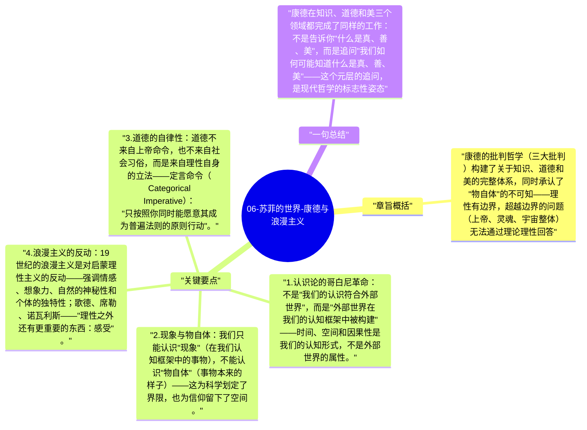

# 06-苏菲的世界-康德与浪漫主义

伊曼努尔·康德（Immanuel Kant, 1724-1804）是现代哲学史上最重要的转折点：他试图调和理性主义（笛卡尔路线）和经验主义（休谟路线），提出了"哥白尼式的认识论革命"——不是认识符合对象，而是对象符合我们的认识结构。

## 章旨概括

康德的批判哲学（三大批判）构建了关于知识、道德和美的完整体系，同时承认了"物自体"的不可知——理性有边界，超越边界的问题（上帝、灵魂、宇宙整体）无法通过理论理性回答。

## 关键要点

1. **认识论的哥白尼革命**：不是"我们的认识符合外部世界"，而是"外部世界在我们的认知框架中被构建"——时间、空间和因果性是我们的认知形式，不是外部世界的属性。
2. **现象与物自体**：我们只能认识"现象"（在我们认知框架中的事物），不能认识"物自体"（事物本来的样子）——这为科学划定了界限，也为信仰留下了空间。
3. **道德的自律性**：道德不来自上帝命令，也不来自社会习俗，而是来自理性自身的立法——定言命令（Categorical Imperative）："只按照你同时能愿意其成为普遍法则的原则行动"。
4. **浪漫主义的反动**：19世纪的浪漫主义是对启蒙理性主义的反动——强调情感、想象力、自然的神秘性和个体的独特性；歌德、席勒、诺瓦利斯——"理性之外还有更重要的东西：感受"。
5. **黑格尔（Hegel）的辩证法**：历史是精神（Geist）通过正、反、合的辩证过程展开自我的历程——"凡现实的都是合理的，凡合理的都是现实的"；历史不是偶然的，有其内在逻辑。

## 一句总结

康德在知识、道德和美三个领域都完成了同样的工作：不是告诉你"什么是真、善、美"，而是追问"我们如何可能知道什么是真、善、美"——这个元层的追问，是现代哲学的标志性姿态。

---

## Mermaid 思维导图

### 图1

