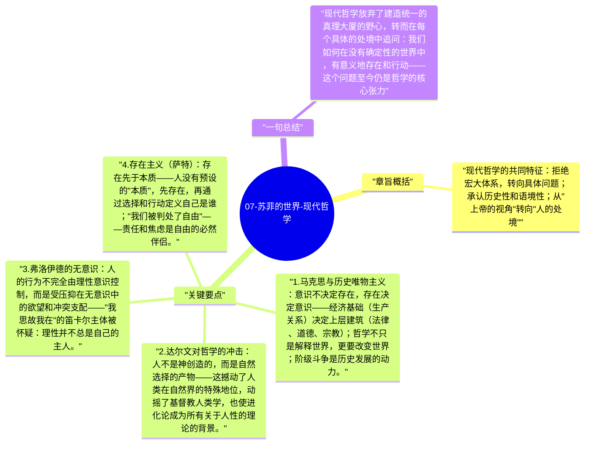

# 07-苏菲的世界-现代哲学

19世纪末到20世纪，哲学进入了一个更加多元和碎片化的时代：马克思的历史唯物主义、达尔文进化论对人类观的冲击、弗洛伊德的无意识理论、存在主义的个体承担，以及20世纪的语言哲学转向。

## 章旨概括

现代哲学的共同特征：拒绝宏大体系，转向具体问题；承认历史性和语境性；从"上帝的视角"转向"人的处境"。每个学派都是在回应：如果传统形而上学不可靠，我们如何思考意义、道德和真理？

## 关键要点

1. **马克思与历史唯物主义**：意识不决定存在，存在决定意识——经济基础（生产关系）决定上层建筑（法律、道德、宗教）；哲学不只是解释世界，更要改变世界；阶级斗争是历史发展的动力。
2. **达尔文对哲学的冲击**：人不是神创造的，而是自然选择的产物——这撼动了人类在自然界的特殊地位，动摇了基督教人类学，也使进化论成为所有关于人性的理论的背景。
3. **弗洛伊德的无意识**：人的行为不完全由理性意识控制，而是受压抑在无意识中的欲望和冲突支配——"我思故我在"的笛卡尔主体被怀疑：理性并不总是自己的主人。
4. **存在主义（萨特）**：存在先于本质——人没有预设的"本质"，先存在，再通过选择和行动定义自己是谁；"我们被判处了自由"——责任和焦虑是自由的必然伴侣。
5. **哲学的语言转向**：20世纪哲学（维特根斯坦、分析哲学）发现：很多哲学问题来自对语言的误用——"语言是思想的边界"；哲学的任务之一是澄清语言，而非构建形而上学体系。

## 一句总结

现代哲学放弃了建造统一的真理大厦的野心，转而在每个具体的处境中追问：我们如何在没有确定性的世界中，有意义地存在和行动——这个问题至今仍是哲学的核心张力。

---

## Mermaid 思维导图

### 图1

