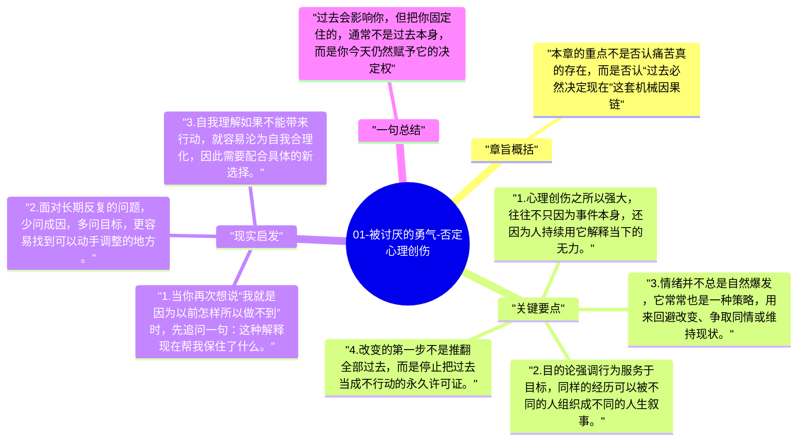

# 01-被讨厌的勇气-否定心理创伤

这一章先拆掉很多人最熟悉的解释框架：把今天的停滞全部归咎于昨天的伤害。作者借哲人与青年人的对话强调，过去会留下痕迹，但真正决定当下行为的，往往是人此刻想达成的目的和为此选取的生活方式。

## 章旨概括

本章的重点不是否认痛苦真的存在，而是否认“过去必然决定现在”这套机械因果链。阿德勒心理学把注意力从“我为什么会变成这样”移到“我现在为了什么而这样活”。一旦视角改变，人的责任位置也会改变：你不再只是过去的受害者，而是当下选择的参与者。

## 关键要点

1. 心理创伤之所以强大，往往不只因为事件本身，还因为人持续用它解释当下的无力。
2. 目的论强调行为服务于目标，同样的经历可以被不同的人组织成不同的人生叙事。
3. 情绪并不总是自然爆发，它常常也是一种策略，用来回避改变、争取同情或维持现状。
4. 改变的第一步不是推翻全部过去，而是停止把过去当成不行动的永久许可证。

## 现实启发

1. 当你再次想说“我就是因为以前怎样所以做不到”时，先追问一句：这种解释现在帮我保住了什么。
2. 面对长期反复的问题，少问成因，多问目标，更容易找到可以动手调整的地方。
3. 自我理解如果不能带来行动，就容易沦为自我合理化，因此需要配合具体的新选择。

## 一句总结

过去会影响你，但把你固定住的，通常不是过去本身，而是你今天仍然赋予它的决定权。

---

## Mermaid 思维导图

### 图1

