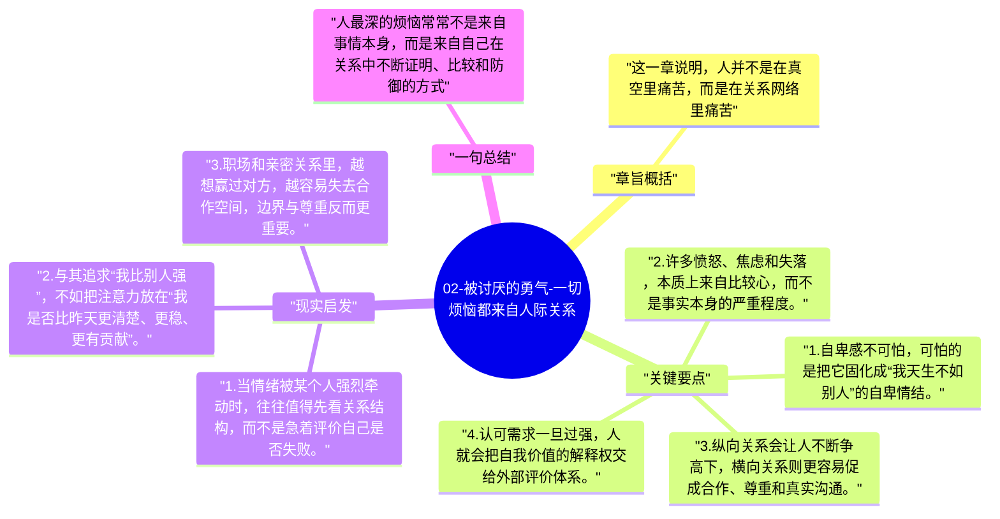

# 02-被讨厌的勇气-一切烦恼都来自人际关系

第二章把视线从个人创伤转向人与人的连接。书中最锋利的一句判断就是：绝大多数烦恼都可以追溯到人际关系，因为自卑、优越、认可需求和焦虑，几乎都在“我和别人如何比较、如何被看见”的结构里生成。

## 章旨概括

这一章说明，人并不是在真空里痛苦，而是在关系网络里痛苦。自卑感原本是成长的动力，但一旦变成竞争和比较，它就会扭曲成嫉妒、防御和逃避。阿德勒并不主张消灭关系，而是主张改变关系的逻辑，从纵向的高下竞争转向横向的彼此尊重。

## 关键要点

1. 自卑感不可怕，可怕的是把它固化成“我天生不如别人”的自卑情结。
2. 许多愤怒、焦虑和失落，本质上来自比较心，而不是事实本身的严重程度。
3. 纵向关系会让人不断争高下，横向关系则更容易促成合作、尊重和真实沟通。
4. 认可需求一旦过强，人就会把自我价值的解释权交给外部评价体系。

## 现实启发

1. 当情绪被某个人强烈牵动时，往往值得先看关系结构，而不是急着评价自己是否失败。
2. 与其追求“我比别人强”，不如把注意力放在“我是否比昨天更清楚、更稳、更有贡献”。
3. 职场和亲密关系里，越想赢过对方，越容易失去合作空间，边界与尊重反而更重要。

## 一句总结

人最深的烦恼常常不是来自事情本身，而是来自自己在关系中不断证明、比较和防御的方式。

---

## Mermaid 思维导图

### 图1

