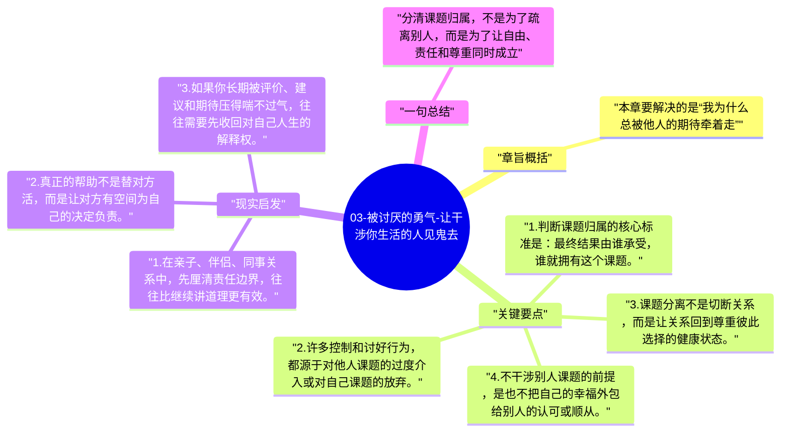

# 03-被讨厌的勇气-让干涉你生活的人见鬼去

第三章把阿德勒心理学最具操作性的概念推到台前：课题分离。它讨论的不是冷漠，而是分清一件事最终由谁承担后果，从而划清责任边界，减少无效控制和无效迎合。

## 章旨概括

本章要解决的是“我为什么总被他人的期待牵着走”。阿德勒认为，一个人之所以不自由，很大程度上是因为混淆了自己的课题和别人的课题。你能表达建议、给出支持，但不能替别人承担人生；同样，你也不必活成别人期待的样子来换取安全感。

## 关键要点

1. 判断课题归属的核心标准是：最终结果由谁承受，谁就拥有这个课题。
2. 许多控制和讨好行为，都源于对他人课题的过度介入或对自己课题的放弃。
3. 课题分离不是切断关系，而是让关系回到尊重彼此选择的健康状态。
4. 不干涉别人课题的前提，是也不把自己的幸福外包给别人的认可或顺从。

## 现实启发

1. 在亲子、伴侣、同事关系中，先厘清责任边界，往往比继续讲道理更有效。
2. 真正的帮助不是替对方活，而是让对方有空间为自己的决定负责。
3. 如果你长期被评价、建议和期待压得喘不过气，往往需要先收回对自己人生的解释权。

## 一句总结

分清课题归属，不是为了疏离别人，而是为了让自由、责任和尊重同时成立。

---

## Mermaid 思维导图

### 图1

