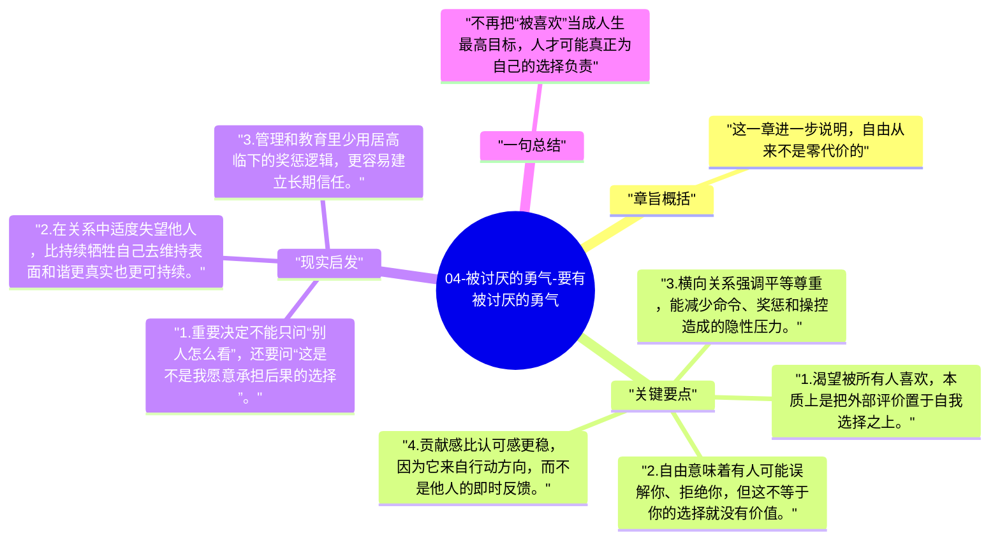

# 04-被讨厌的勇气-要有被讨厌的勇气

到了这一章，前面的逻辑开始落地到最难的一步：如果你不再被认可需求驱动，就必须接受有人不会喜欢你。所谓“被讨厌的勇气”，不是挑衅他人，而是愿意承担自由带来的评价成本。

## 章旨概括

这一章进一步说明，自由从来不是零代价的。只要你开始按照自己的价值选择，就一定会和他人的期待发生摩擦。阿德勒的重点不在鼓励对抗，而在提醒人：把人生建立在“必须让所有人满意”之上，本身就是一条通向不自由的路。真正稳固的关系，来自平等的横向联结，而不是讨好换取的暂时安稳。

## 关键要点

1. 渴望被所有人喜欢，本质上是把外部评价置于自我选择之上。
2. 自由意味着有人可能误解你、拒绝你，但这不等于你的选择就没有价值。
3. 横向关系强调平等尊重，能减少命令、奖惩和操控造成的隐性压力。
4. 贡献感比认可感更稳，因为它来自行动方向，而不是他人的即时反馈。

## 现实启发

1. 重要决定不能只问“别人怎么看”，还要问“这是不是我愿意承担后果的选择”。
2. 在关系中适度失望他人，比持续牺牲自己去维持表面和谐更真实也更可持续。
3. 管理和教育里少用居高临下的奖惩逻辑，更容易建立长期信任。

## 一句总结

不再把“被喜欢”当成人生最高目标，人才可能真正为自己的选择负责。

---

## Mermaid 思维导图

### 图1

