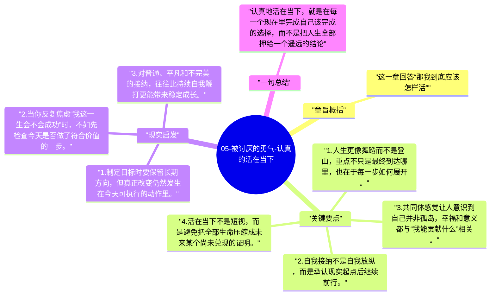

# 05-被讨厌的勇气-认真的活在当下

最后一章把前面的观念收束到生活姿态上。书里反复强调，人生不是一条预先排好的直线，而是一连串此刻的选择；真正的幸福，不是等到终点才确认，而是在每个当下都能感到自己与他人、与世界有真实连接。

## 章旨概括

这一章回答“那我到底应该怎样活”。阿德勒给出的答案并不宏大：活在当下，保持自我接纳，持续贡献。所谓“认真地活”，不是用力表演，也不是追求永不失败，而是在每个当下都把注意力放回能实践的行动上，让自己从比较和评价的牢笼里退出来。

## 关键要点

1. 人生更像舞蹈而不是登山，重点不只是最终到达哪里，也在于每一步如何展开。
2. 自我接纳不是自我放纵，而是承认现实起点后继续前行。
3. 共同体感觉让人意识到自己并非孤岛，幸福和意义都与“我能贡献什么”相关。
4. 活在当下不是短视，而是避免把全部生命压缩成未来某个尚未兑现的证明。

## 现实启发

1. 制定目标时要保留长期方向，但真正改变仍然发生在今天可执行的动作里。
2. 当你反复焦虑“我这一生会不会成功”时，不如先检查今天是否做了符合价值的一步。
3. 对普通、平凡和不完美的接纳，往往比持续自我鞭打更能带来稳定成长。

## 一句总结

认真地活在当下，就是在每一个现在里完成自己该完成的选择，而不是把人生全部押给一个遥远的结论。

---

## Mermaid 思维导图

### 图1

