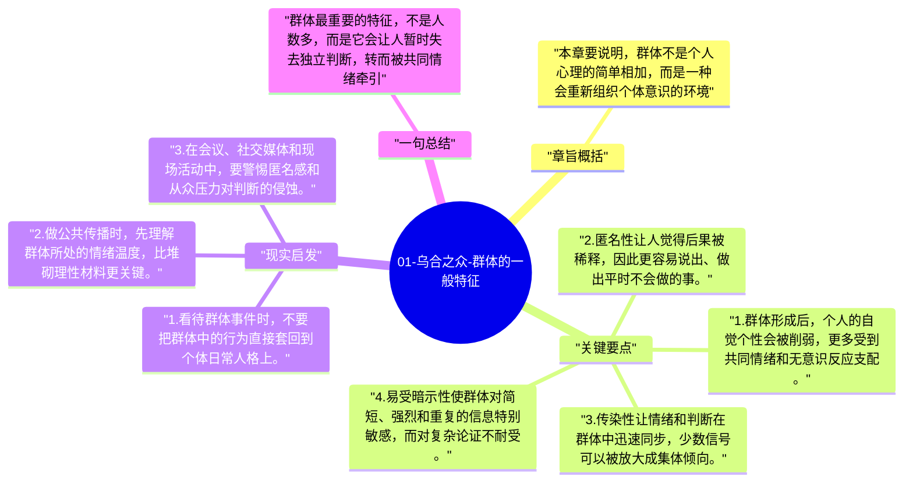

# 01-乌合之众-群体的一般特征

这一章是全书的起点，勒庞先解释为什么“许多人聚在一起”并不只是人数增加，而会生成一种新的心理状态。人在群体里不只是意见更大声，而是整个判断方式都会发生变化。

## 章旨概括

本章要说明，群体不是个人心理的简单相加，而是一种会重新组织个体意识的环境。匿名感降低责任感，情绪传染削弱独立判断，暗示效应又让人更容易接受单一信号，于是理性让位于冲动，复杂判断让位于简单反应。勒庞借此建立起他的核心判断：进入群体后，个人会在心理层级上发生明显下降。

## 关键要点

1. 群体形成后，个人的自觉个性会被削弱，更多受到共同情绪和无意识反应支配。
2. 匿名性让人觉得后果被稀释，因此更容易说出、做出平时不会做的事。
3. 传染性让情绪和判断在群体中迅速同步，少数信号可以被放大成集体倾向。
4. 易受暗示性使群体对简短、强烈和重复的信息特别敏感，而对复杂论证不耐受。

## 现实启发

1. 看待群体事件时，不要把群体中的行为直接套回到个体日常人格上。
2. 做公共传播时，先理解群体所处的情绪温度，比堆砌理性材料更关键。
3. 在会议、社交媒体和现场活动中，要警惕匿名感和从众压力对判断的侵蚀。

## 一句总结

群体最重要的特征，不是人数多，而是它会让人暂时失去独立判断，转而被共同情绪牵引。

---

## Mermaid 思维导图

### 图1

