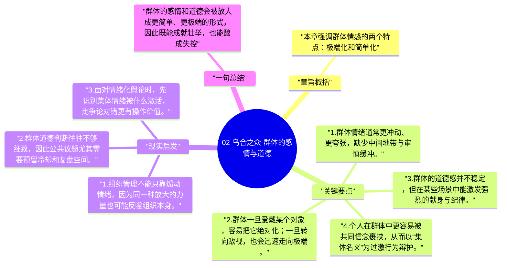

# 02-乌合之众-群体的感情与道德

第二章继续追问：当个人进入群体之后，情绪和道德会变成什么样。勒庞的回答并不单纯悲观，他认为群体既可能更残暴，也可能更高尚，关键在于哪一种情绪被共同点燃。

## 章旨概括

本章强调群体情感的两个特点：极端化和简单化。群体不擅长细腻权衡，更容易在敬爱与憎恨、崇拜与毁灭之间快速摆动。与此同时，群体也可能表现出个人平时没有的自我牺牲与英雄主义，因为集体信念会放大道德激情。勒庞借此指出，群体不是没有道德，而是其道德形态高度依赖情境和刺激方向。

## 关键要点

1. 群体情绪通常更冲动、更夸张，缺少中间地带与审慎缓冲。
2. 群体一旦爱戴某个对象，容易把它绝对化；一旦转向敌视，也会迅速走向极端。
3. 群体的道德感并不稳定，但在某些场景中能激发强烈的献身与纪律。
4. 个人在群体中更容易被共同信念裹挟，从而以“集体名义”为过激行为辩护。

## 现实启发

1. 组织管理不能只靠煽动情绪，因为同一种放大的力量也可能反噬组织本身。
2. 群体道德判断往往不够细致，因此公共议题尤其需要预留冷却和复盘空间。
3. 面对情绪化舆论时，先识别集体情绪被什么激活，比争论对错更有操作价值。

## 一句总结

群体的感情和道德会被放大成更简单、更极端的形式，因此既能成就壮举，也能酿成失控。

---

## Mermaid 思维导图

### 图1

