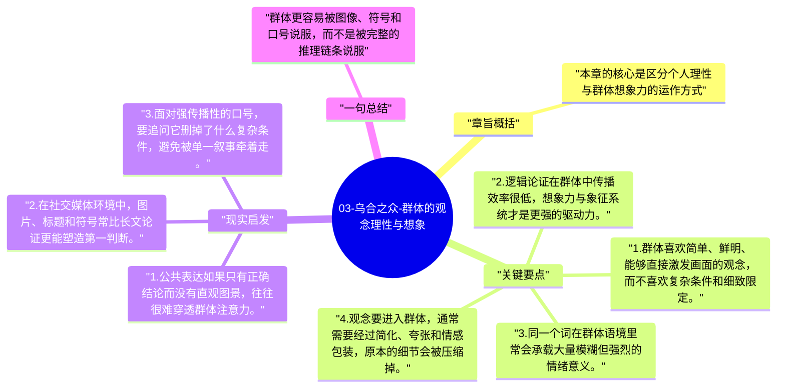

# 03-乌合之众-群体的观念理性与想象

这一章讨论群体如何理解世界。勒庞认为，群体不是完全没有观念，而是更依赖形象化、象征化和直觉式的理解路径，对抽象逻辑和细密推理的接受度很低。

## 章旨概括

本章的核心是区分个人理性与群体想象力的运作方式。群体接受观念时，往往不是因为论证严密，而是因为某个词、某个画面、某个象征击中了集体想象。观念一旦进入群体，常被压缩成简单口号，并与情绪和欲望绑定。勒庞借此提醒人们：群体中的“相信”更像图像与情感的结合，而不是命题逻辑的结果。

## 关键要点

1. 群体喜欢简单、鲜明、能够直接激发画面的观念，而不喜欢复杂条件和细致限定。
2. 逻辑论证在群体中传播效率很低，想象力与象征系统才是更强的驱动力。
3. 同一个词在群体语境里常会承载大量模糊但强烈的情绪意义。
4. 观念要进入群体，通常需要经过简化、夸张和情感包装，原本的细节会被压缩掉。

## 现实启发

1. 公共表达如果只有正确结论而没有直观图景，往往很难穿透群体注意力。
2. 在社交媒体环境中，图片、标题和符号常比长文论证更能塑造第一判断。
3. 面对强传播性的口号，要追问它删掉了什么复杂条件，避免被单一叙事牵着走。

## 一句总结

群体更容易被图像、符号和口号说服，而不是被完整的推理链条说服。

---

## Mermaid 思维导图

### 图1

