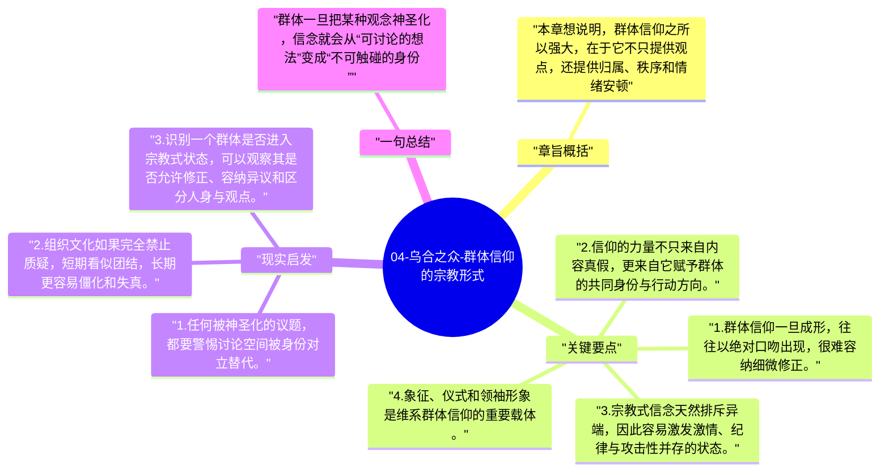

# 04-乌合之众-群体信仰的宗教形式

第四章进一步指出，群体一旦形成稳定信念，往往会表现出近似宗教的结构：绝对化、不可质疑、对异见敌意强。这里的“宗教形式”指的不是具体宗教，而是一种信念被神圣化后的心理形态。

## 章旨概括

本章想说明，群体信仰之所以强大，在于它不只提供观点，还提供归属、秩序和情绪安顿。当一个观念上升为群体信条，它就不再接受普通意义上的讨论，而更像一种需要守护的身份象征。于是，质疑者会被视为敌人，仪式、口号和象征也会获得超出内容本身的权威。

## 关键要点

1. 群体信仰一旦成形，往往以绝对口吻出现，很难容纳细微修正。
2. 信仰的力量不只来自内容真假，更来自它赋予群体的共同身份与行动方向。
3. 宗教式信念天然排斥异端，因此容易激发激情、纪律与攻击性并存的状态。
4. 象征、仪式和领袖形象是维系群体信仰的重要载体。

## 现实启发

1. 任何被神圣化的议题，都要警惕讨论空间被身份对立替代。
2. 组织文化如果完全禁止质疑，短期看似团结，长期更容易僵化和失真。
3. 识别一个群体是否进入宗教式状态，可以观察其是否允许修正、容纳异议和区分人身与观点。

## 一句总结

群体一旦把某种观念神圣化，信念就会从“可讨论的想法”变成“不可触碰的身份”。

---

## Mermaid 思维导图

### 图1

