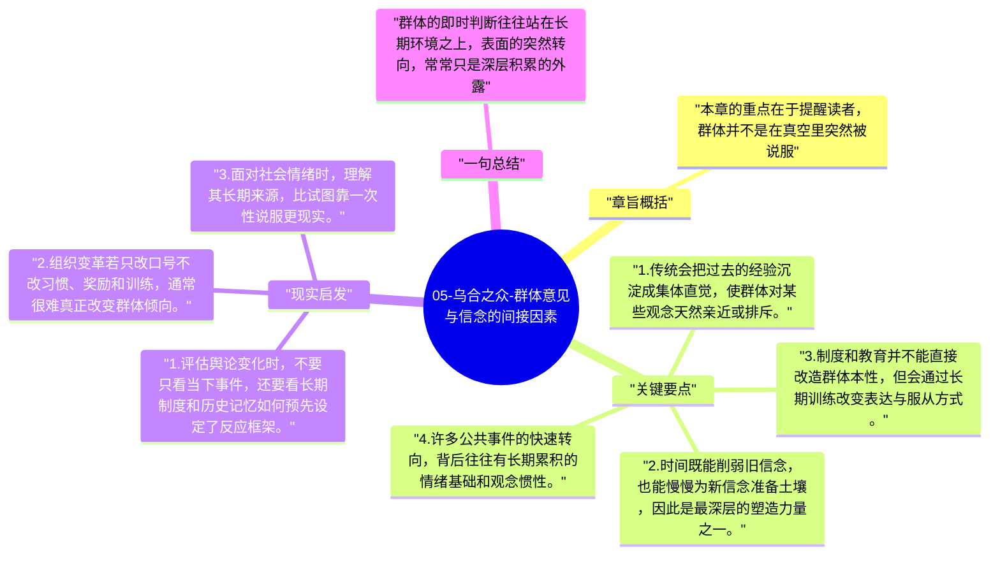

# 05-乌合之众-群体意见与信念的间接因素

从这一章开始，勒庞转向“群体为什么会这样想”。他先讨论那些不易被短期察觉、却长期塑造群体信念的间接因素，比如传统、时间、制度、教育和社会背景。

## 章旨概括

本章的重点在于提醒读者，群体并不是在真空里突然被说服。许多看似即时爆发的意见，其实早已被长期环境铺垫。民族性格、历史记忆、制度安排和教育方式会慢慢塑造群体能接受什么、排斥什么。勒庞因此认为，短期宣传固然有力，但真正决定群体底色的，往往还是那些缓慢而深层的条件。

## 关键要点

1. 传统会把过去的经验沉淀成集体直觉，使群体对某些观念天然亲近或排斥。
2. 时间既能削弱旧信念，也能慢慢为新信念准备土壤，因此是最深层的塑造力量之一。
3. 制度和教育并不能直接改造群体本性，但会通过长期训练改变表达与服从方式。
4. 许多公共事件的快速转向，背后往往有长期累积的情绪基础和观念惯性。

## 现实启发

1. 评估舆论变化时，不要只看当下事件，还要看长期制度和历史记忆如何预先设定了反应框架。
2. 组织变革若只改口号不改习惯、奖励和训练，通常很难真正改变群体倾向。
3. 面对社会情绪时，理解其长期来源，比试图靠一次性说服更现实。

## 一句总结

群体的即时判断往往站在长期环境之上，表面的突然转向，常常只是深层积累的外露。

---

## Mermaid 思维导图

### 图1

