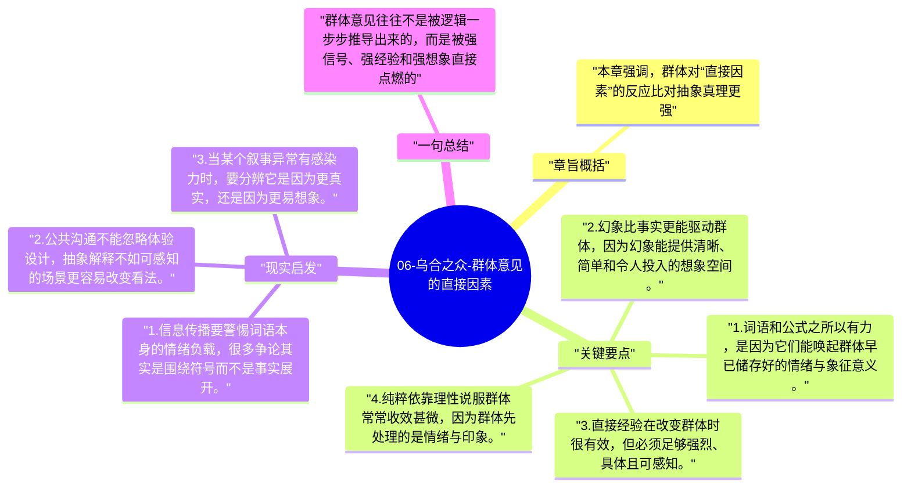

# 06-乌合之众-群体意见的直接因素

如果说上一章谈的是长期背景，这一章谈的就是短期触发器。勒庞分析了词语、口号、图像、经验和幻象如何在短时间内迅速塑造群体判断。

## 章旨概括

本章强调，群体对“直接因素”的反应比对抽象真理更强。一个词如果能勾连集体想象，就可能比一整套论证更有力量；一次鲜明的经验，也可能迅速改变群体的信念结构。勒庞同时指出，理性在这里作用有限，因为群体首先响应的不是命题真假，而是信号强度和情绪联想。

## 关键要点

1. 词语和公式之所以有力，是因为它们能唤起群体早已储存好的情绪与象征意义。
2. 幻象比事实更能驱动群体，因为幻象能提供清晰、简单和令人投入的想象空间。
3. 直接经验在改变群体时很有效，但必须足够强烈、具体且可感知。
4. 纯粹依靠理性说服群体常常收效甚微，因为群体先处理的是情绪与印象。

## 现实启发

1. 信息传播要警惕词语本身的情绪负载，很多争论其实是围绕符号而不是事实展开。
2. 公共沟通不能忽略体验设计，抽象解释不如可感知的场景更容易改变看法。
3. 当某个叙事异常有感染力时，要分辨它是因为更真实，还是因为更易想象。

## 一句总结

群体意见往往不是被逻辑一步步推导出来的，而是被强信号、强经验和强想象直接点燃的。

---

## Mermaid 思维导图

### 图1

