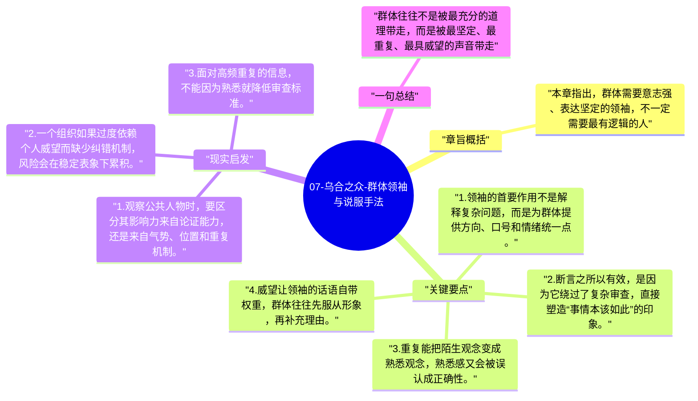

# 07-乌合之众-群体领袖与说服手法

这一章进入全书最具现实感的部分：既然群体容易受暗示，那么谁来提供暗示，靠什么让群体跟随。勒庞把目光聚焦到领袖和说服技术上。

## 章旨概括

本章指出，群体需要意志强、表达坚定的领袖，不一定需要最有逻辑的人。真正能动员群体的人，往往懂得用断言、重复和传染来建立共同节奏，再借助威望稳固信任。勒庞认为，在群体语境里，力量感比证明更重要，持续性比精巧性更有效。

## 关键要点

1. 领袖的首要作用不是解释复杂问题，而是为群体提供方向、口号和情绪统一点。
2. 断言之所以有效，是因为它绕过了复杂审查，直接塑造“事情本该如此”的印象。
3. 重复能把陌生观念变成熟悉观念，熟悉感又会被误认成正确性。
4. 威望让领袖的话语自带权重，群体往往先服从形象，再补充理由。

## 现实启发

1. 观察公共人物时，要区分其影响力来自论证能力，还是来自气势、位置和重复机制。
2. 一个组织如果过度依赖个人威望而缺少纠错机制，风险会在稳定表象下累积。
3. 面对高频重复的信息，不能因为熟悉就降低审查标准。

## 一句总结

群体往往不是被最充分的道理带走，而是被最坚定、最重复、最具威望的声音带走。

---

## Mermaid 思维导图

### 图1

